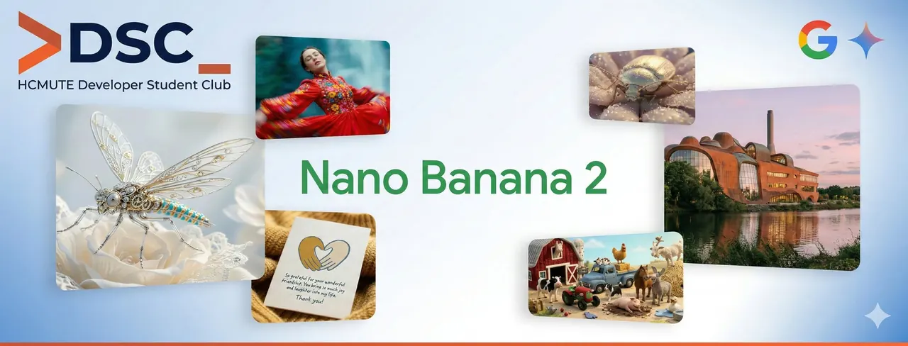

\[GOOGLE RA MẮT NANO BANANA 2: KHI AI TẠO ẢNH KHÔNG CHỈ ĐỂ "FOR FUN" MÀ LÀ "FOR PRODUCTION"  
🍌✨\] Ngày 26/02, Google chính thức giới thiệu Nano Banana 2 – phiên bản mới trong dòng model tạo ảnh thuộc hệ Gemini. Nếu trước đây AI tạo ảnh còn gây khó chịu vì text sai, layout lệch hay chi tiết vỡ, thì lần này mục tiêu đã rõ ràng hơn: tối ưu để sử dụng thực tế, không chỉ để thử nghiệm.

<!--truncate-->

🛠 Có gì hot cho dân Tech  Creator  
✅ Core: Build trên kiến trúc Gemini Flash Image, tối ưu tốc độ và độ chính xác.  
✅ Render Text: Đã cải thiện đáng kể (feature được mong chờ nhất để làm UI/Poster).  
✅ Control: Kiểm soát bố cục (layout) và style tốt hơn, hỗ trợ render tới 4K.  
✅ Complex Scenes: Xử lý ngon lành các prompt nhiều nhân vật/vật thể mà ít bị artifact.  
💡 Tại sao SV IT nên quan tâm Câu chuyện không còn dừng ở việc “AI vẽ đẹp cỡ nào”, mà là “AI dùng được đến đâu”. Khi model được tích hợp hợp thẳng vào Gemini App, Search và Google Lens, workflow từ Idea -&gt; Code -&gt; Image Assets sẽ mượt hơn rất nhiều. Điều này mở ra cách làm việc mới cho developer, designer lẫn content creator. Cuộc đua bây giờ không còn là "AI nào vẽ đẹp hơn" mà là "AI nào dùng được việc hơn" (Usability vs Benchmark).  
👉 Các bạn đã test thử chưa Comment ngay một chiếc prompt để xem độ thông minh của "Chuối Nano 2" nào!  
👇

---

_Bài viết được lưu trữ từ [fanpage HCMUTE Developer Student Club](https://www.facebook.com/hcmute.dsc)._
