\#InterviewPrep101 - Part 2 | DSA BÍ KÍP "SINH TỒN" PHỎNG VẤN DSA: TẠM BIỆT HỌC VẸT, NẮM VỮNG NGHỆ THUẬT ĐÁNH ĐỔI KỸ THUẬT 💻⚖️ Một kỹ sư giỏi không chỉ biết code chạy đúng, mà còn phải biết chọn đúng mô-típ để tối ưu giữa thời gian và bộ nhớ; hãy khám phá ngay lộ trình giúp bạn chuyển mình từ "người giải toán" sang ứng viên sở hữu tư duy Engineering thực tế
  
\#HCMUTE #HCMUTE\_DSC

<!--truncate-->

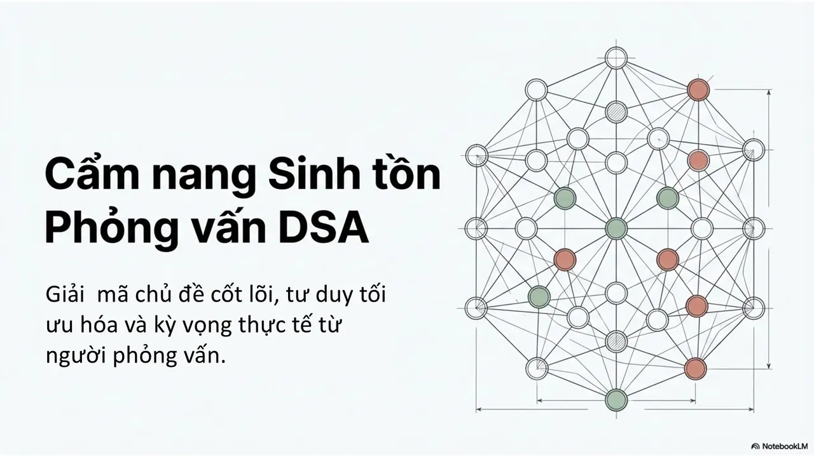

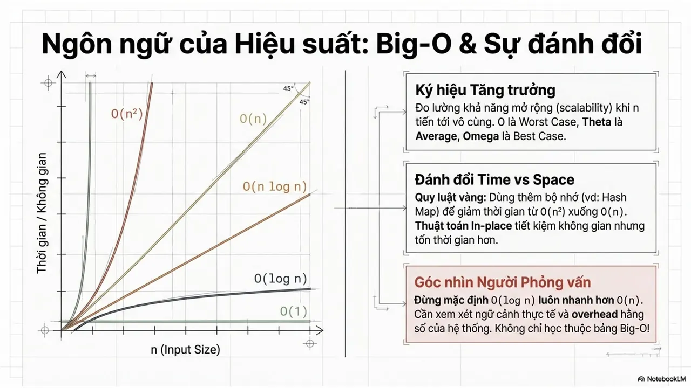
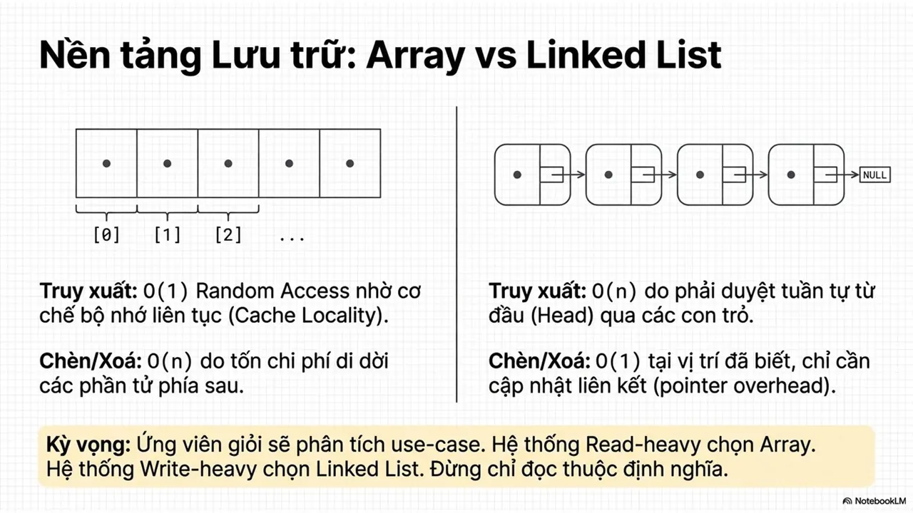
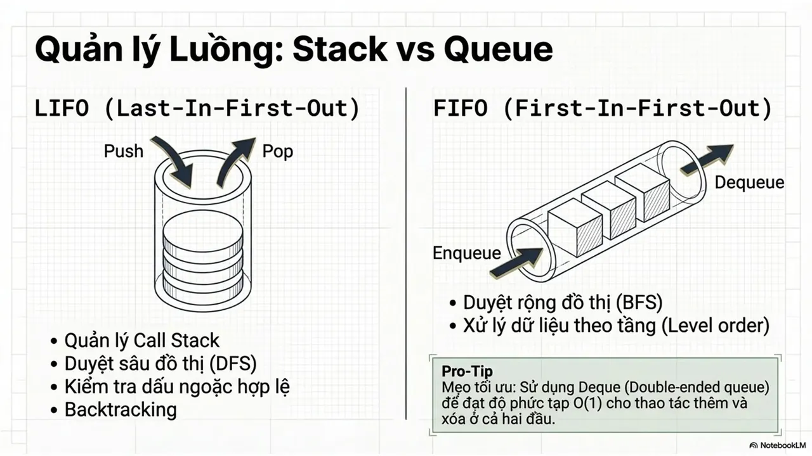
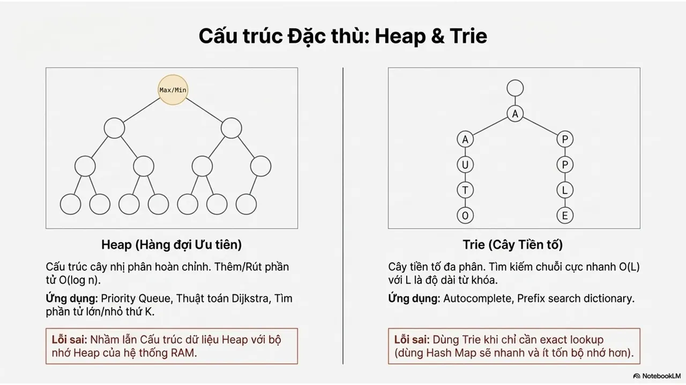
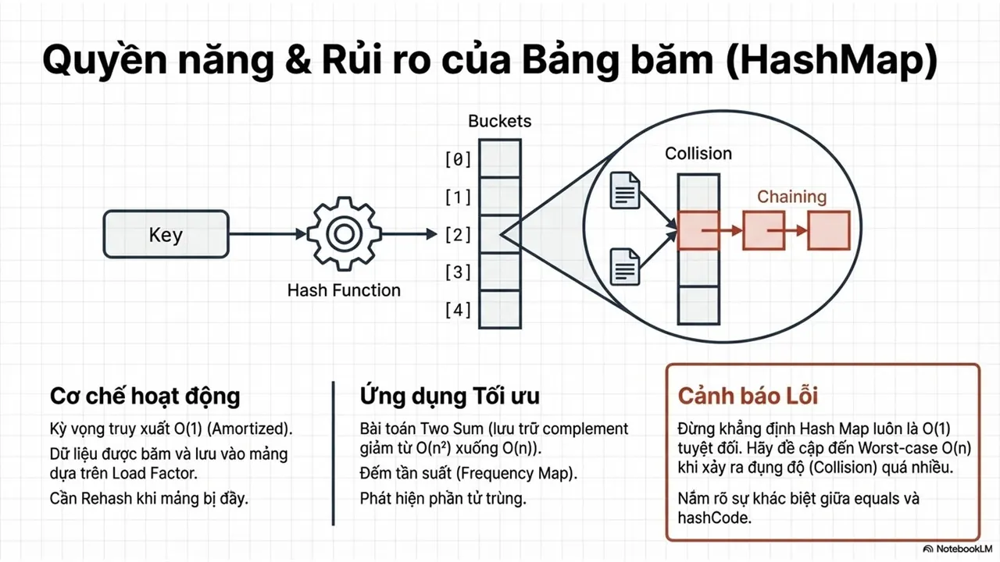
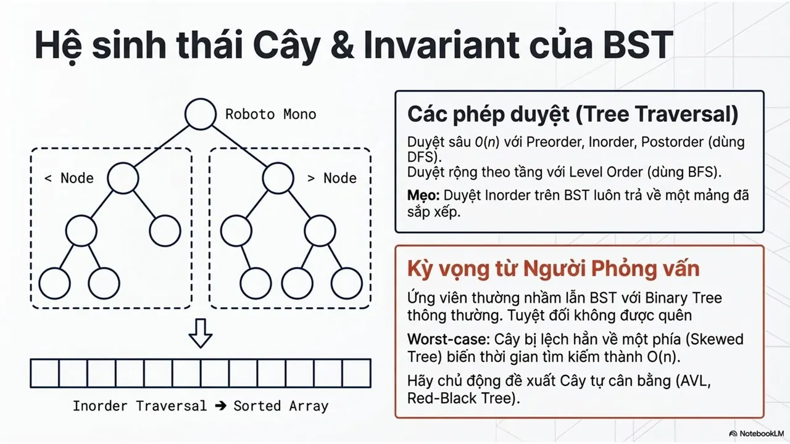
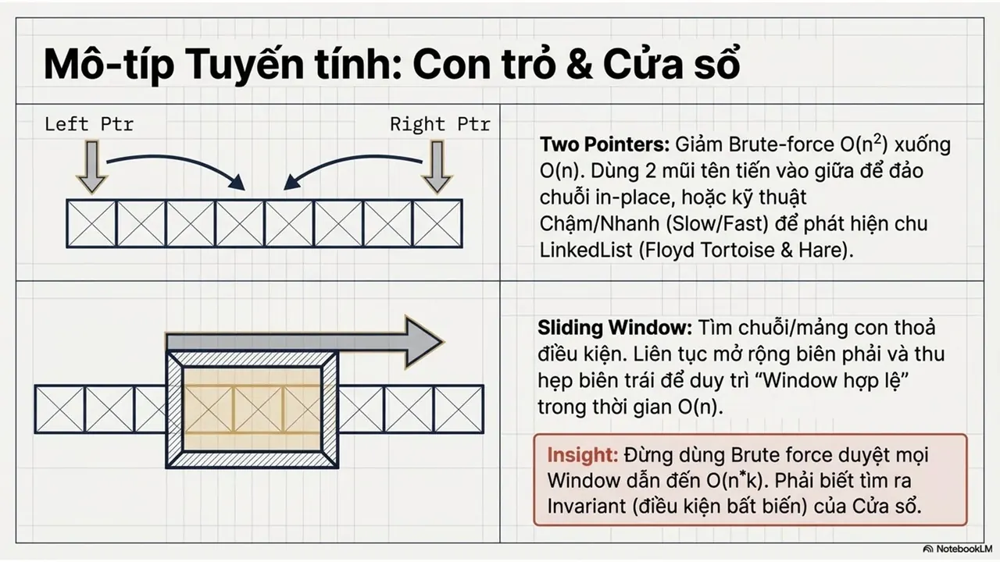
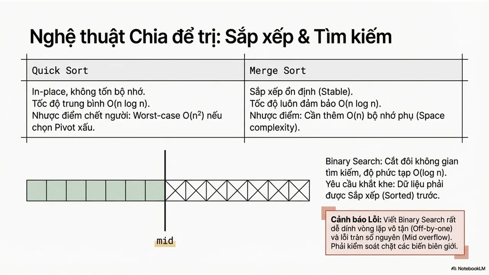
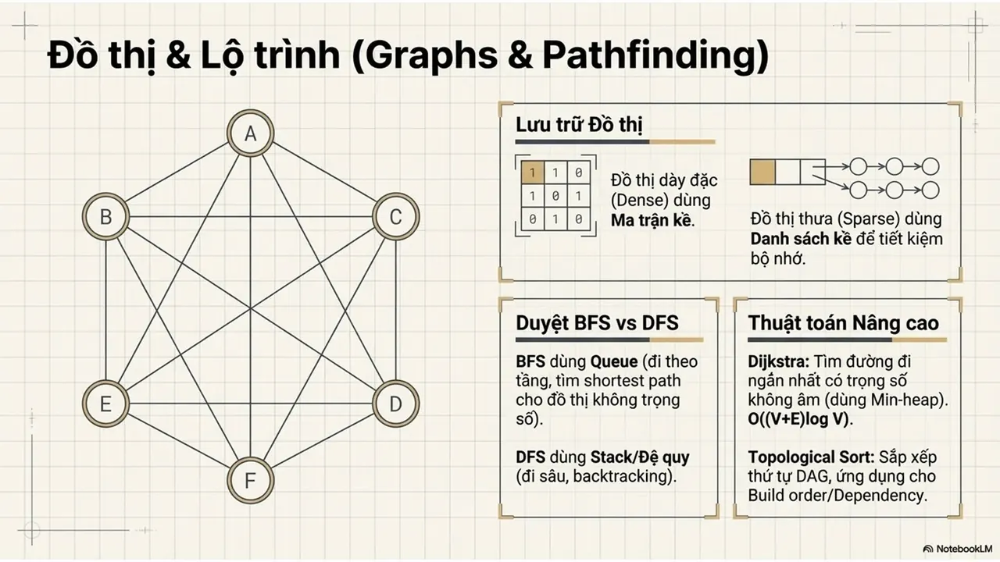
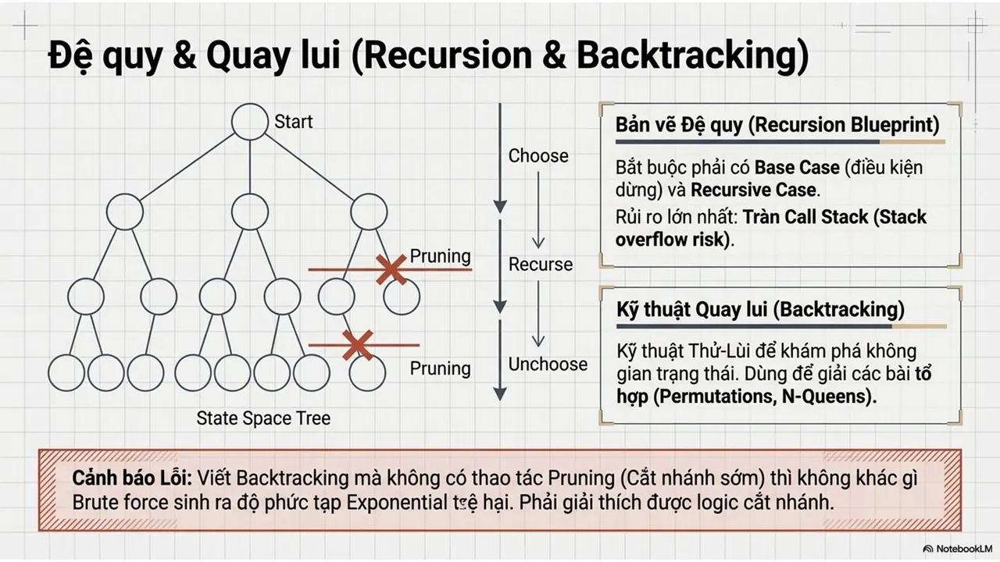
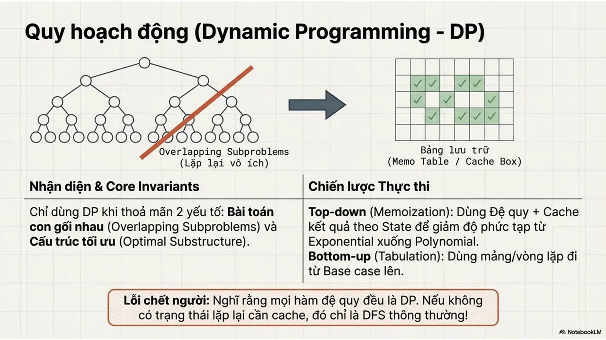
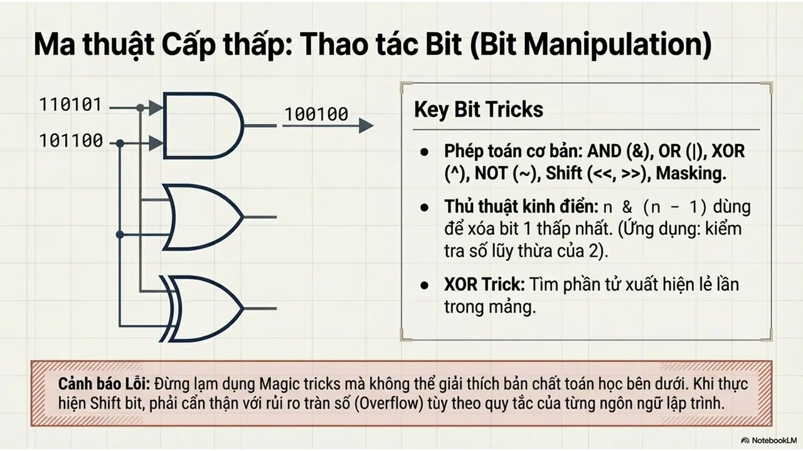
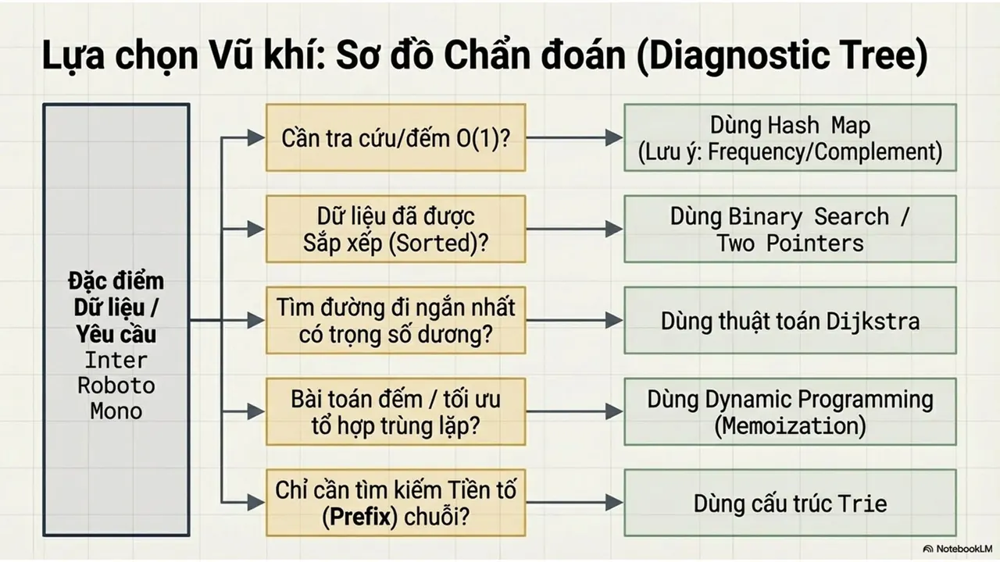
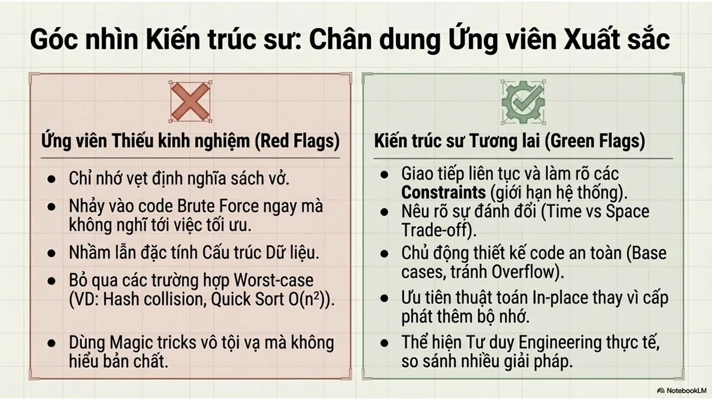

---

_Bài viết được lưu trữ từ [fanpage HCMUTE Developer Student Club](https://www.facebook.com/hcmute.dsc)._
