\#InterviewPrep101 - Part 3 | OOP & System Design
  
TỪ OOP ĐẾN SYSTEM DESIGN: HÀNH TRÌNH TỪ VIẾT CODE → THIẾT KẾ HỆ THỐNG 🚀

<!--truncate-->

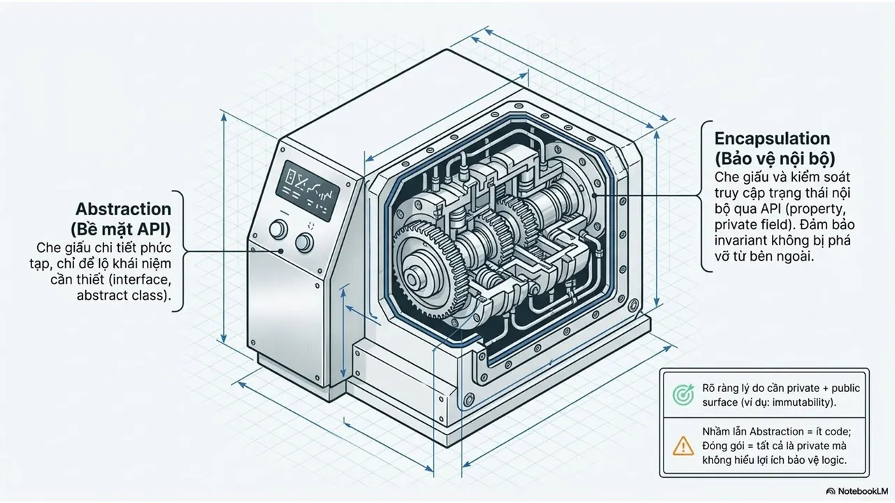

Kỹ thuật phần mềm không chỉ là những quy tắc cứng nhắc, mà là nghệ thuật quản lý sự phụ thuộc và khả năng thích ứng với thay đổi.
  
👉 Bạn đang ở level nào?  
Từ việc viết 1 class nhỏ đến thiết kế cả hệ thống lớn, tất cả đều bắt đầu từ tư duy đúng.  
Đừng chỉ là người viết code, hãy là người kiến tạo hệ thống.
  
😉 Hãy cùng mình giải mã hành trình tiến hóa từ những hạt nhân OOP cơ bản đến những siêu cấu trúc Microservices phức tạp qua bộ "Sổ tay chẩn đoán kiến trúc" này nhé!
  
\#HCMUTE #HCMUTE\_DSC

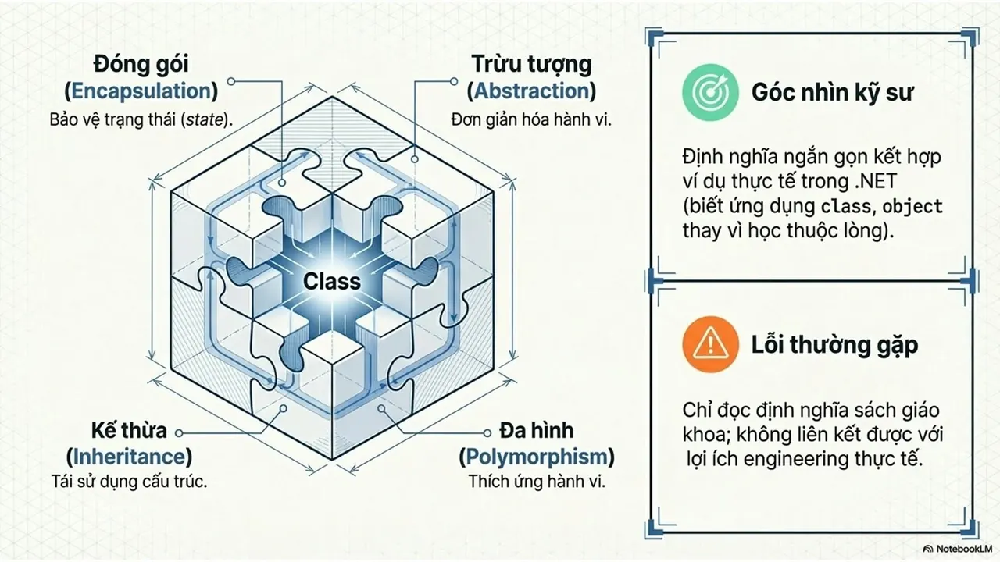
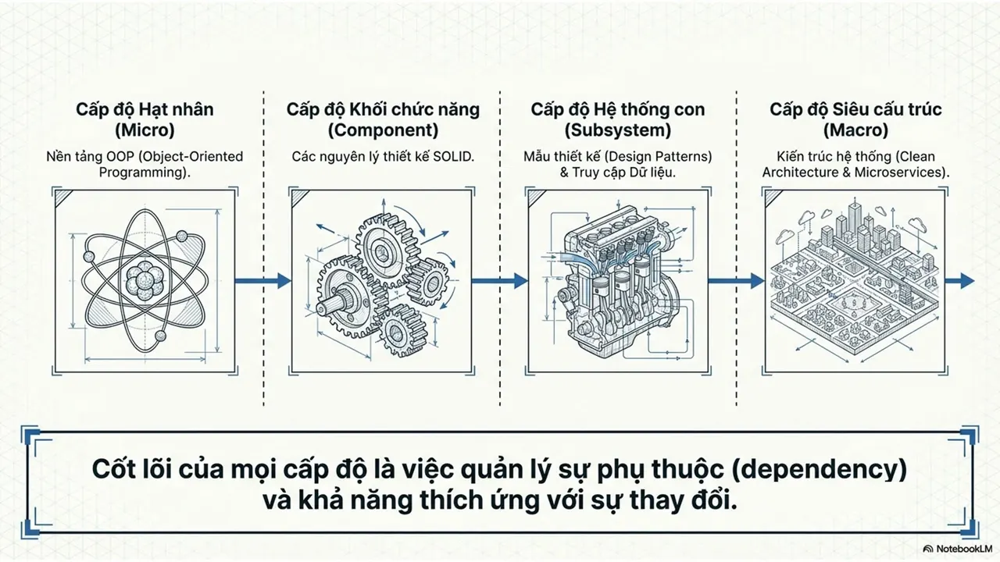
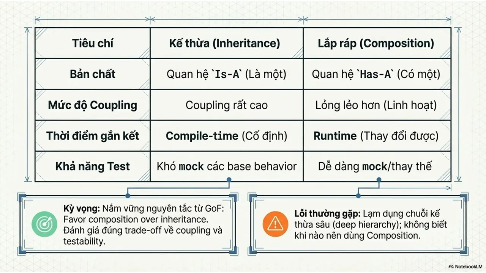
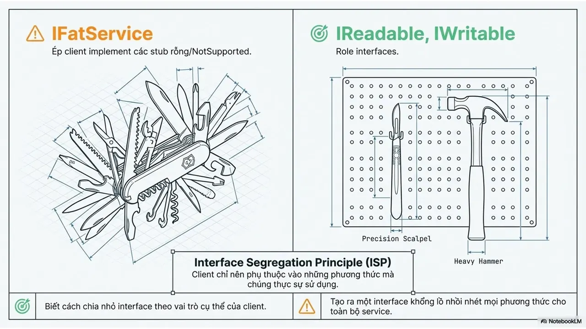
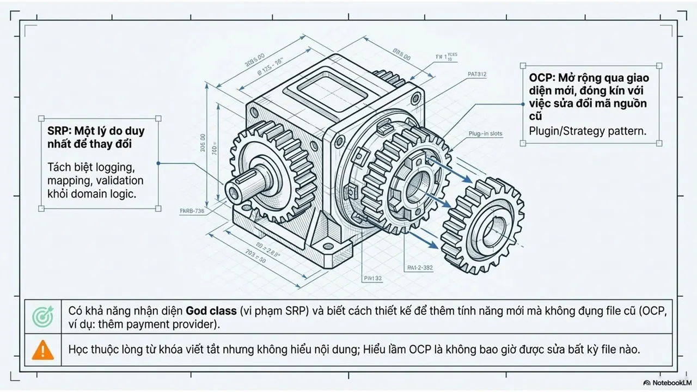
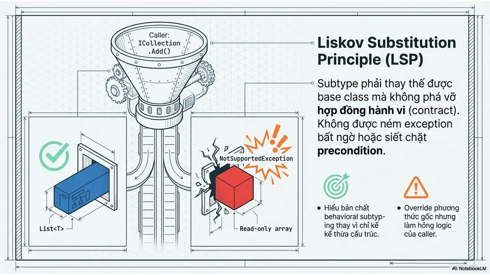
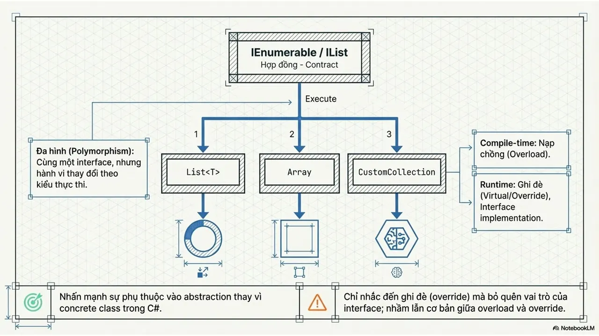
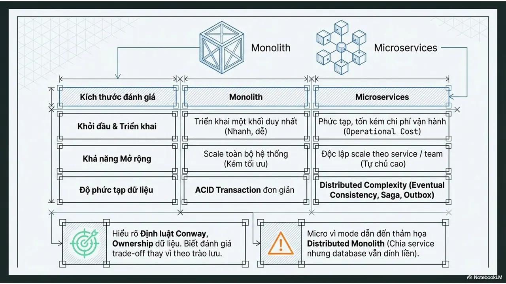
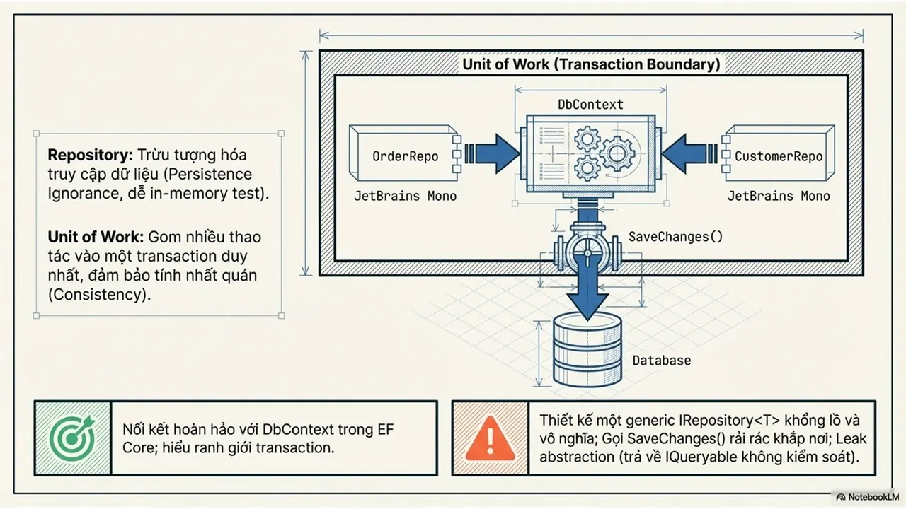
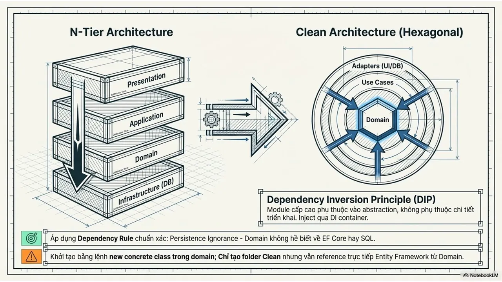
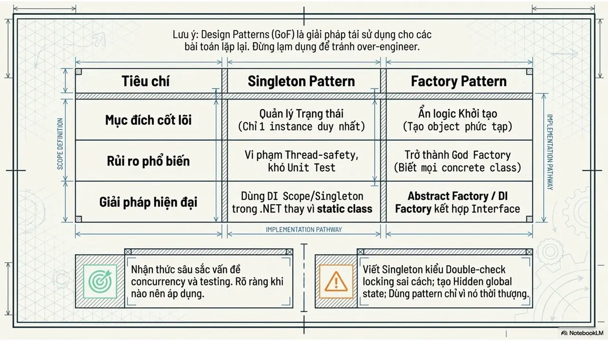
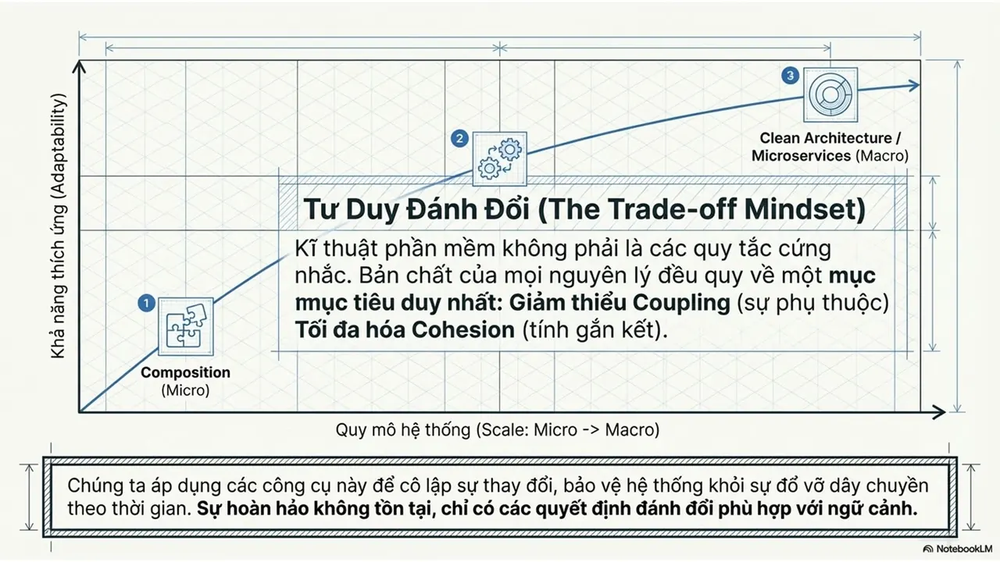

---

_Bài viết được lưu trữ từ [fanpage HCMUTE Developer Student Club](https://www.facebook.com/hcmute.dsc)._
