\#InterviewPrep101 - Part 4 | Database  
BÍ KÍP CỐT LÕI CƠ SỞ DỮ LIỆU: TỪ NỀN TẢNG ĐẾN TỐI ƯU 🗄️⚡

<!--truncate-->

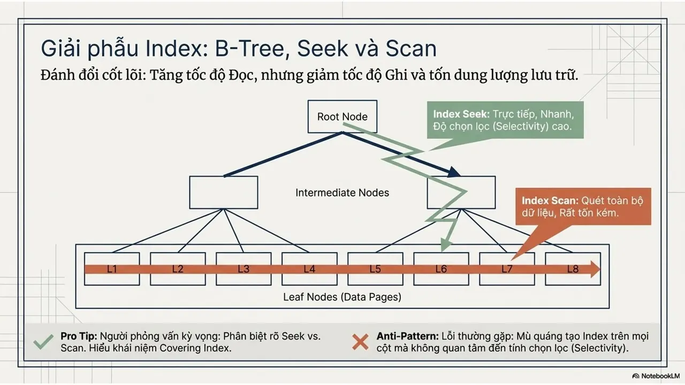

🗄️ Cơ sở dữ liệu không chỉ là nơi lưu trữ, mà là trái tim định hình nên hiệu suất và độ tin cậy của cả hệ thống.  
⚡ Đừng chỉ viết câu lệnh SQL chạy được, hãy cùng mình làm chủ tư duy của một Database Engineer thực thụ thông qua những quyết định thiết kế và nghệ thuật đánh đổi (trade-offs) giữa tốc độ, dung lượng và tính toàn vẹn.
  
\#HCMUTE #HCMUTE\_DSC

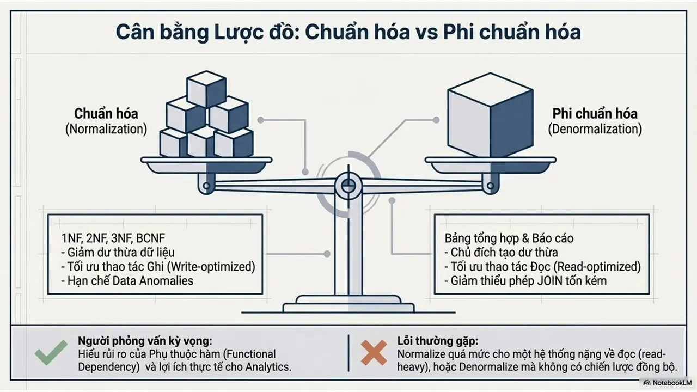
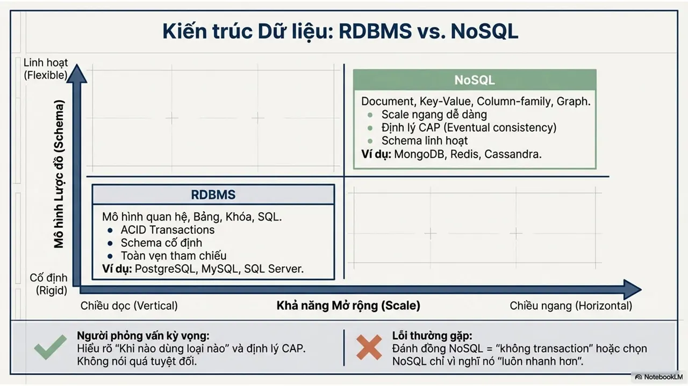
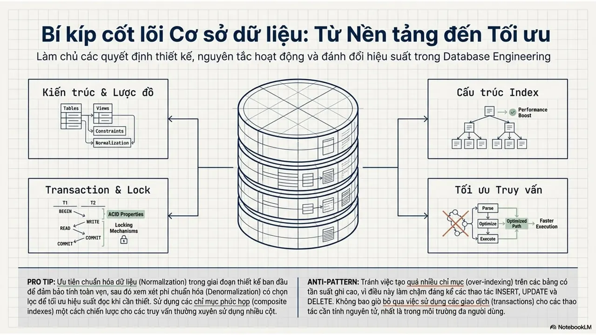
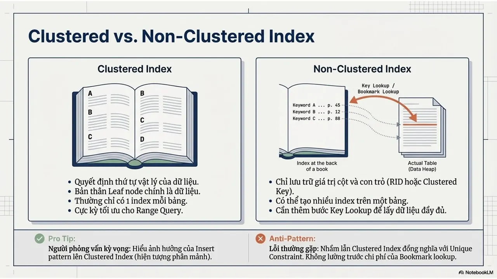
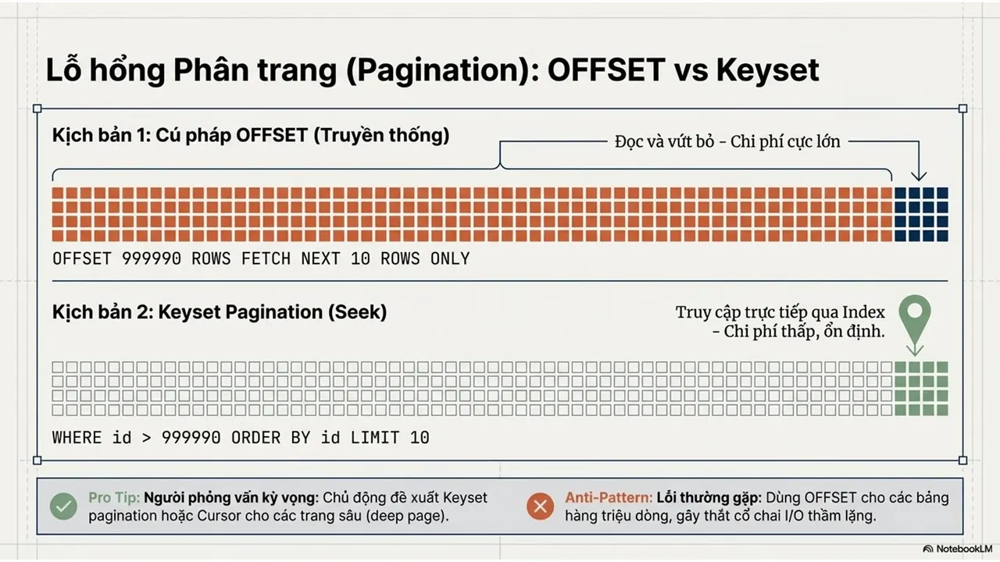
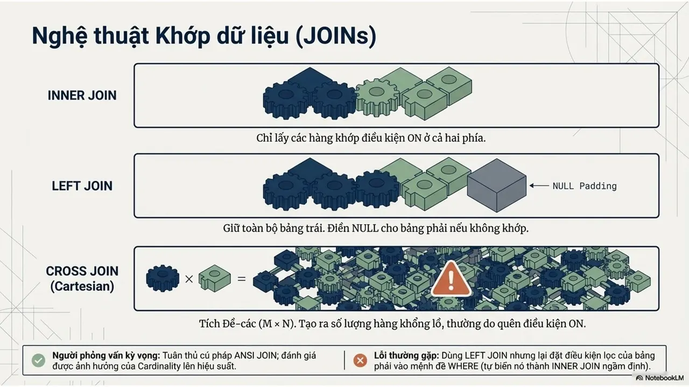
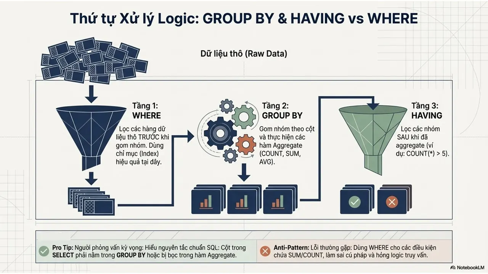
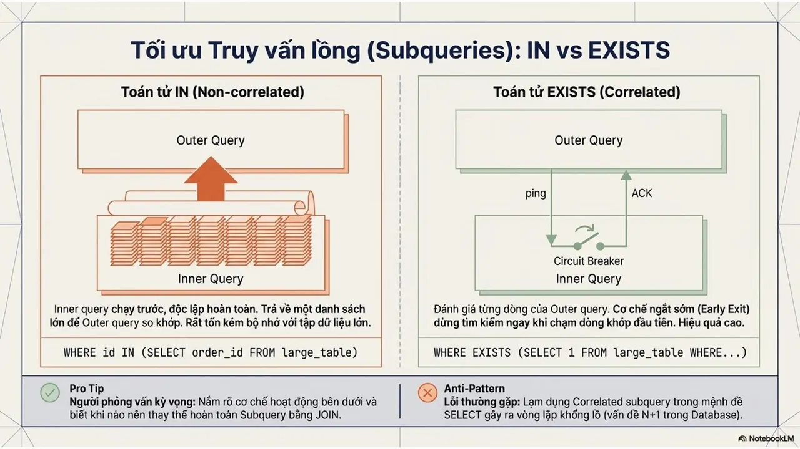
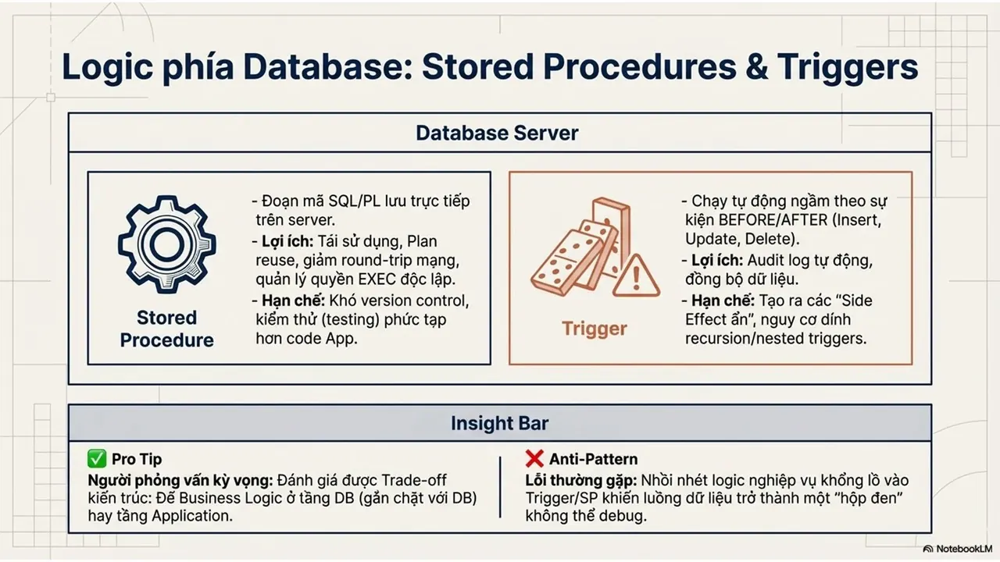
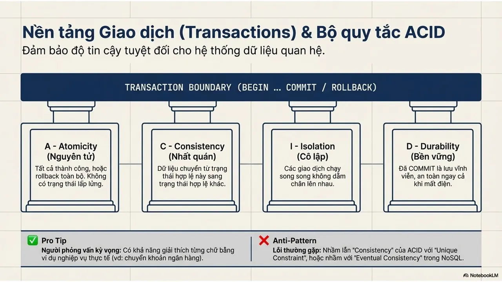
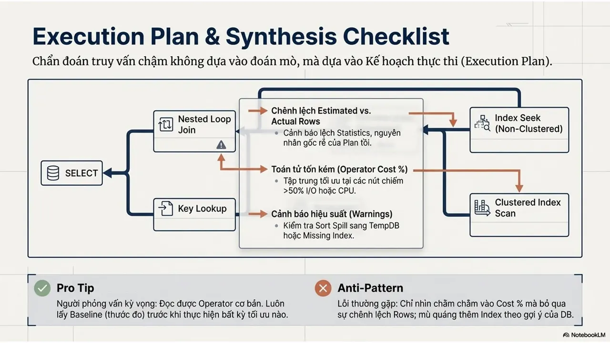
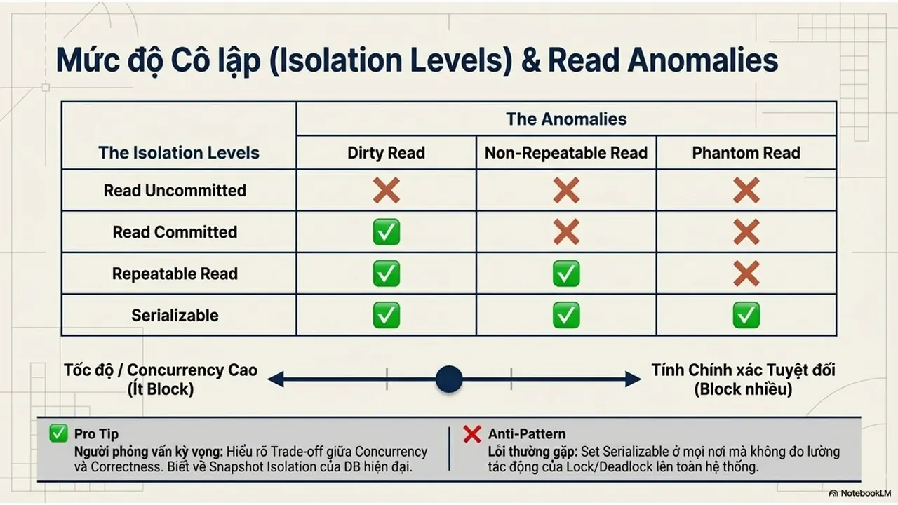
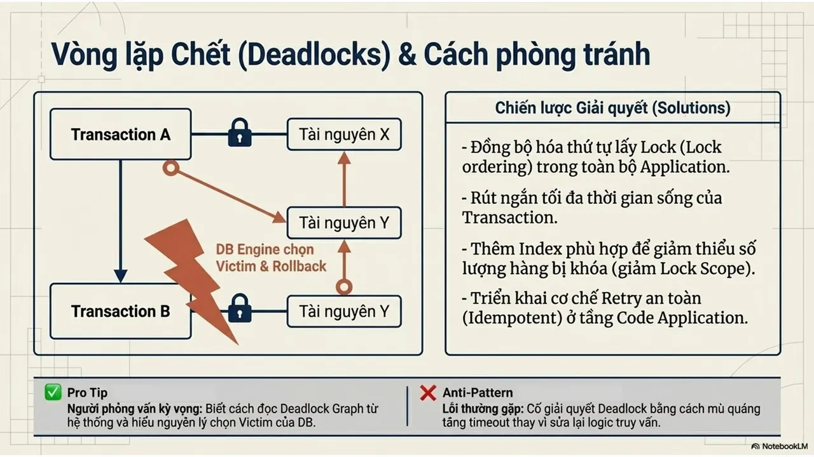
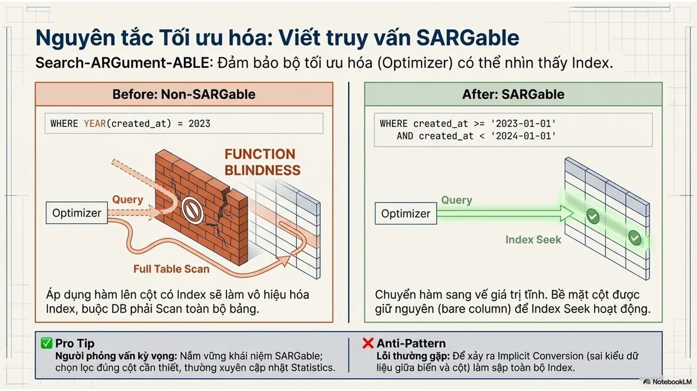

---

_Bài viết được lưu trữ từ [fanpage HCMUTE Developer Student Club](https://www.facebook.com/hcmute.dsc)._
