\#InterviewPrep101 - Part 5 | API  
🚀 CẨM NANG THIẾT KẾ API HIỆN ĐẠI: TỪ KIẾN TRÚC ĐẾN VẬN HÀNH

<!--truncate-->

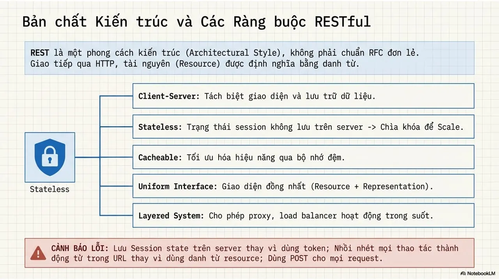

🤔 Bạn có biết sự khác biệt lớn nhất giữa một "người viết code" và một "kỹ sư Backend thực thụ" nằm ở cách họ thiết kế những bản hợp đồng giao tiếp?
  
👉 API không đơn thuần là các endpoint, mà là xương sống định hình sự ổn định của cả một hệ thống hiện đại. Hãy cùng mình "mổ xẻ" bộ khung tiêu chuẩn toàn diện - từ tư duy RESTful, ma thuật GraphQL cho đến những lớp khiên bảo mật đa tầng - để biến mỗi API bạn tạo ra thành một sản phẩm đẳng cấp và đáng tin cậy!
  
\#HCMUTE #HCMUTE\_DSC

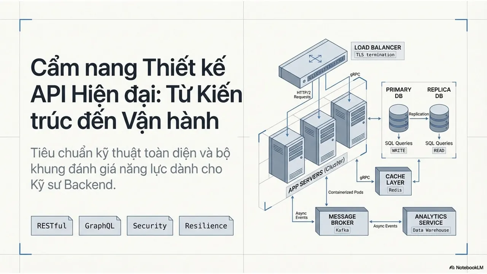
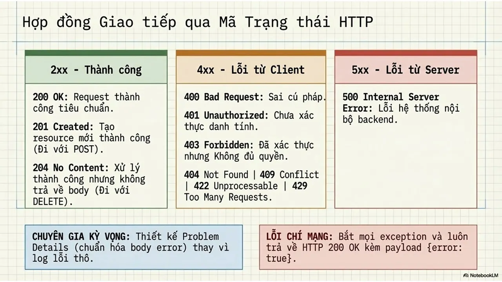
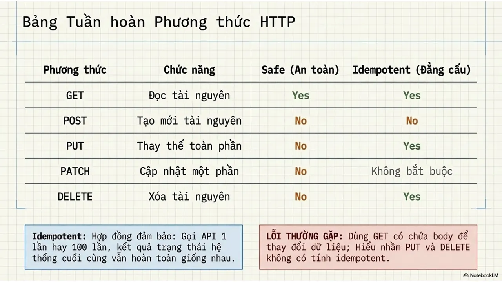
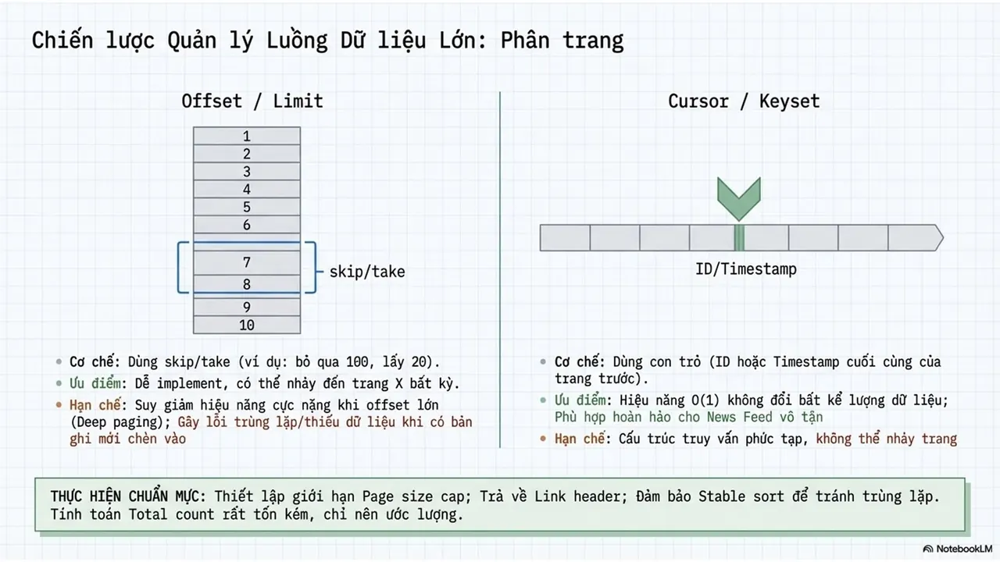
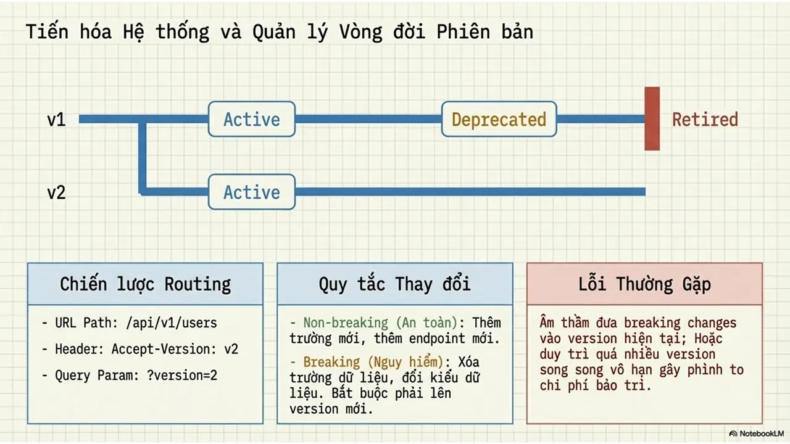
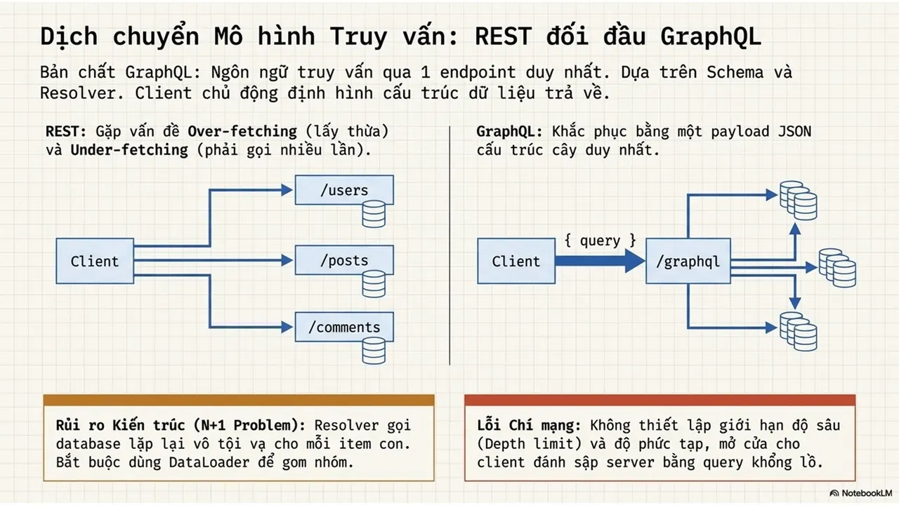
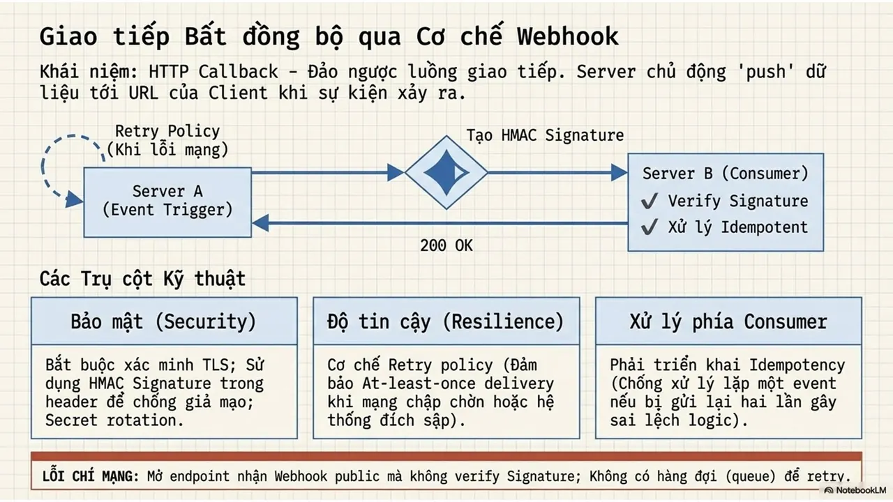
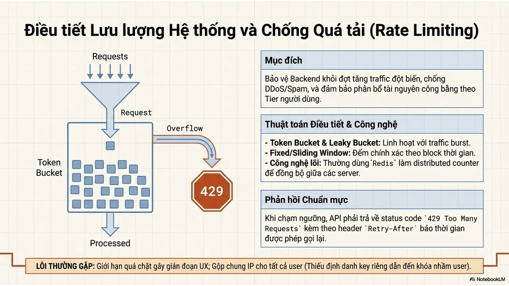
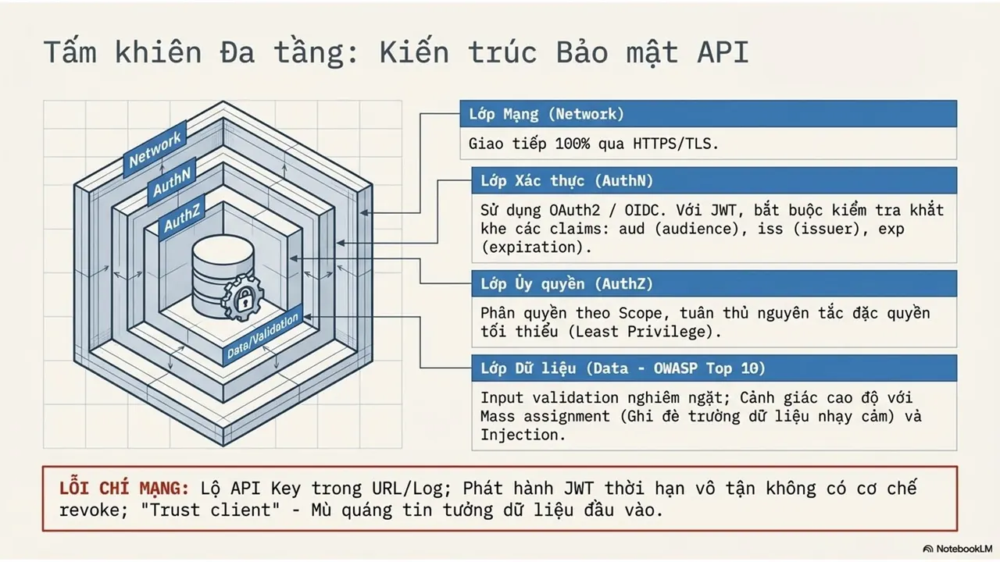
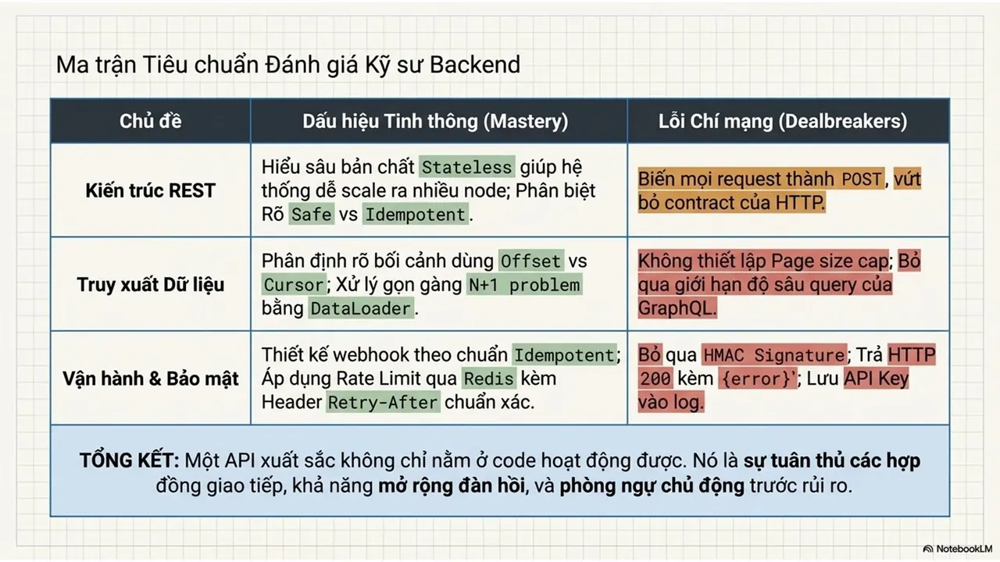

---

_Bài viết được lưu trữ từ [fanpage HCMUTE Developer Student Club](https://www.facebook.com/hcmute.dsc)._
