\#InterviewPrep101 - Part 6 | Angular 🚀 LÀM CHỦ KIẾN TRÚC ANGULAR: TỪ CỐT LÕI ĐẾN TỐI ƯU HIỆU NĂNG Angular không đơn thuần là một thư viện UI, nó là một nền tảng kỹ thuật chặt chẽ dành cho các ứng dụng quy mô lớn. Để thực sự "chạm" tới trình độ Senior, bạn cần vượt qua việc chỉ học cú pháp để thấu hiểu bản thiết kế hệ thống - từ cây Injector, luồng xử lý RxJS đến cơ chế Change Detection. Dưới đây là bộ "cẩm nang" giải mã chi tiết từng ngóc ngách của Angular qua lăng kính của những kỹ sư thực chiến. Hãy cùng mình "mổ xẻ" những kiến thức quan trọng nhất, các kỳ vọng từ nhà tuyển dụng và những sai lầm cần tránh để nâng cấp tư duy Engineering của bạn ngay hôm nay!
  
\#HCMUTE #HCMUTE\_DSC

<!--truncate-->

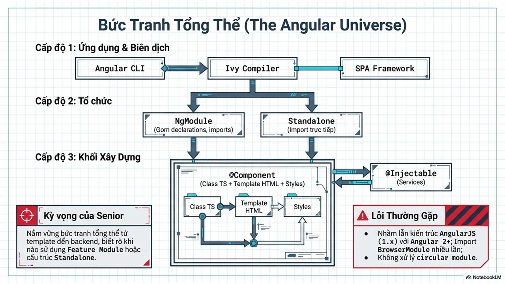

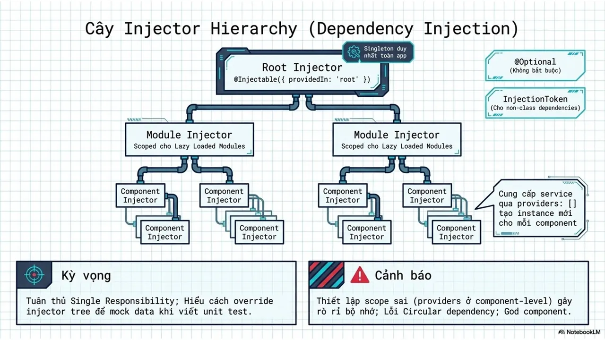
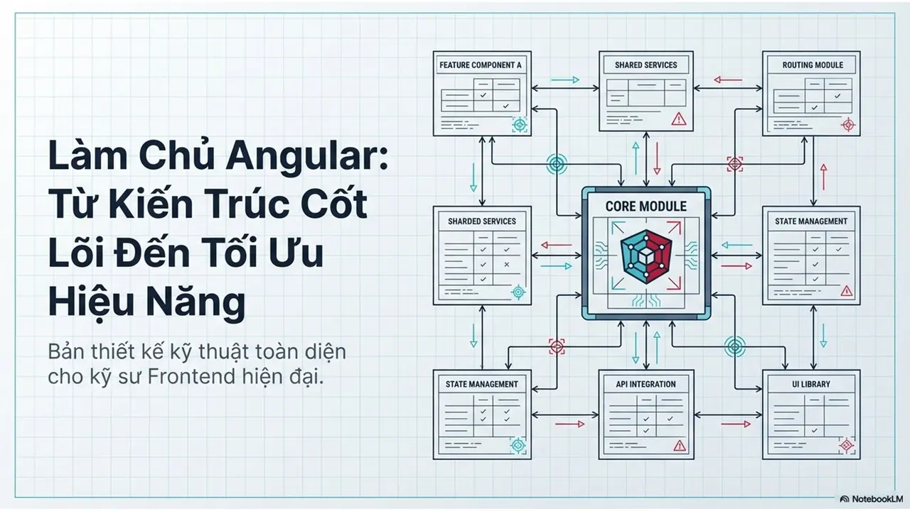
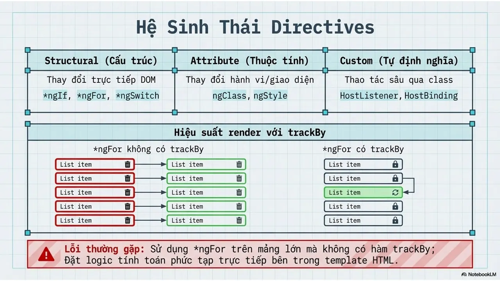
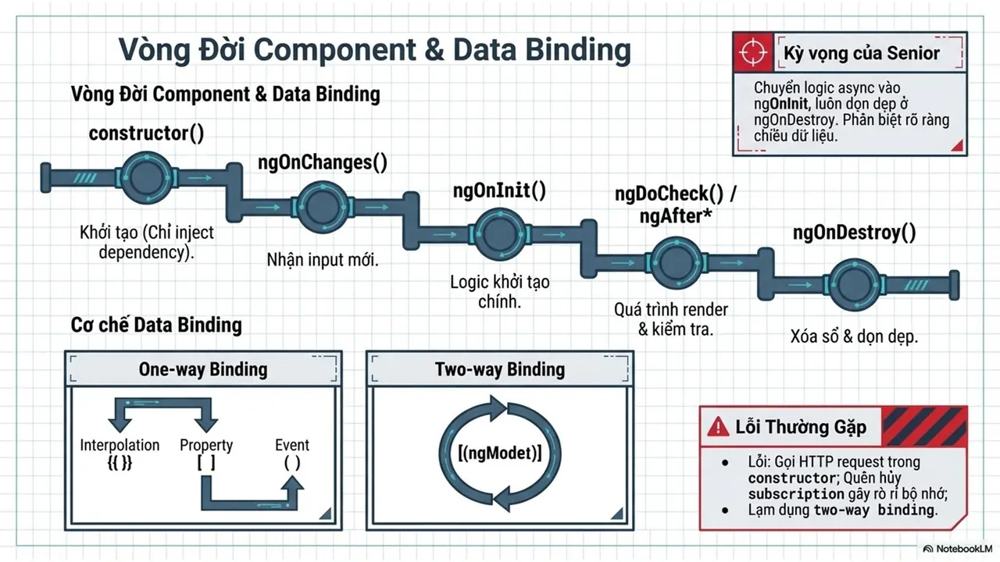
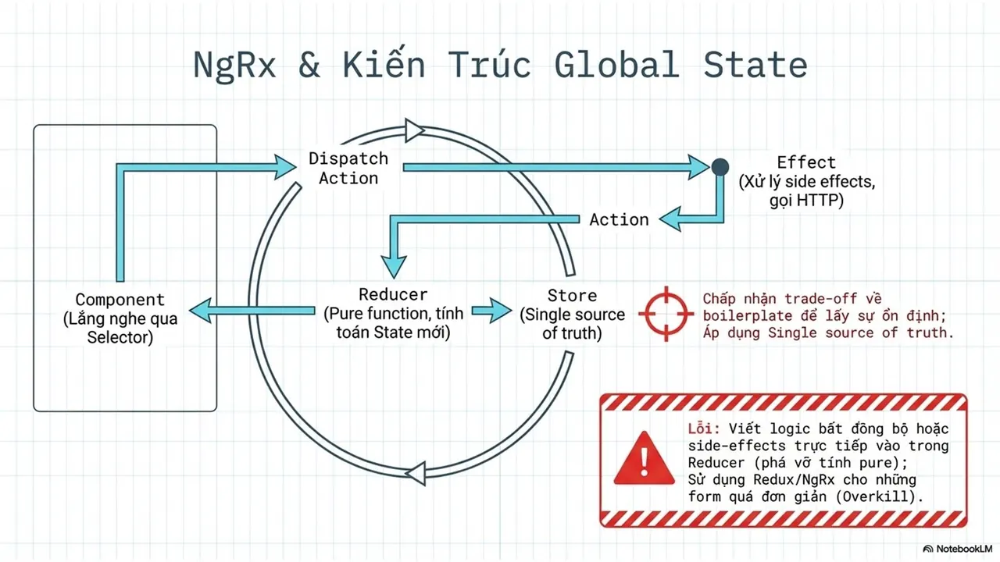
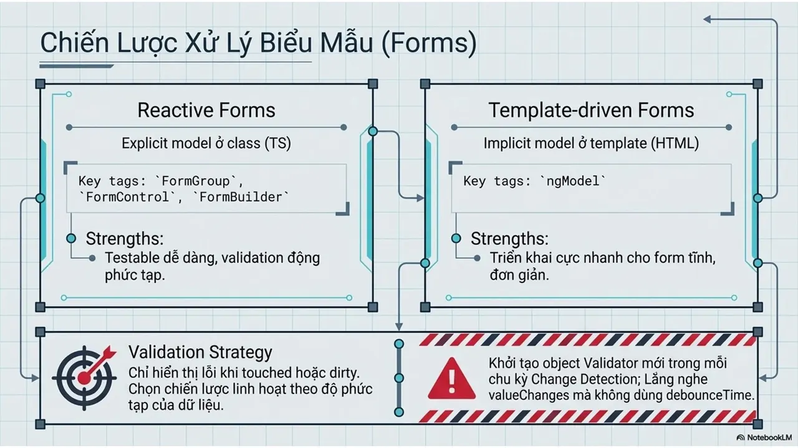
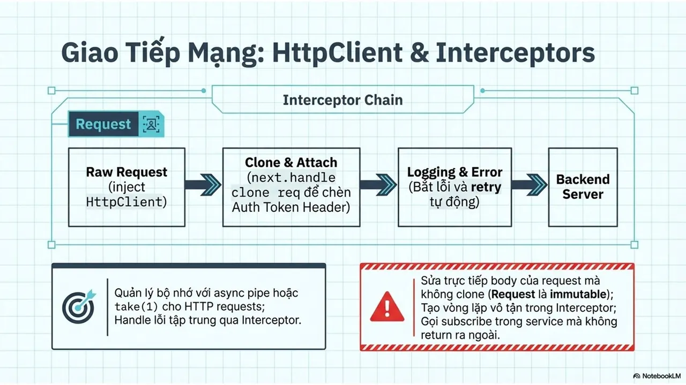
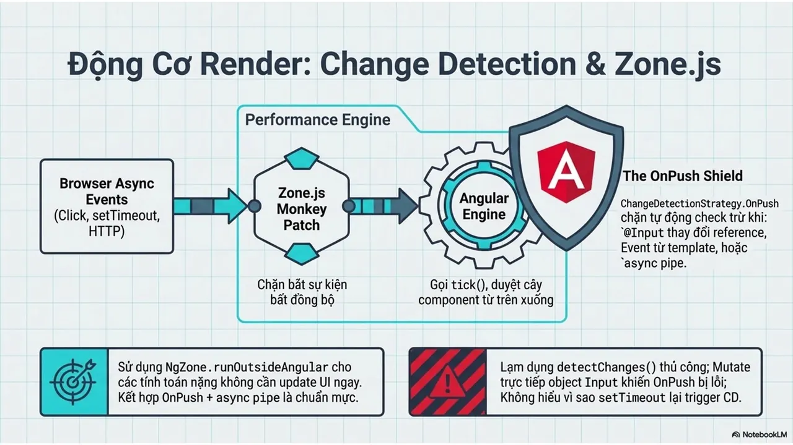
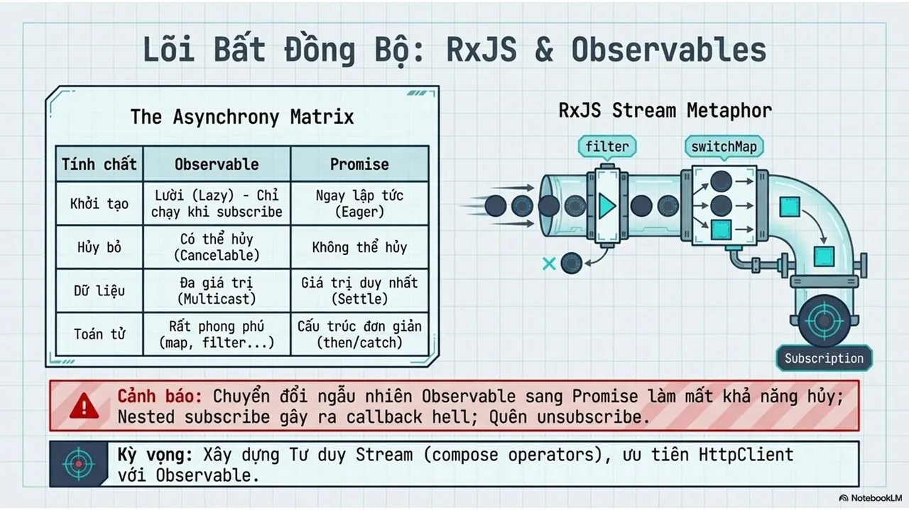
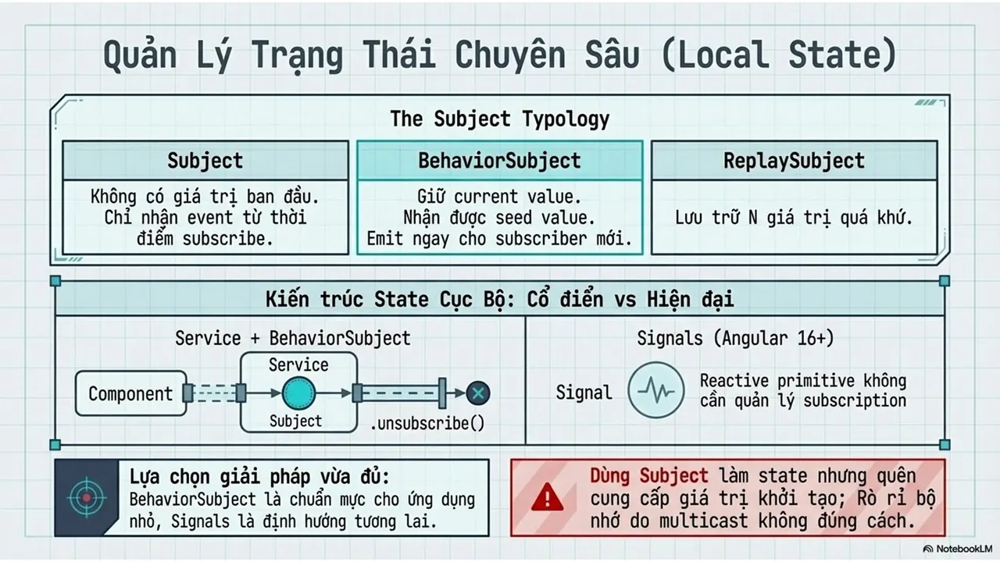
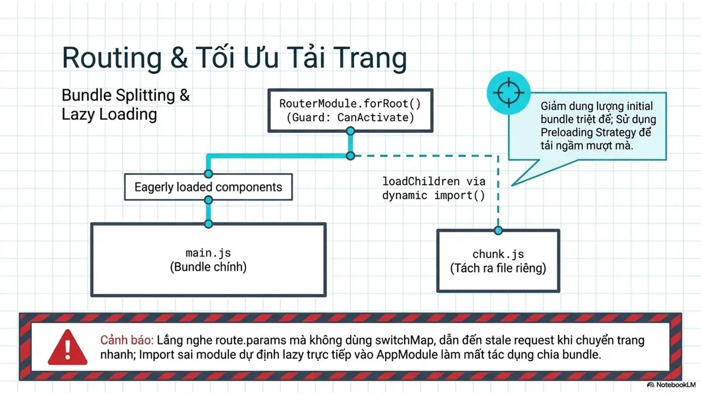
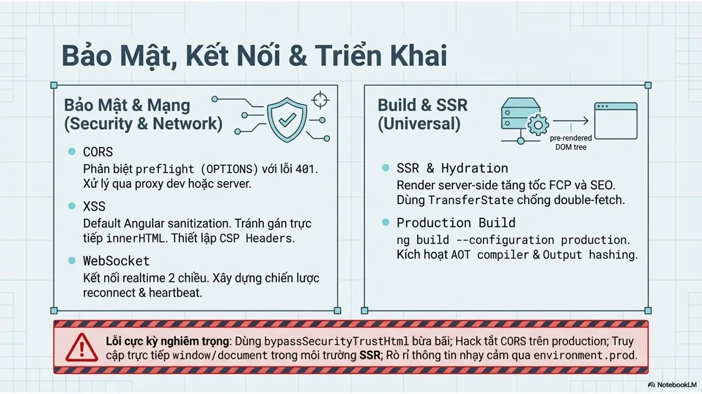
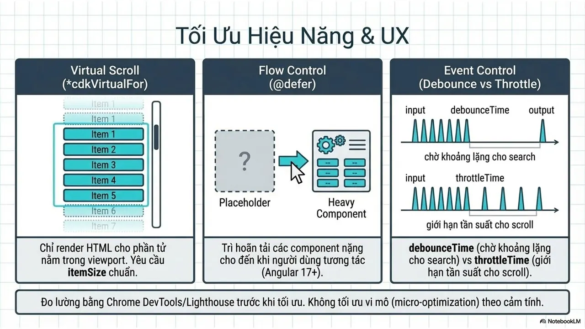
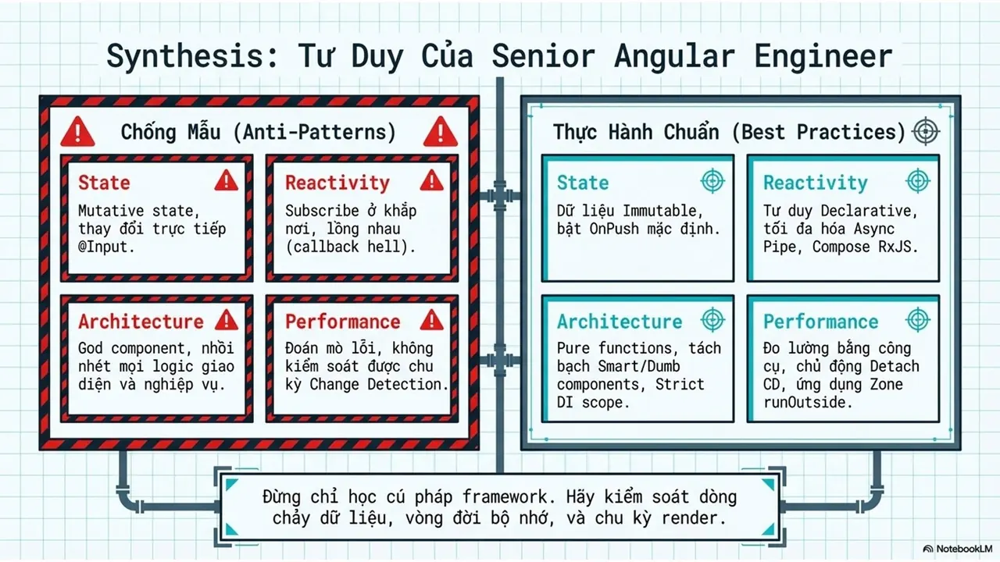

---

_Bài viết được lưu trữ từ [fanpage HCMUTE Developer Student Club](https://www.facebook.com/hcmute.dsc)._
