\#InterviewPrep101 - Part 7 | React
  
🚀 LÀM CHỦ KIẾN TRÚC REACT: TỪ TƯ DUY THAO TÁC ĐẾN TƯ DUY HỆ THỐNG

<!--truncate-->

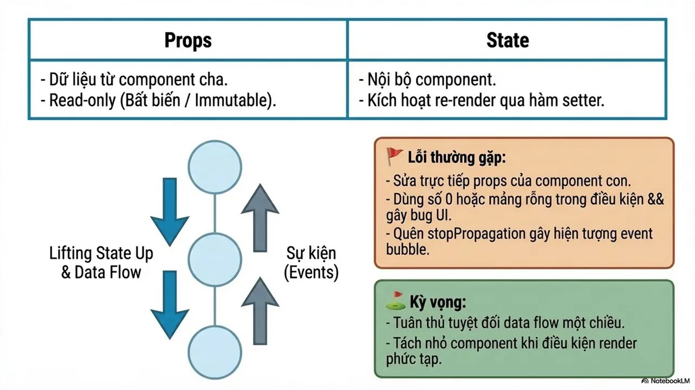

Khi học React, nhiều người thường chỉ tập trung vào việc viết component hay xử lý UI sao cho “chạy được”. Nhưng để xây dựng những ứng dụng lớn, dễ mở rộng và dễ bảo trì, điều quan trọng hơn là hiểu cách toàn bộ hệ thống phía sau vận hành.
  
React không chỉ là giao diện hiển thị, mà còn là cách dữ liệu di chuyển, cách rendering hoạt động, cách tối ưu hiệu suất và cách giữ cho ứng dụng ổn định khi quy mô ngày càng lớn.
  
Bài viết lần này sẽ cùng bạn nhìn React dưới góc độ kiến trúc và tư duy Engineering — nơi mỗi quyết định về state, render hay performance đều ảnh hưởng trực tiếp đến chất lượng của cả hệ thống.
  
Nếu muốn tiến xa hơn từ mức “biết dùng React” đến “hiểu React hoạt động như thế nào”, đây sẽ là hành trình dành cho bạn ✨
  
\#ReactJS #Frontend #WebDevelopment #HCMUTE #HCMUTE\_DSC

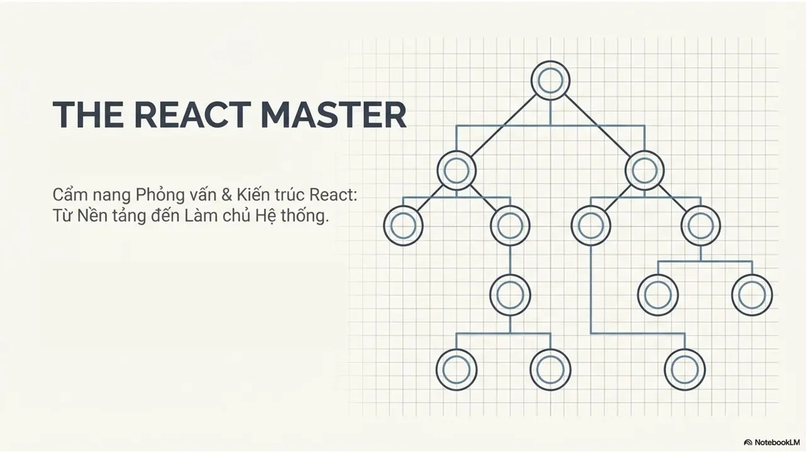
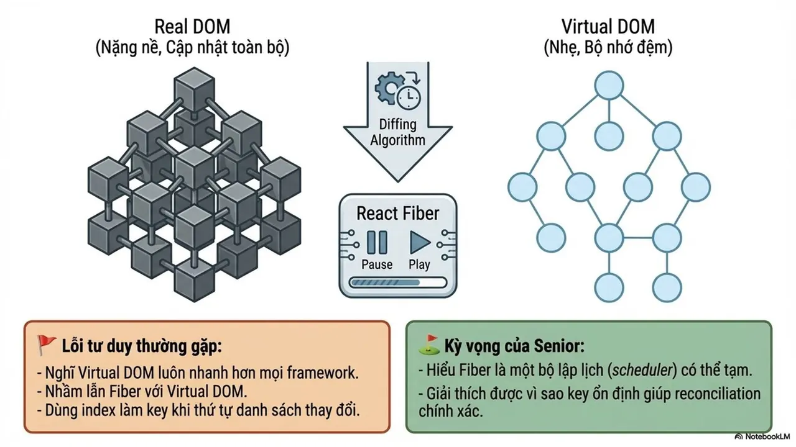
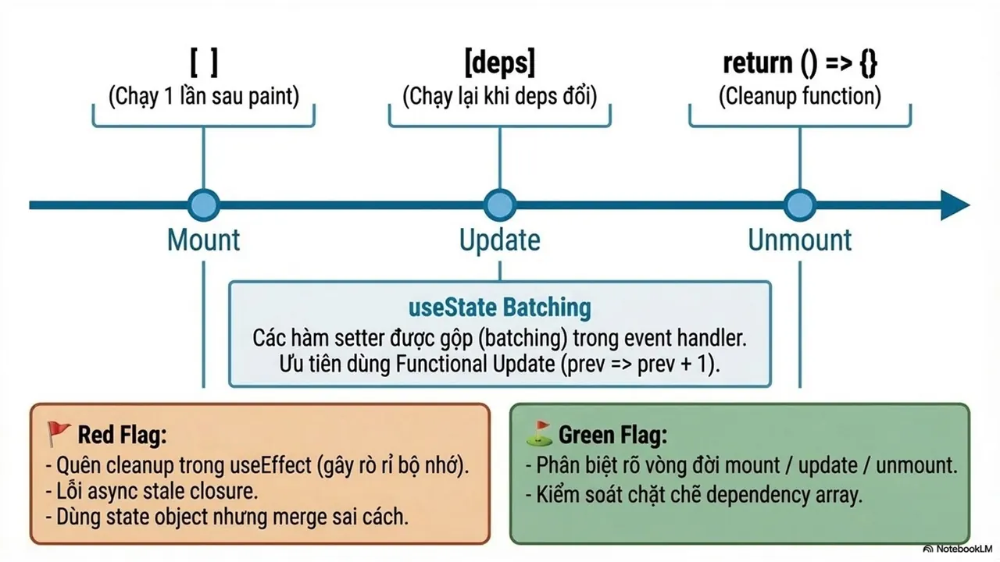
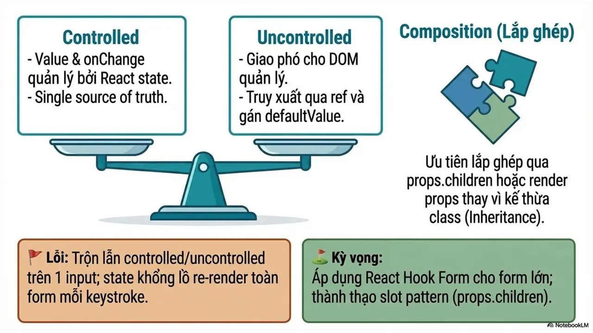
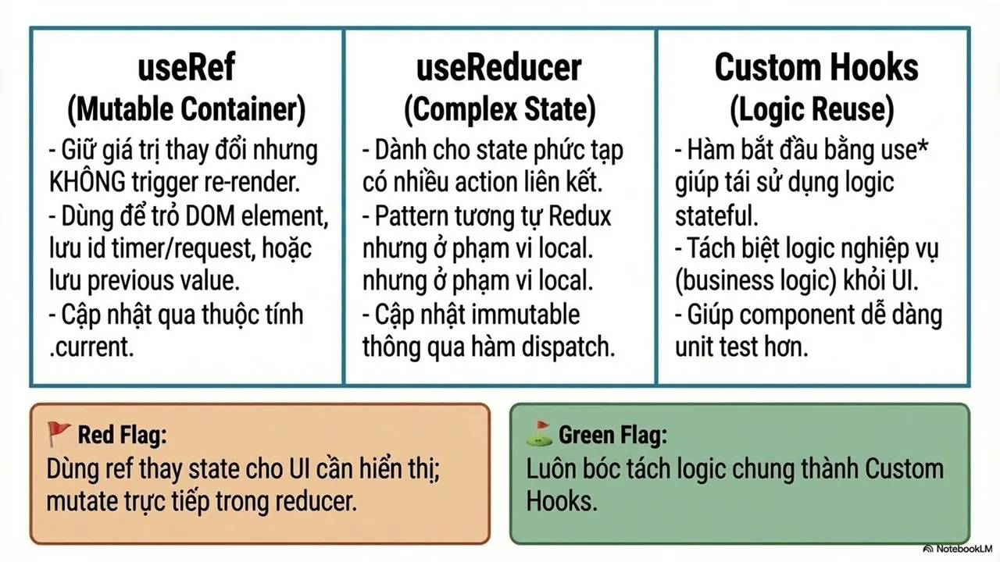
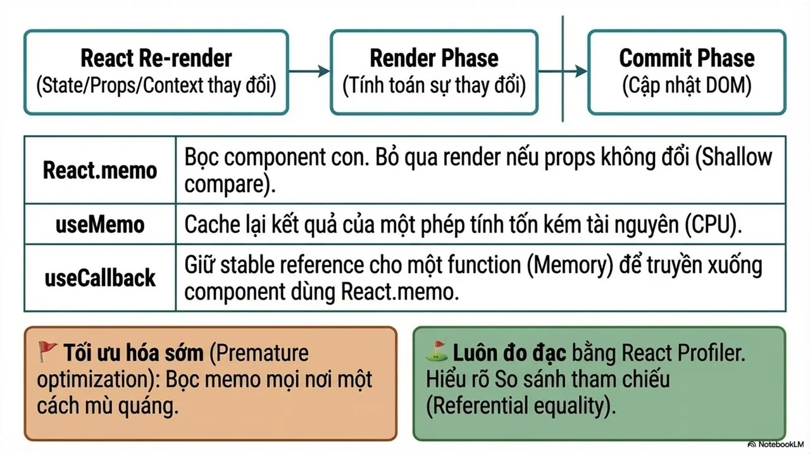
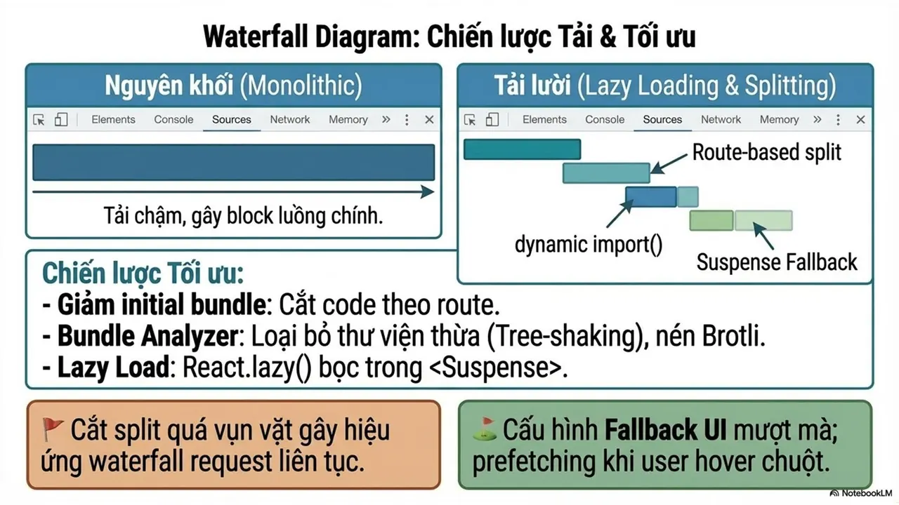
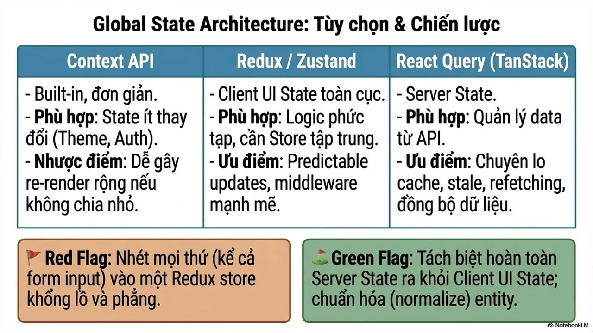
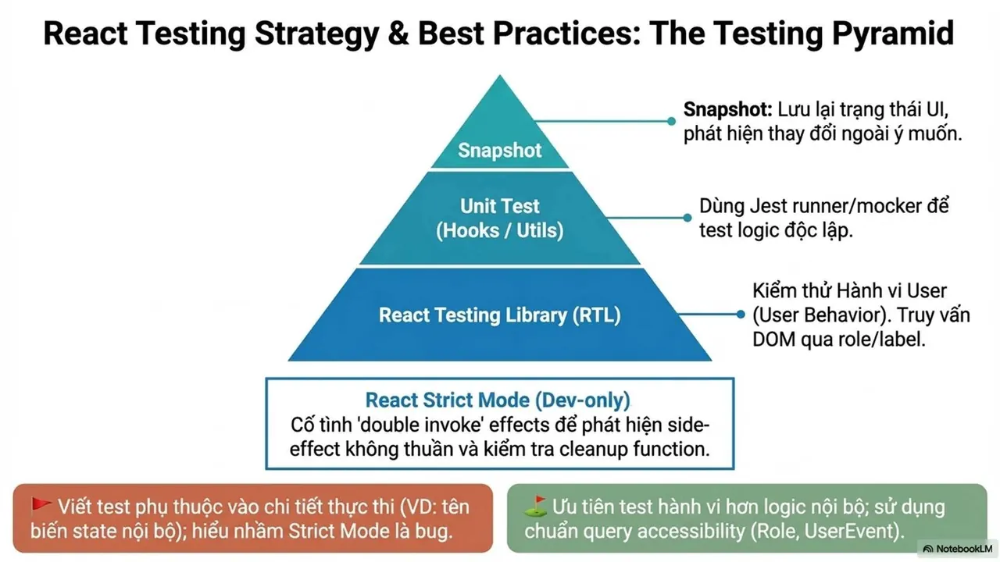
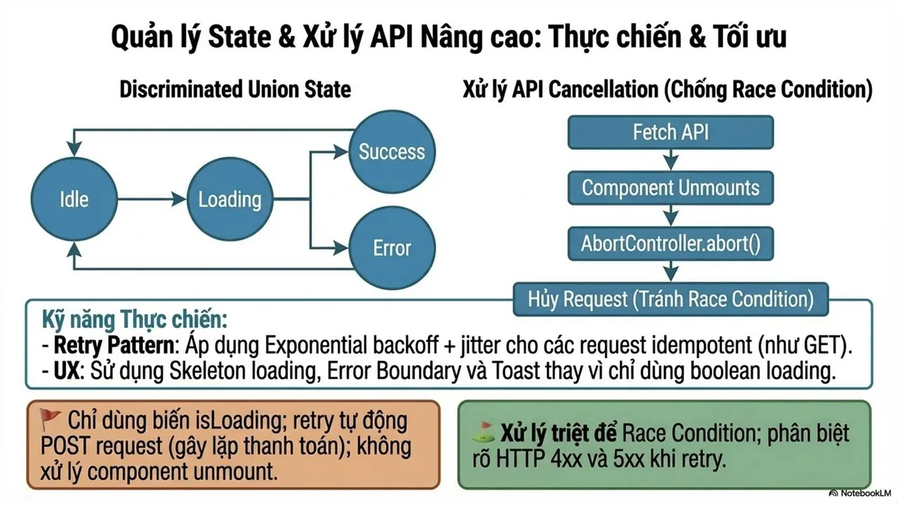
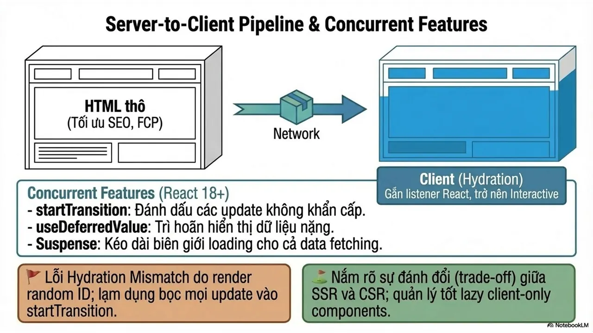
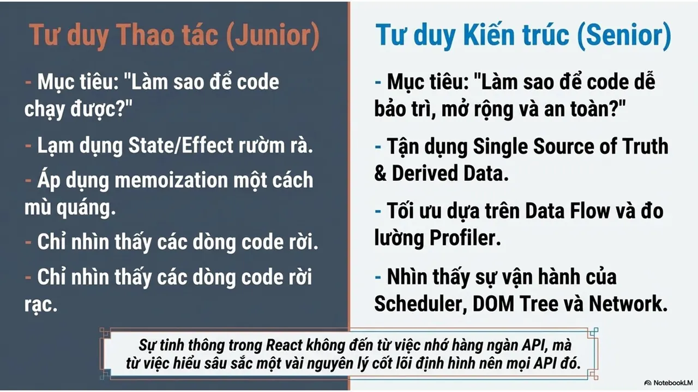
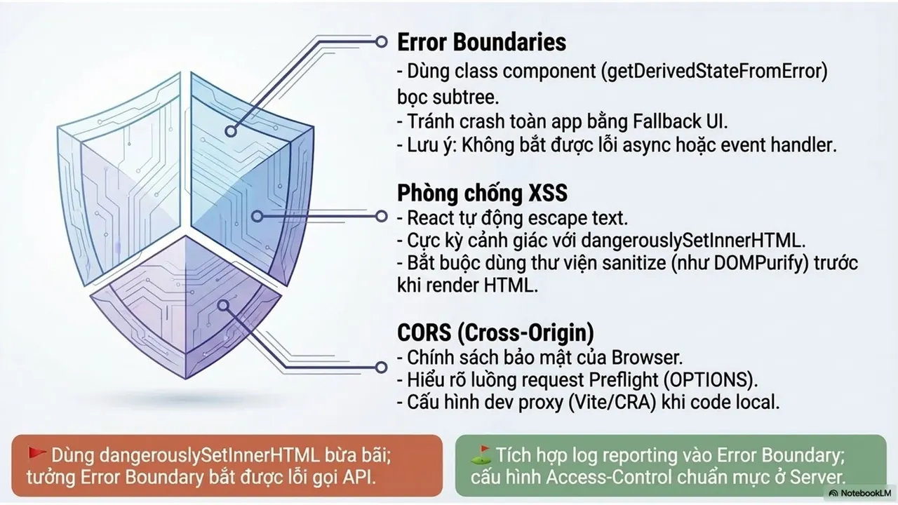

---

_Bài viết được lưu trữ từ [fanpage HCMUTE Developer Student Club](https://www.facebook.com/hcmute.dsc)._
