\#InterviewPrep101 - Part 8 | Next.js  
🚀 CẨM NANG KIẾN TRÚC & PHỎNG VẤN - LÀM CHỦ NEXT.JS

<!--truncate-->

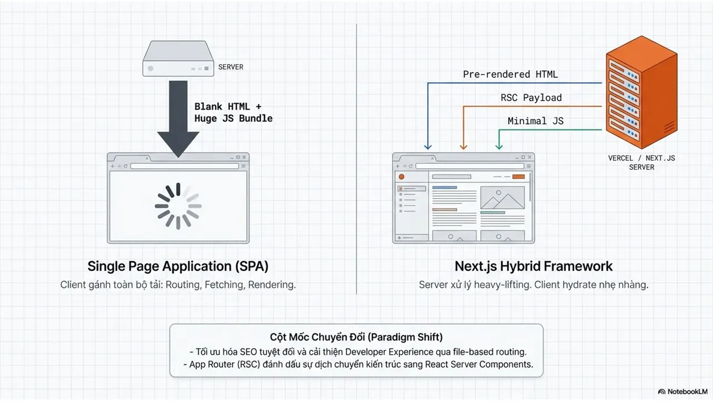

Việc xây dựng một ứng dụng web hiện đại không còn chỉ xoay quanh giao diện đẹp hay trải nghiệm mượt mà, mà còn nằm ở cách hệ thống xử lý dữ liệu, tối ưu hiệu năng và vận hành ổn định ở quy mô lớn. Next.js ra đời như một Hybrid Framework giúp chuyển bớt tải xử lý nặng từ trình duyệt về phía máy chủ, đồng thời kết hợp linh hoạt nhiều chiến lược rendering để cân bằng giữa SEO, tốc độ tải trang và trải nghiệm người dùng.
  
Nội dung này được xây dựng nhằm hệ thống hóa toàn bộ những nguyên lý quan trọng nhất trong kiến trúc Next.js hiện đại - từ Rendering, Data Fetching, Caching cho đến Performance, Security và System Design. Thay vì chỉ nhìn Next.js như công cụ để SSR, chúng ta sẽ tiếp cận nó như một kiến trúc full-stack hoàn chỉnh, nơi mỗi quyết định về render hay cache đều ảnh hưởng trực tiếp đến trải nghiệm và chi phí vận hành của hệ thống.
  
\#Nextjs #Frontend #WebDevelopment #HCMUTE #HCMUTE\_DSC

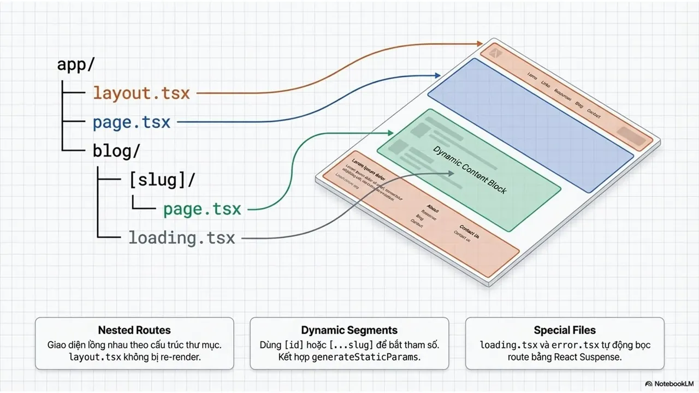
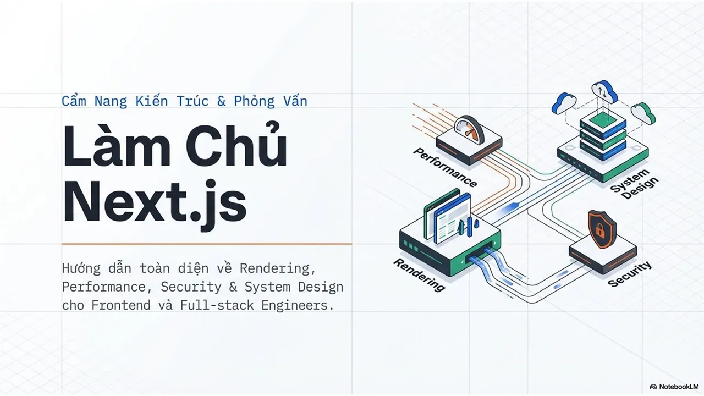
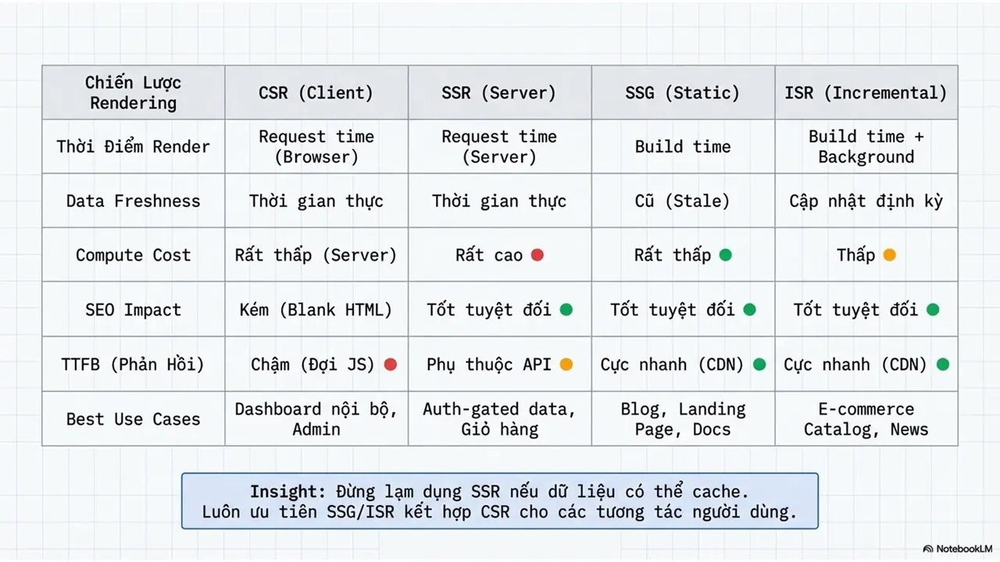
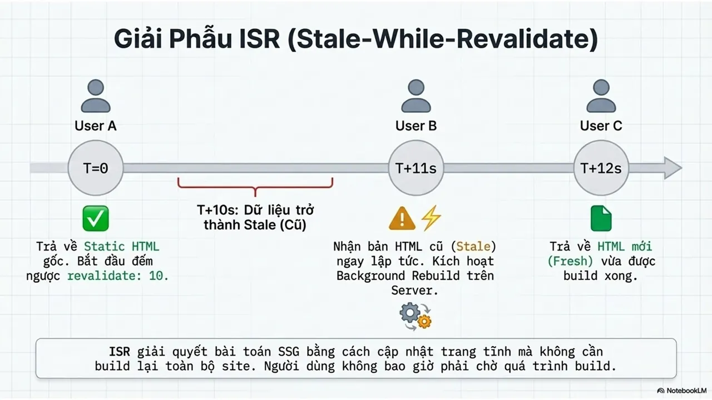
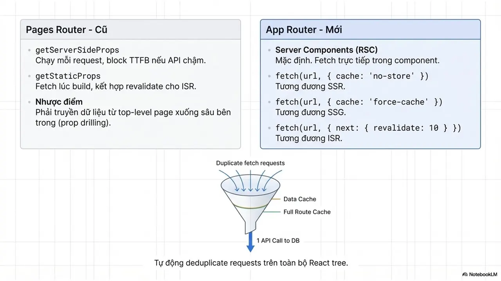
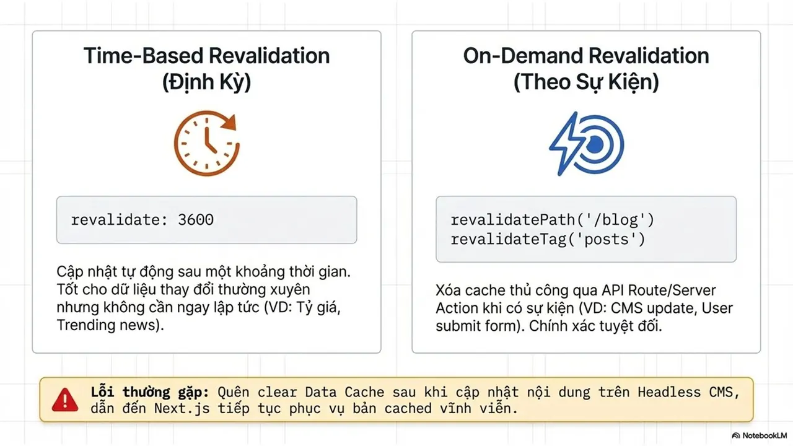
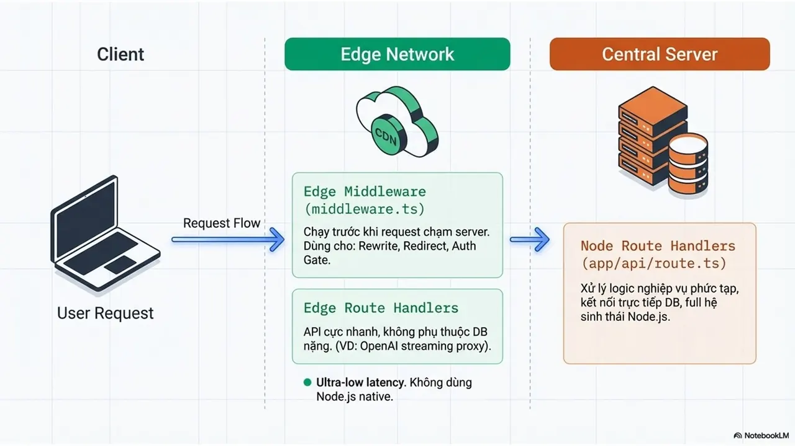
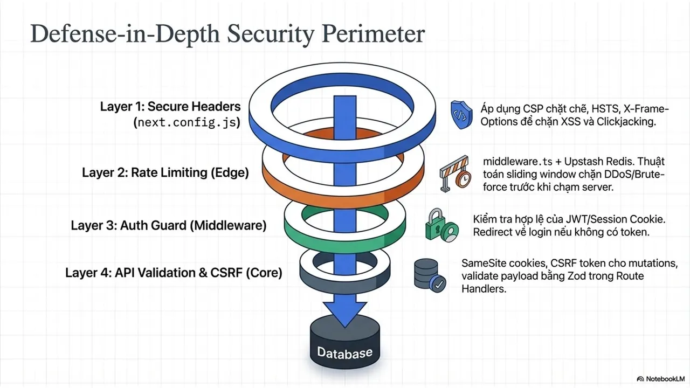
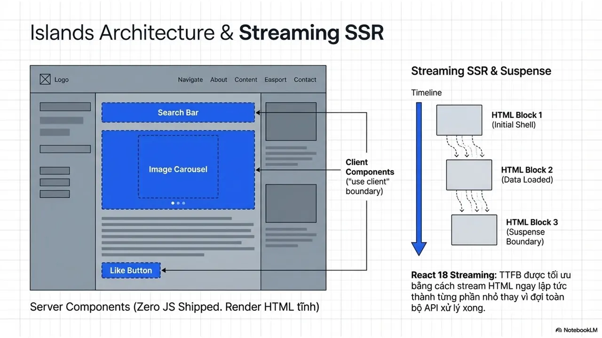
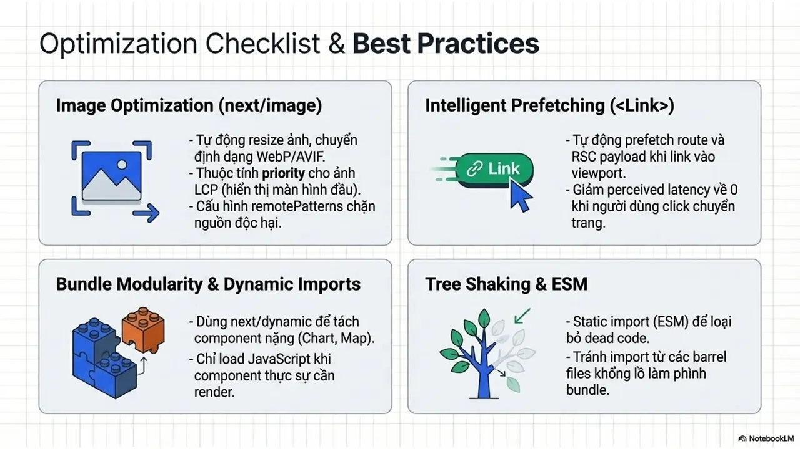
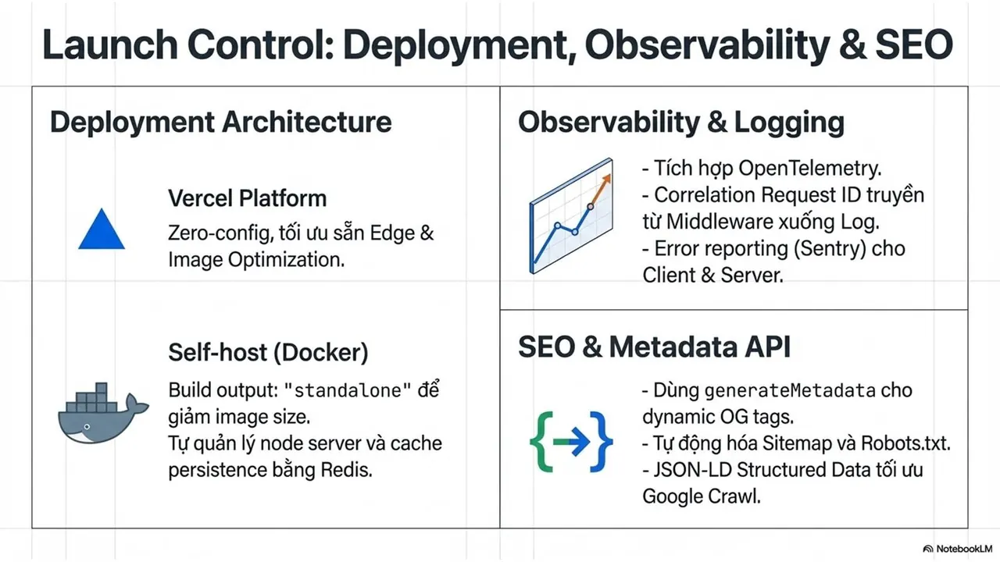
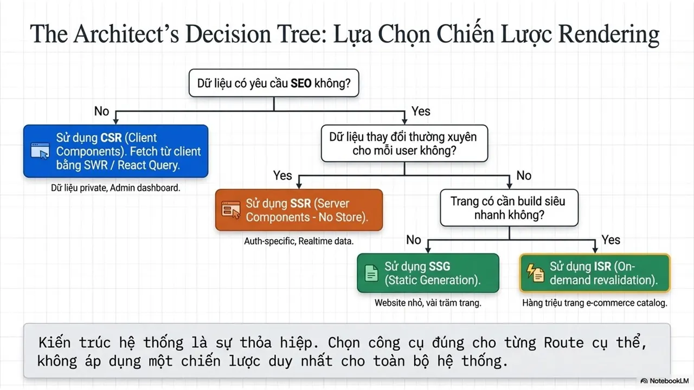

---

_Bài viết được lưu trữ từ [fanpage HCMUTE Developer Student Club](https://www.facebook.com/hcmute.dsc)._
