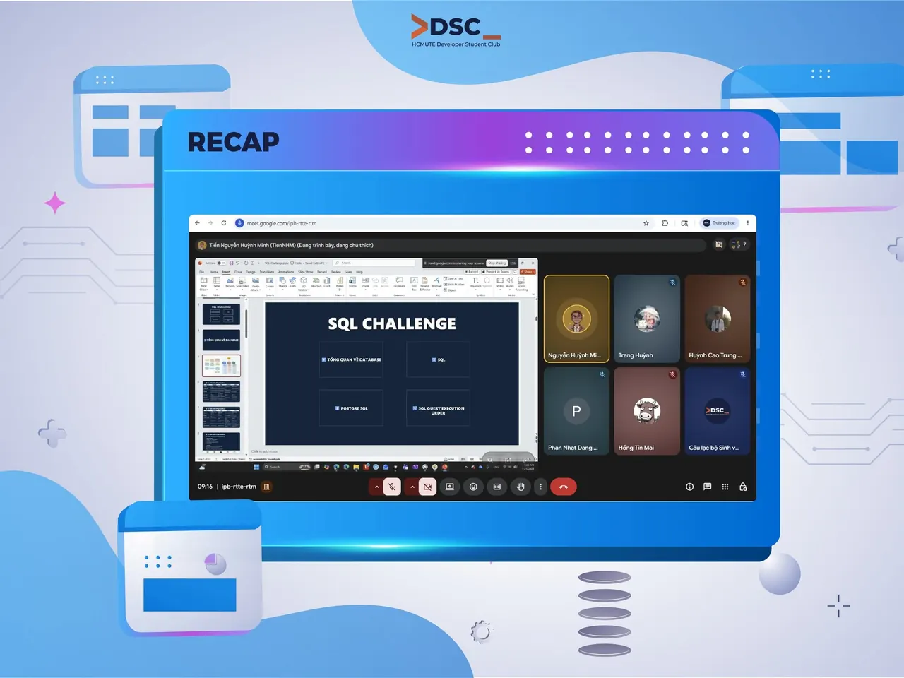

\[RECAP BUỔI 1 | SQL CHALLENGE - HCMUTE DSC\]
  
HCMUTE DSC đã chính thức khởi động buổi đầu tiên của SQL Challenge — hoạt động nội bộ dành cho các thành viên câu lạc bộ cùng nhau học tập và thực hành về SQL, Database cũng như tư duy xử lý dữ liệu 💙

<!--truncate-->

Trong buổi sinh hoạt mở màn, các thành viên đã cùng nhau tìm hiểu những kiến thức nền tảng như:  
📌 Tổng quan về Database và SQL  
📌 Làm quen với PostgreSQL và môi trường thực hành  
📌 Các câu truy vấn SQL cơ bản
  
Mặc dù challenge được tổ chức nội bộ, DSC vẫn muốn chia sẻ bộ tài liệu tổng hợp kiến thức SQL do anh speaker biên soạn để những bạn quan tâm bên ngoài cũng có thể tham khảo và tự học thêm 📚
  
👉 Tài liệu SQL: [https://tiennhm.github.io/docs/category/learn-sql-in-30-days](https://tiennhm.github.io/docs/category/learn-sql-in-30-days)
  
🎉 Tài liệu được biên soạn bởi anh Nguyễn Huỳnh Minh Tiến.  
DSC xin gửi lời cảm ơn đến anh vì sự chuẩn bị chỉn chu và tâm huyết dành cho SQL Challenge lần này. 💖  
\_\_\_\_\_\_\_\_\_\_\_\_\_\_\_\_\_\_\_\_\_\_\_\_\_\_\_\_\_\_\_\_\_\_\_  
\#DSC #HCMUTEDeveloperStudentClubs #HCMUTE\_DSC #SQL #SQL\_CHALLENGE

---

_Bài viết được lưu trữ từ [fanpage HCMUTE Developer Student Club](https://www.facebook.com/hcmute.dsc)._
