\#InterviewPrep101 - Part 9 | Python 🚀 PYTHON BACKEND INTERVIEW HANDBOOK – TỪ RUNTIME ĐẾN PRODUCTION Việc học Python cho Backend không chỉ dừng lại ở cú pháp hay framework, mà còn nằm ở khả năng hiểu sâu cách hệ thống thực sự vận hành phía sau mỗi dòng code. Từ cơ chế thực thi của CPython, quản lý bộ nhớ, mô hình xử lý đồng thời cho đến kiến trúc web hiện đại, tất cả đều ảnh hưởng trực tiếp đến hiệu năng, khả năng mở rộng và độ ổn định của ứng dụng trong môi trường thực tế. Nội dung dưới đây được xây dựng theo hướng tư duy interview và engineering, tập trung vào những chủ đề mà Backend Engineer thường gặp trong quá trình phỏng vấn cũng như khi vận hành hệ thống production. Lộ trình đi từ nền tảng runtime nội bộ của Python đến các cơ chế nâng cao như Generator, Decorator, GIL, AsyncIO, ASGI và tối ưu concurrency. Mục tiêu không chỉ là “code chạy được”, mà là hiểu vì sao hệ thống hoạt động như vậy, khi nào sẽ trở thành bottleneck và đâu là cách lựa chọn kiến trúc phù hợp cho từng loại workload.
  
\#Python #Backend #HCMUTE #HCMUTE\_DSC

<!--truncate-->

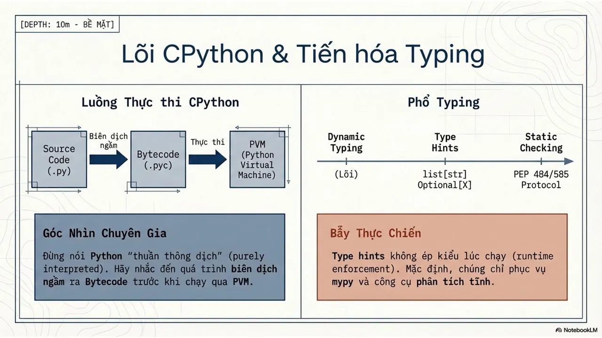

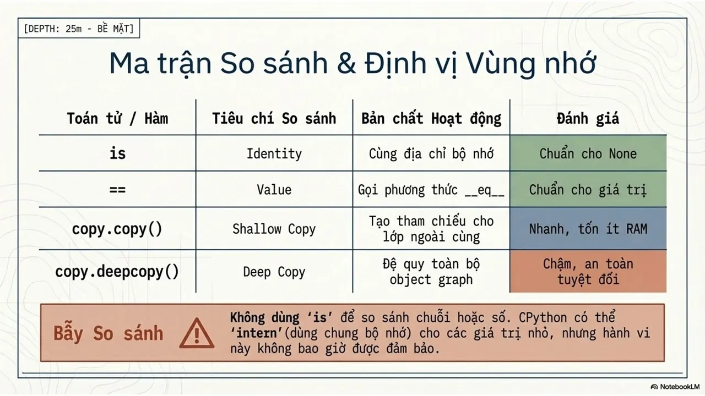
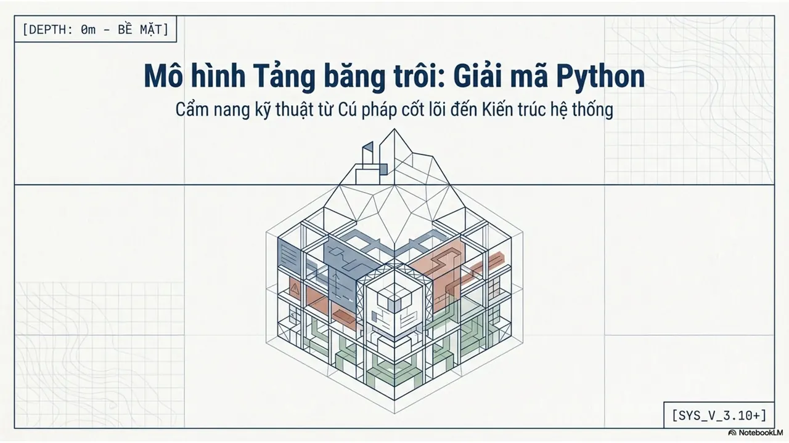
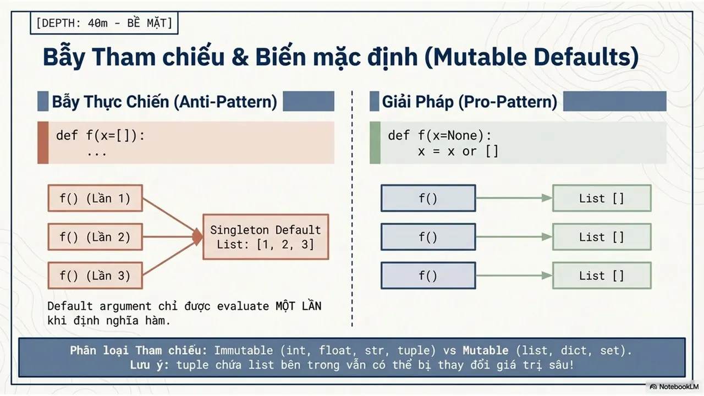
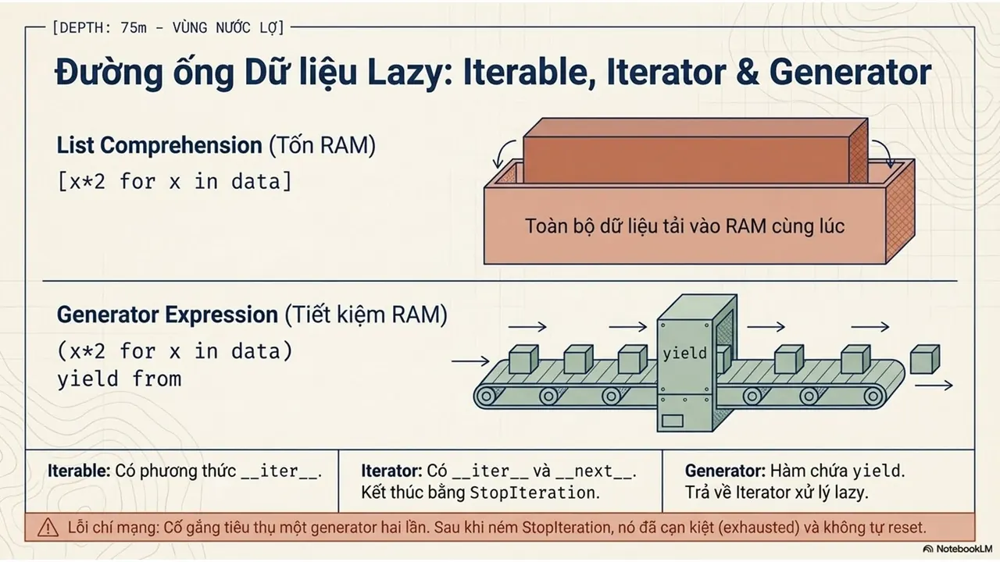
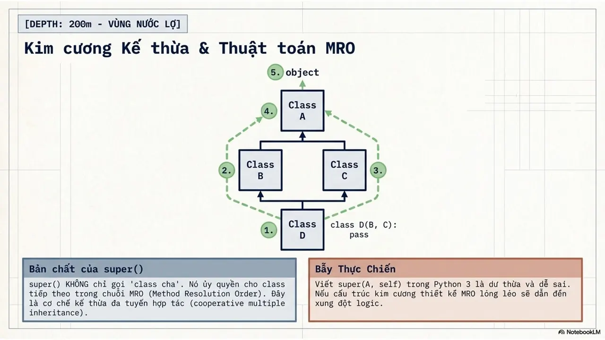
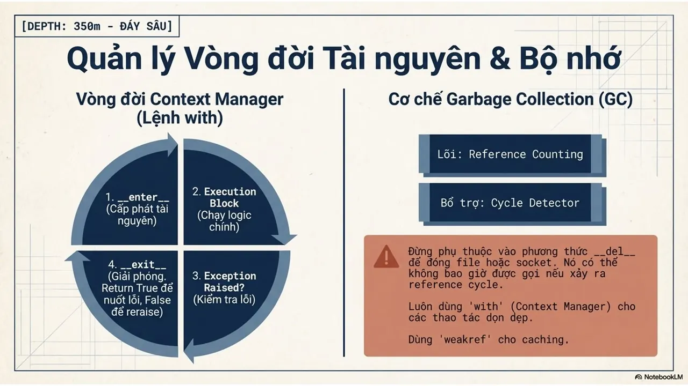
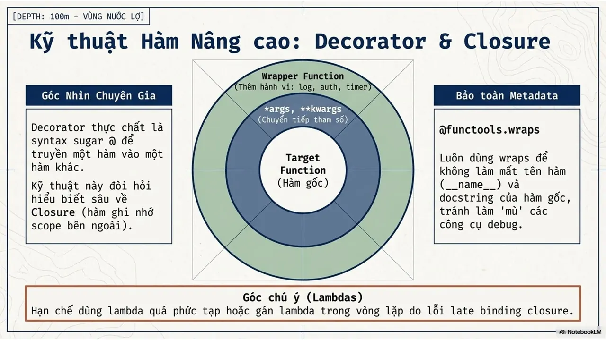
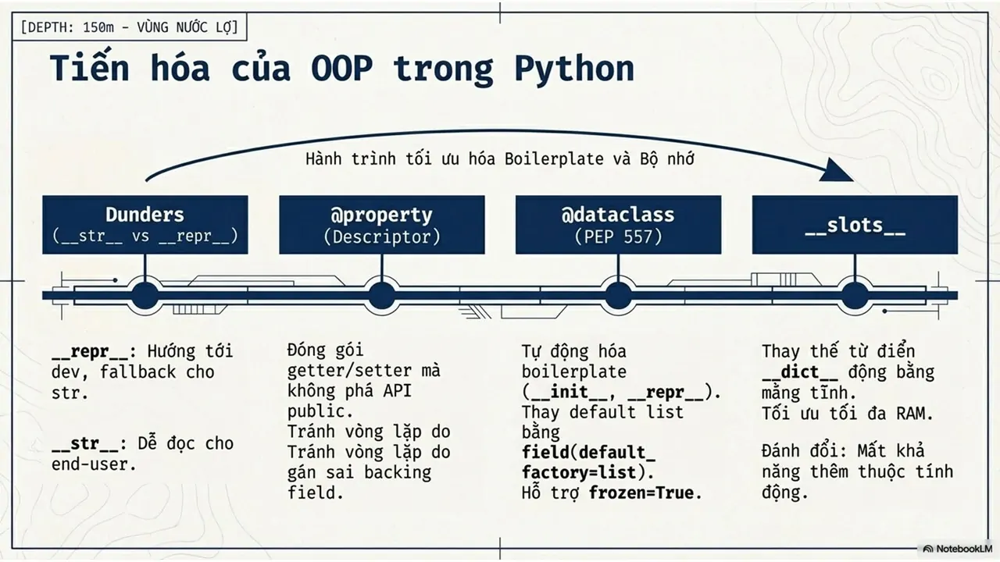
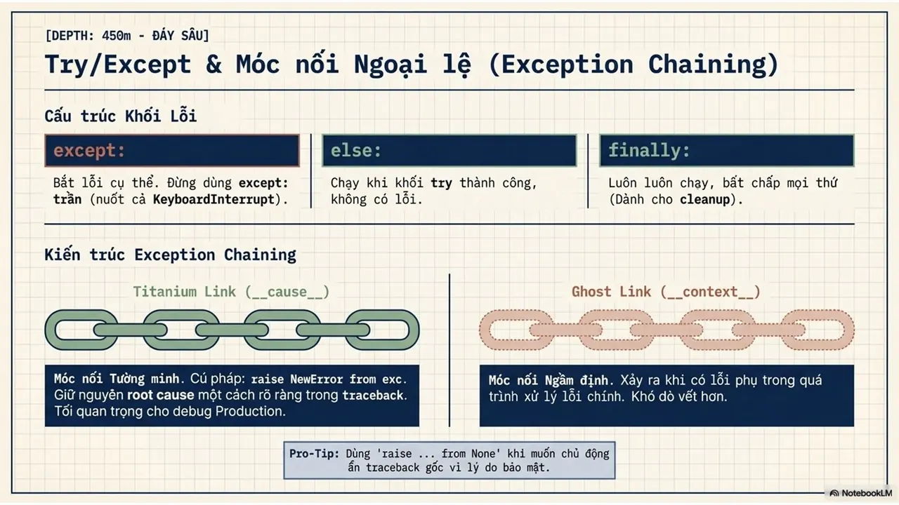
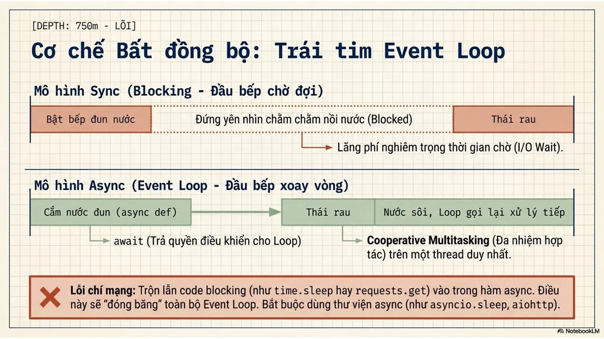
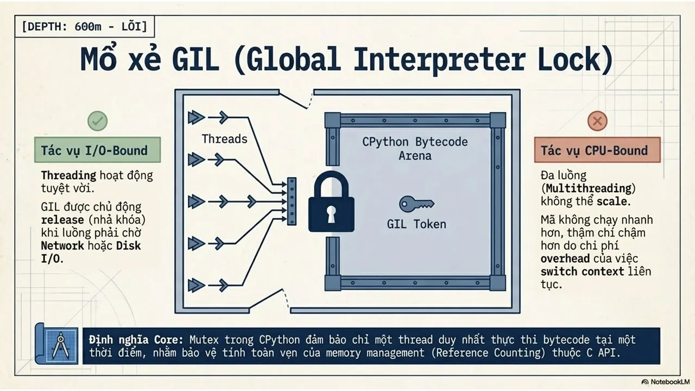
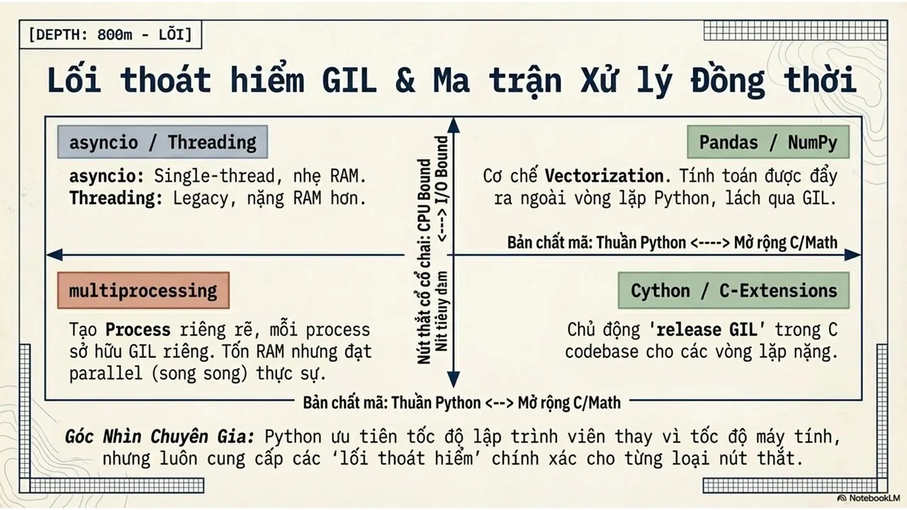
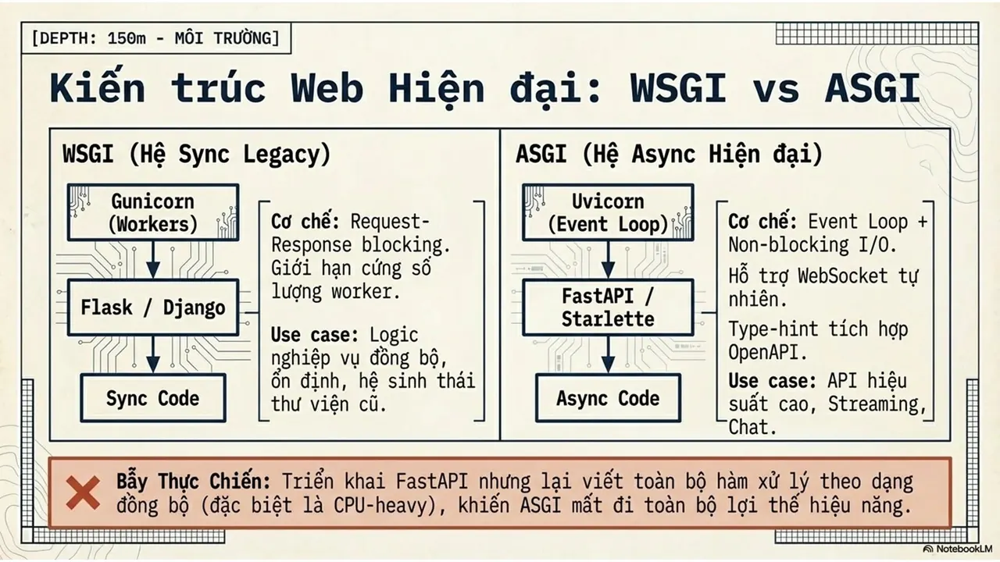
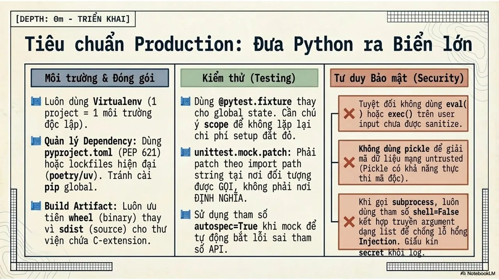

---

_Bài viết được lưu trữ từ [fanpage HCMUTE Developer Student Club](https://www.facebook.com/hcmute.dsc)._
