\#InterviewPrep101 - Part 10 | Java Spring 🚀 JAVA  SPRING BACKEND INTERVIEW HANDBOOK – TỪ JVM ĐẾN HỆ THỐNG DOANH NGHIỆP Việc xây dựng một ứng dụng Java chuyên nghiệp không chỉ dừng lại ở việc viết mã có thể chạy được, mà còn nằm ở khả năng thấu hiểu toàn bộ hệ thống vận hành phía sau runtime và framework. Để thực sự làm chủ Java Backend trong môi trường enterprise, cần nhìn sâu hơn vào cách JVM thực thi bytecode, cách Garbage Collector quản lý bộ nhớ, cách đa luồng vận hành và cách Spring xử lý dependency injection, transaction hay security ở quy mô lớn. Nội dung dưới đây được xây dựng theo hướng tư duy interview và backend engineering, tập trung vào các chủ đề cốt lõi thường xuất hiện trong quá trình phỏng vấn cũng như khi vận hành hệ thống production thực tế. Lộ trình đi từ kiến trúc JVM, memory model, collections, concurrency cho đến hệ sinh thái Spring, JPA, Reactive và các kỹ thuật tối ưu hiệu năng hệ thống. Mục tiêu cuối cùng không chỉ là “biết dùng framework”, mà là hiểu cách toàn bộ nền tảng hoạt động phía sau để xây dựng các hệ thống ổn định, dễ mở rộng và có hiệu suất cao.
  
\#JAVA #Backend #HCMUTE #HCMUTE\_DSC

<!--truncate-->

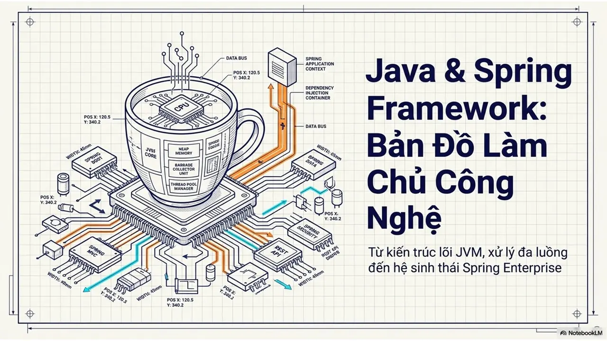

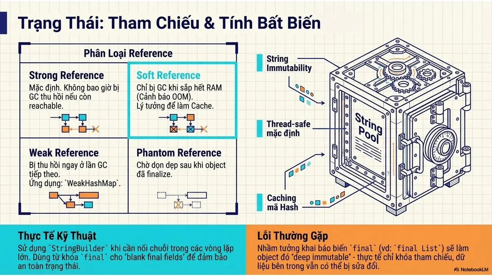
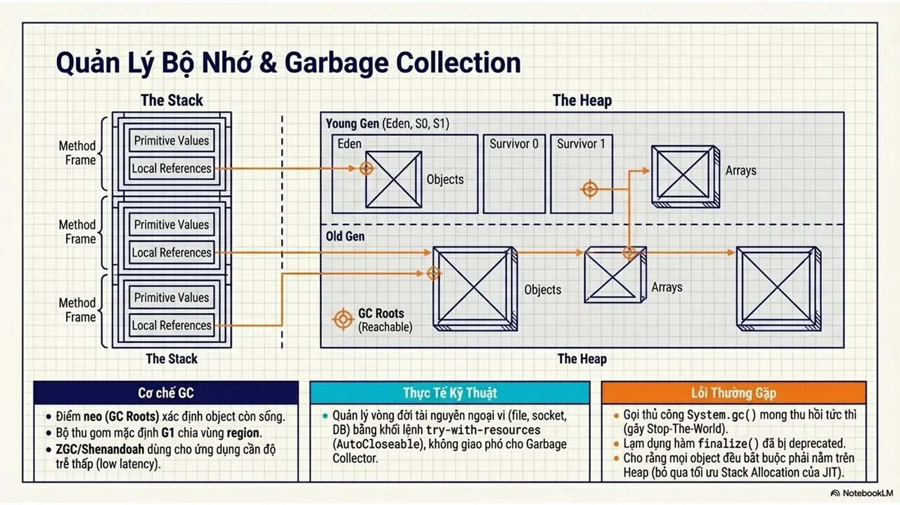
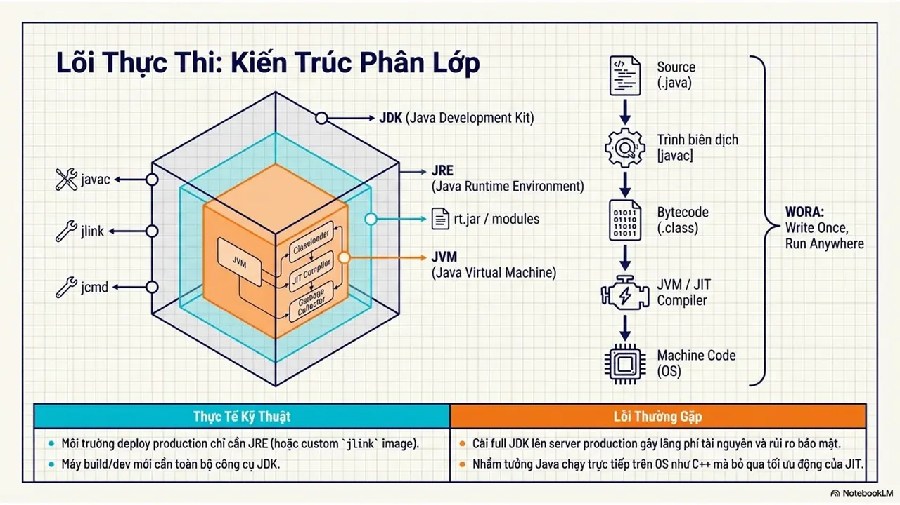
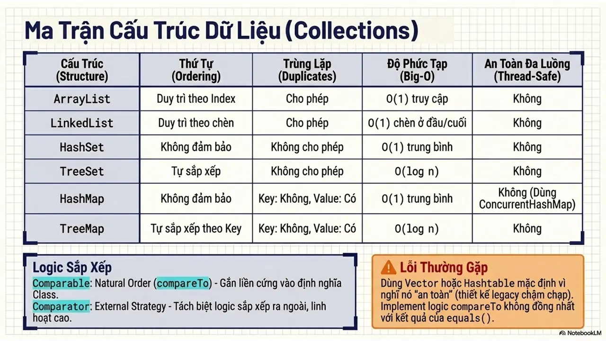
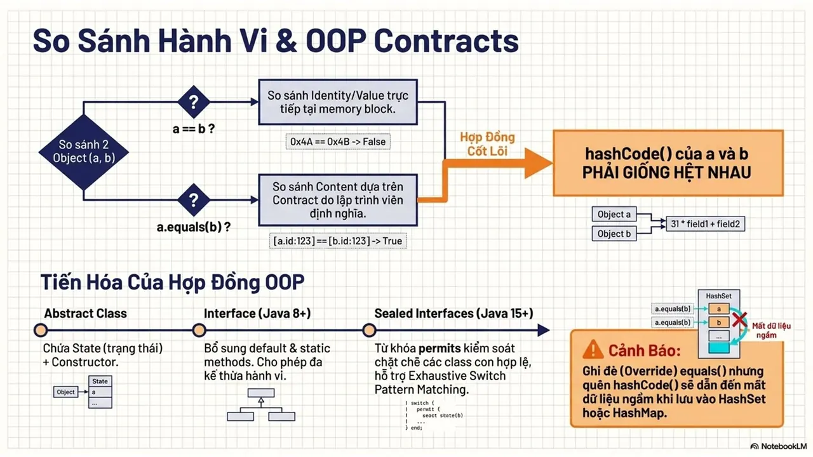
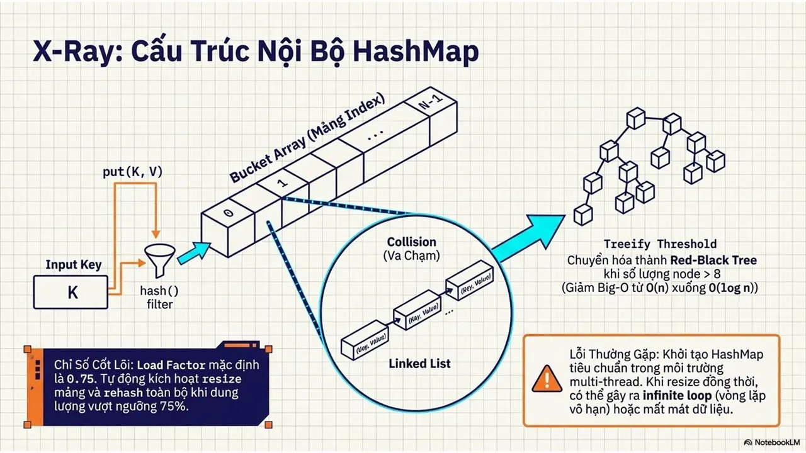
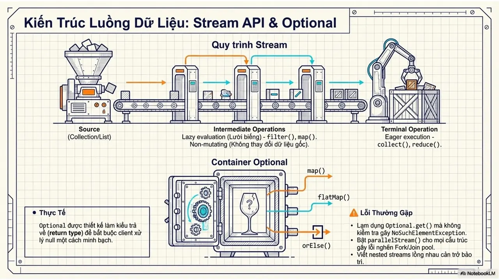
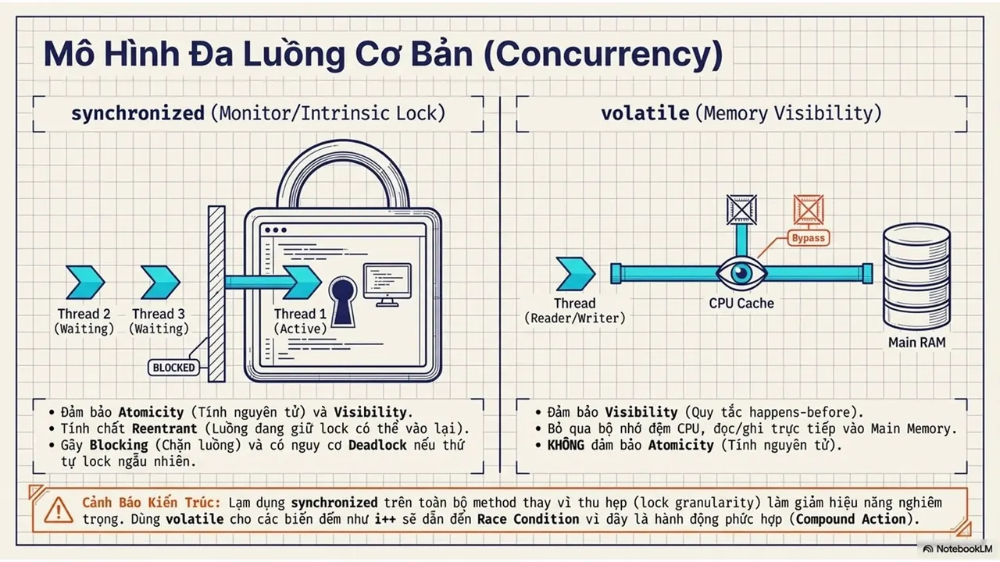
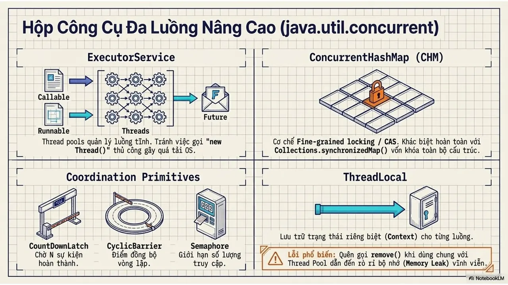
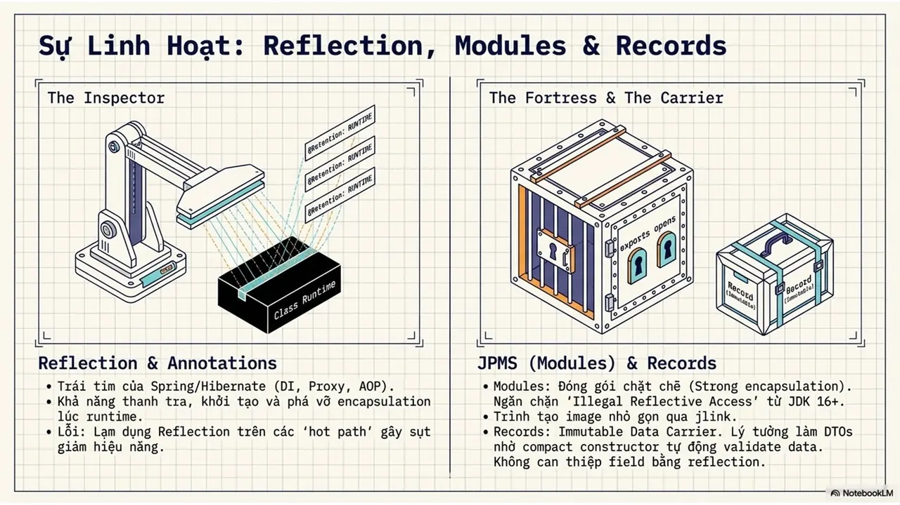
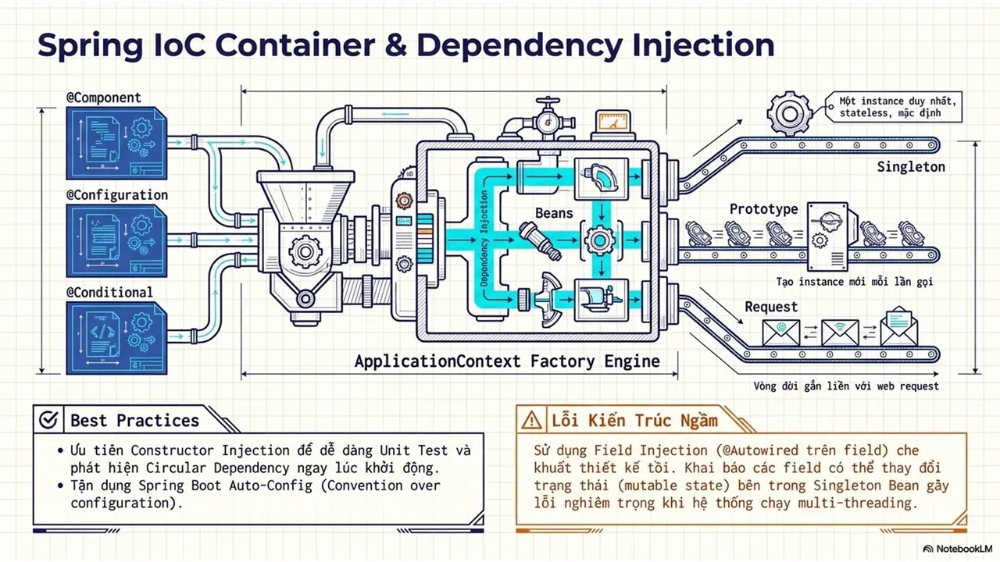
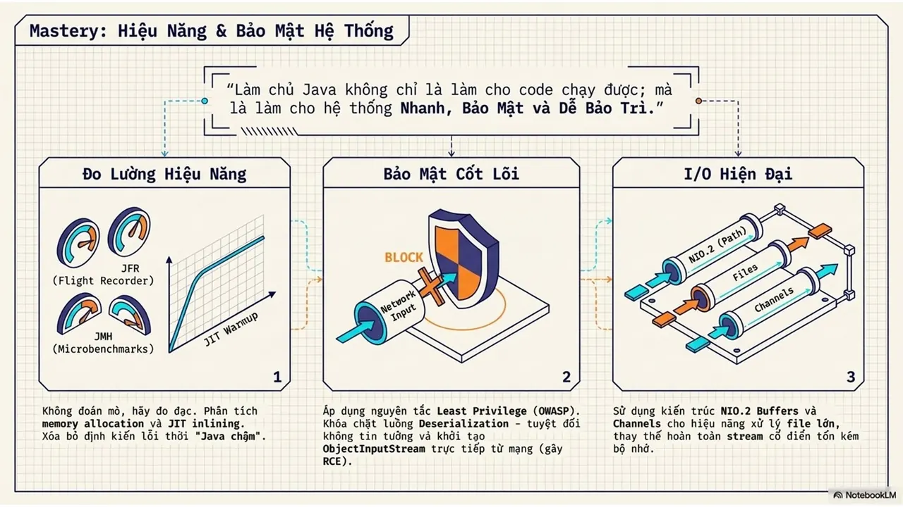
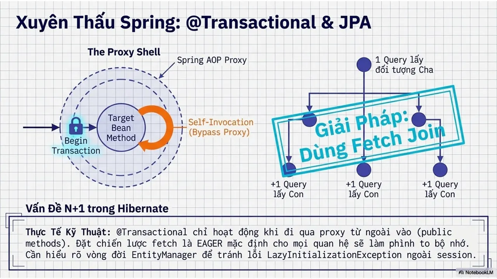
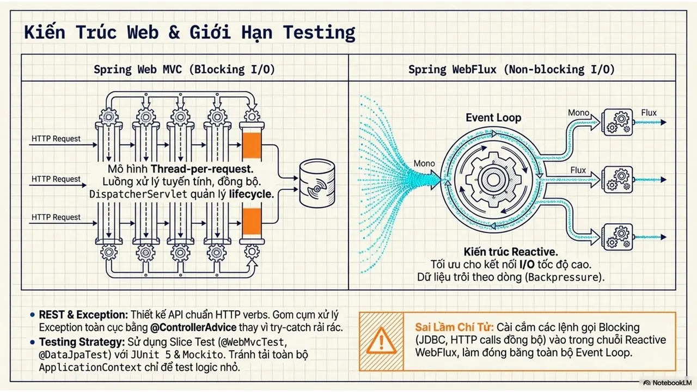

---

_Bài viết được lưu trữ từ [fanpage HCMUTE Developer Student Club](https://www.facebook.com/hcmute.dsc)._
