\#InterviewPrep101 - Part 11 | DotNet 🚀 DOTNET BACKEND INTERVIEW HANDBOOK – FROM CLR TO PRODUCT SYSTEMS Việc phát triển ứng dụng trên nền tảng .NET không chỉ nằm ở khả năng sử dụng C# hay xây dựng API bằng ASP.NET Core, mà còn phụ thuộc vào mức độ thấu hiểu cách hệ thống vận hành phía sau runtime. Từ cơ chế thực thi của CLR, quản lý bộ nhớ thông qua Garbage Collector, xử lý bất đồng bộ bằng async/await cho đến cách Entity Framework Core theo dõi trạng thái dữ liệu, mọi quyết định kỹ thuật đều tác động trực tiếp đến hiệu năng, khả năng mở rộng và độ ổn định của ứng dụng trong môi trường production. Nội dung dưới đây được xây dựng theo hướng tư duy interview và engineering, tập trung vào những chủ đề mà Backend Developer thường xuyên gặp trong các buổi phỏng vấn kỹ thuật cũng như trong quá trình vận hành hệ thống thực tế. Lộ trình đi từ các thành phần nền tảng của .NET Runtime đến các cơ chế quan trọng trong ASP.NET Core, Entity Framework Core và kiến trúc phân tán. Mục tiêu không chỉ là biết framework hoạt động như thế nào, mà còn hiểu vì sao nó được thiết kế như vậy, khi nào hệ thống trở thành bottleneck và đâu là cách đưa ra lựa chọn kiến trúc phù hợp cho từng bài toán.
  
\#DotNet #Backend #HCMUTE #HCMUTE\_DSC

<!--truncate-->

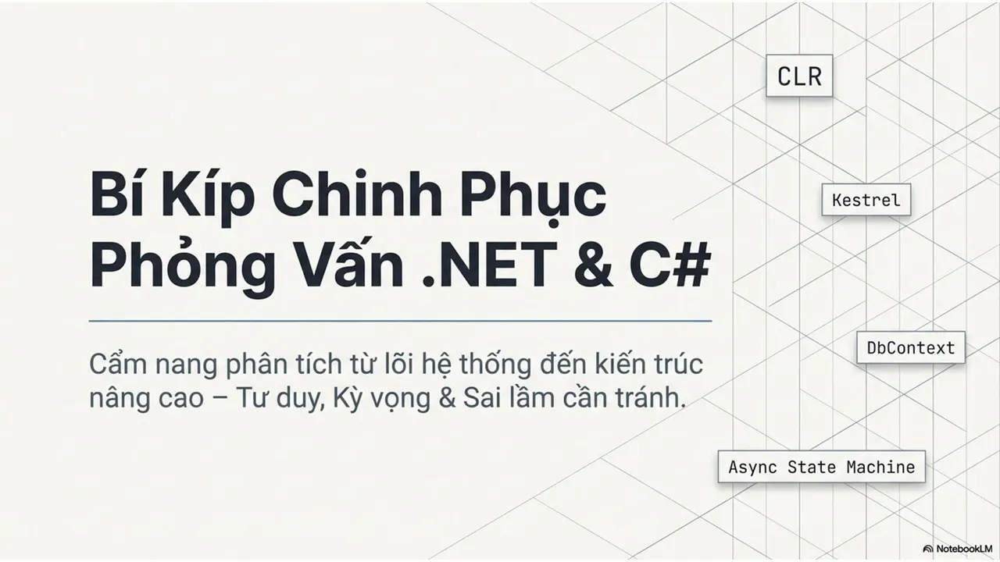

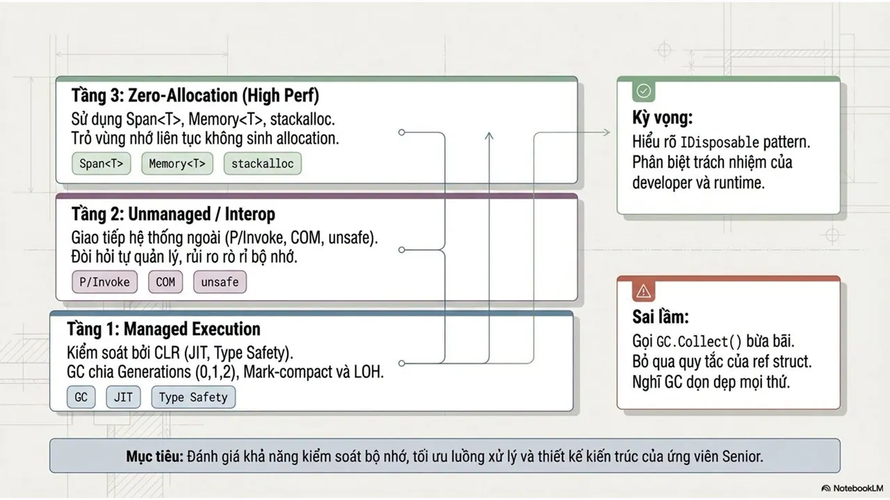
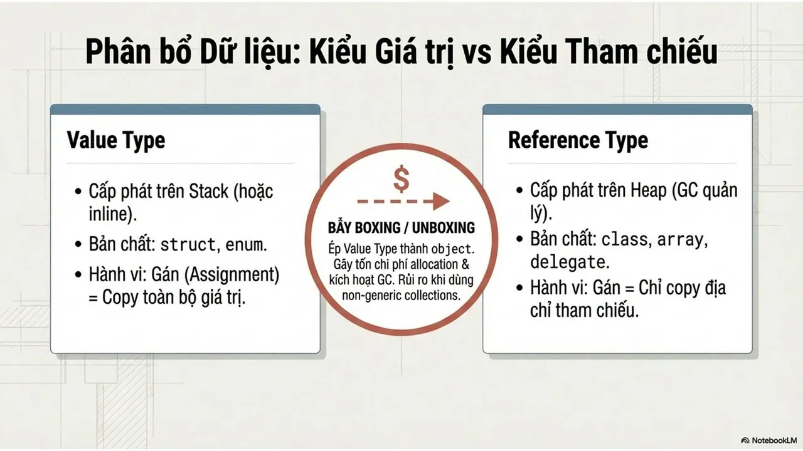
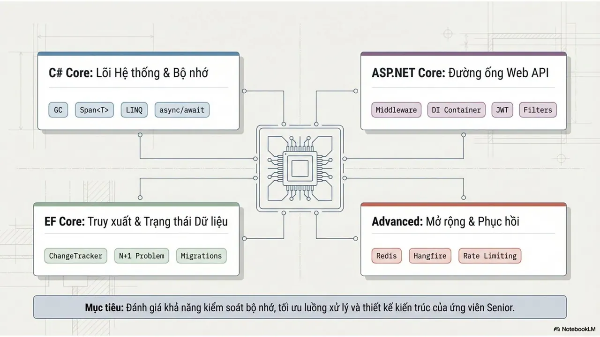
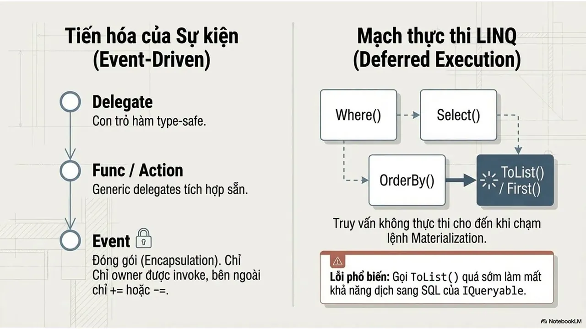
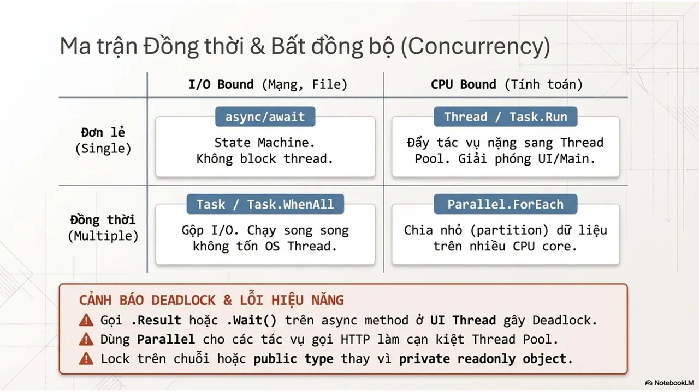
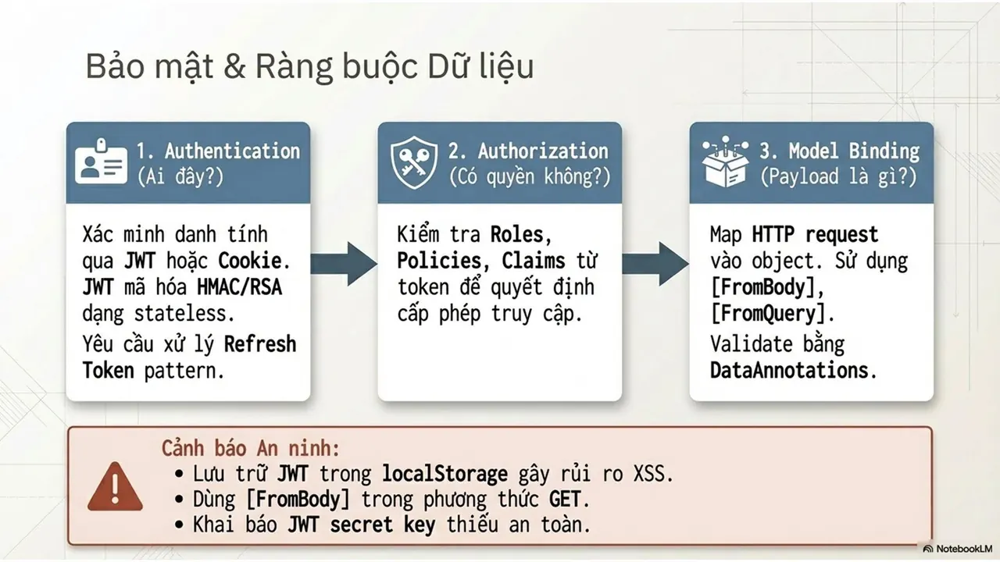
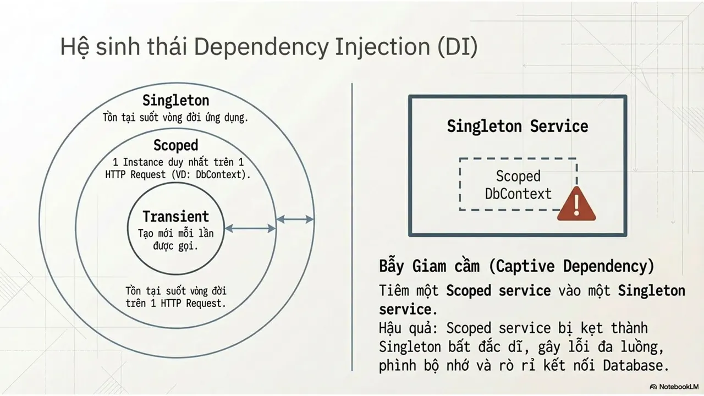
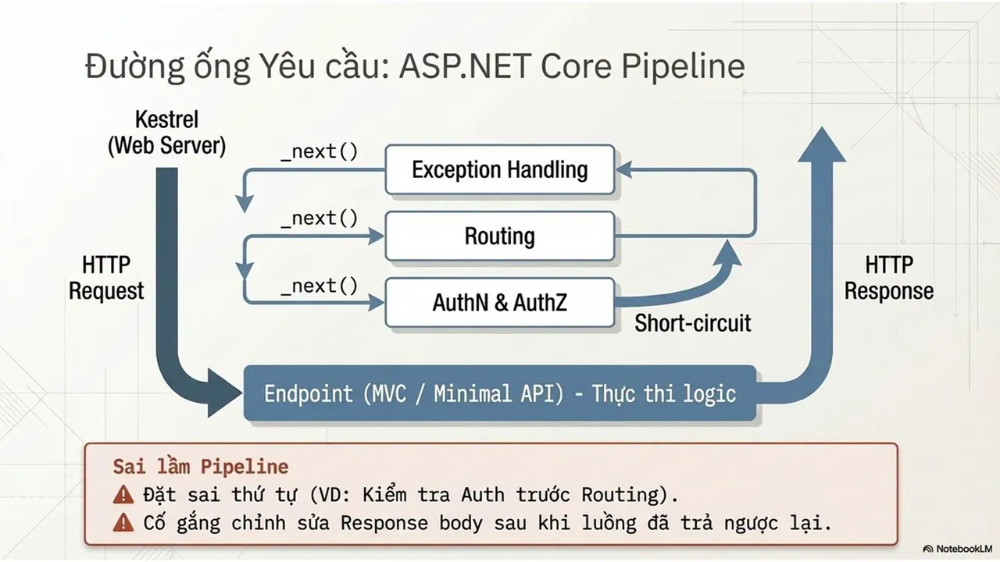
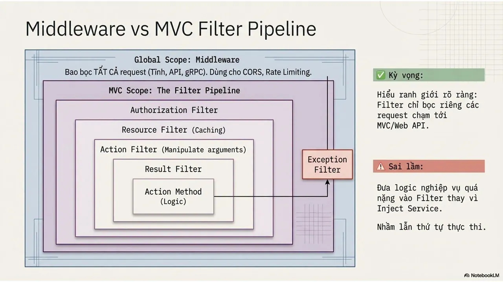
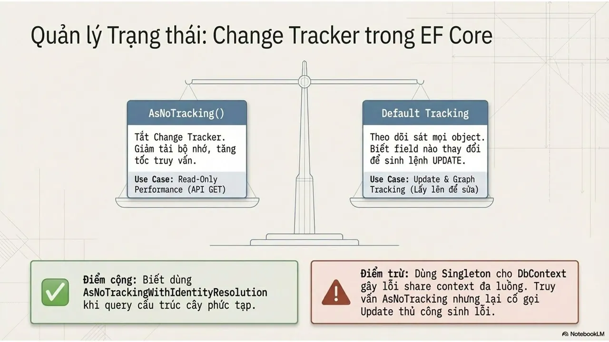
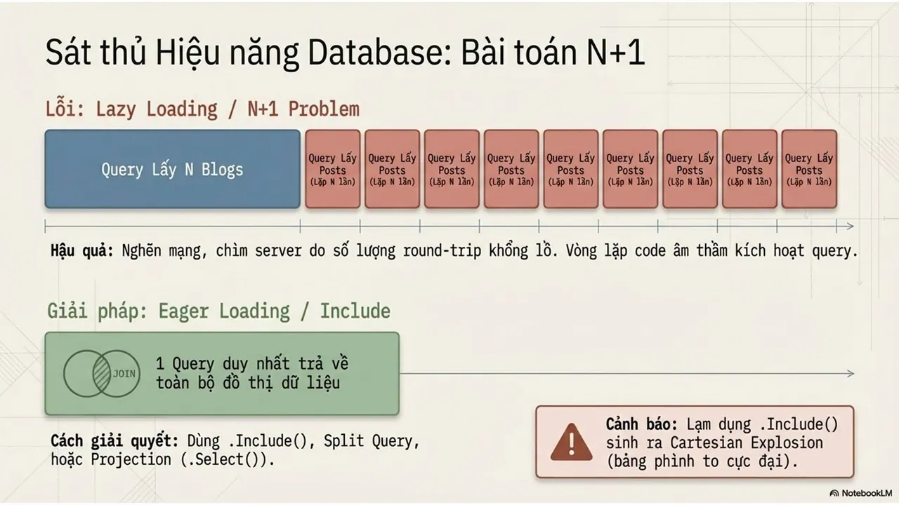
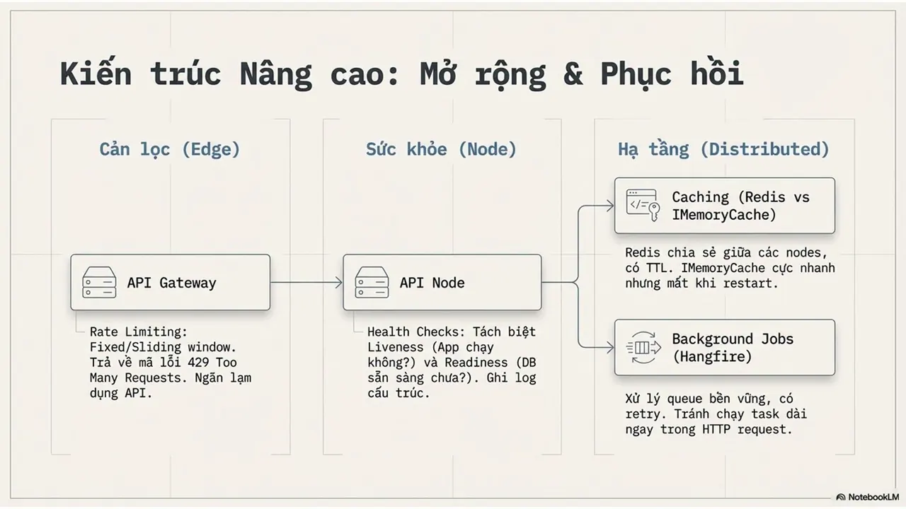
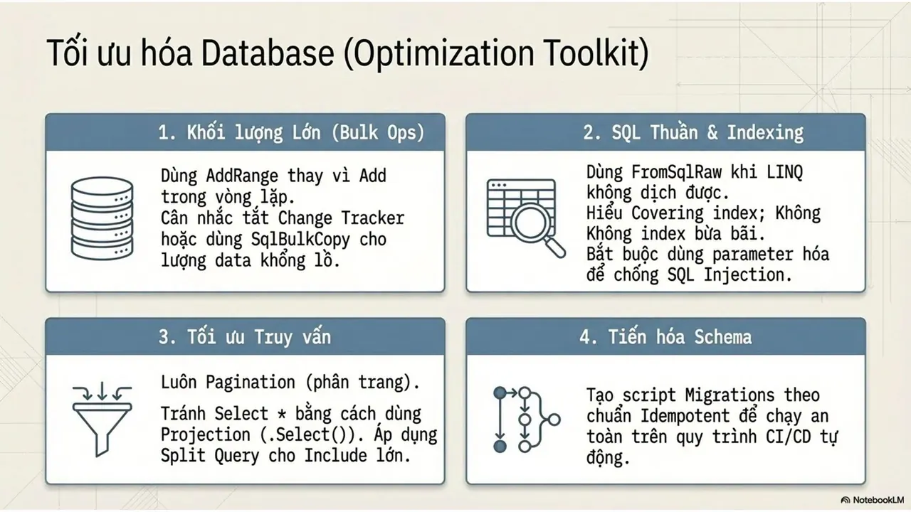
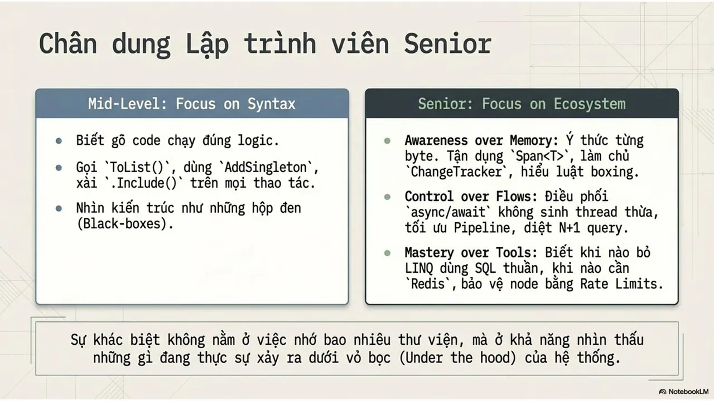

---

_Bài viết được lưu trữ từ [fanpage HCMUTE Developer Student Club](https://www.facebook.com/hcmute.dsc)._
