\#InterviewPrep101 - Part 12 | NestJS 🚀 NESTJS ENTERPRISE ARCHITECTURE HANDBOOK – FROM REQUEST PIPELINE TO SCALABLE SYSTEMS Việc xây dựng một ứng dụng phía máy chủ bền vững không chỉ dừng lại ở việc mã nguồn có thể hoạt động, mà nằm ở khả năng thiết lập một cấu trúc có tính kỷ luật cao và dễ mở rộng. Thấu hiểu bản chất vận hành của hệ thống - từ cơ chế tiêm phụ thuộc, luồng xử lý yêu cầu đến các chiến lược về thiết kế hệ thống - chính là yếu tố then chốt để làm chủ các ứng dụng quy mô doanh nghiệp. Nội dung dưới đây được hệ thống hóa nhằm làm rõ các nguyên lý kỹ thuật quan trọng trong NestJS. Từng phần kiến thức tập trung vào việc bóc tách bản chất hệ thống, đi kèm các ghi chú thực tế để định hình một tư duy lập trình chuyên nghiệp và chuẩn mực.
  
\#NestJS #Backend #HCMUTE #HCMUTE\_DSC

<!--truncate-->

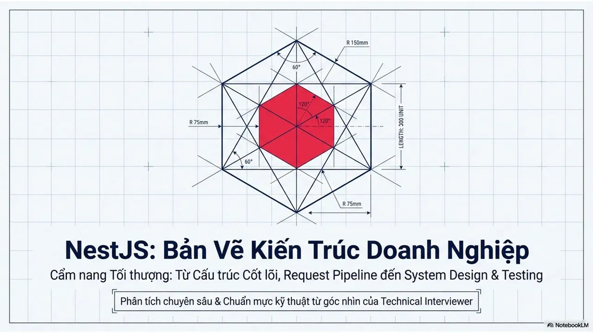

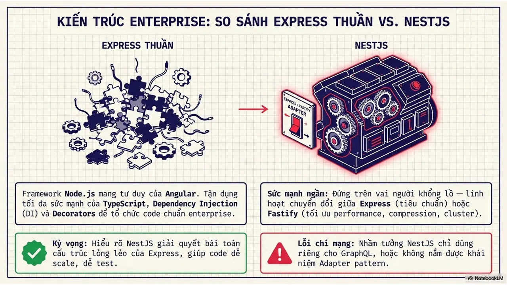
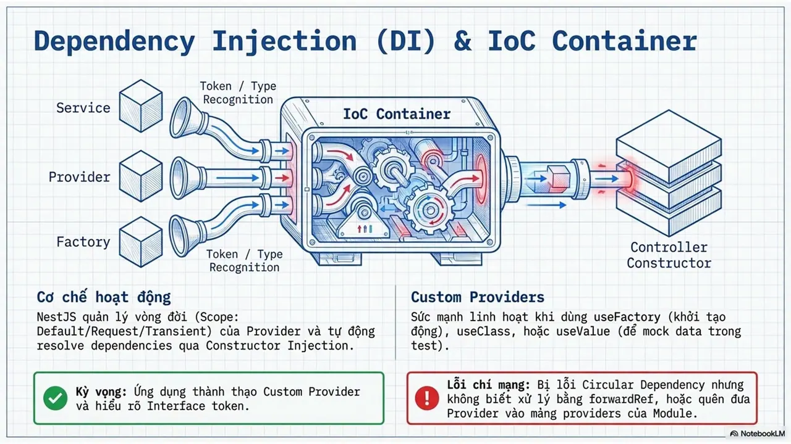
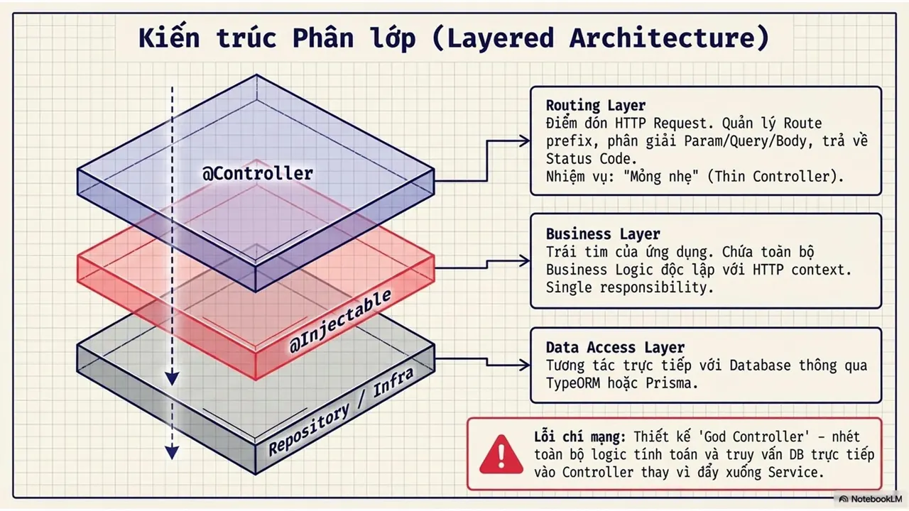
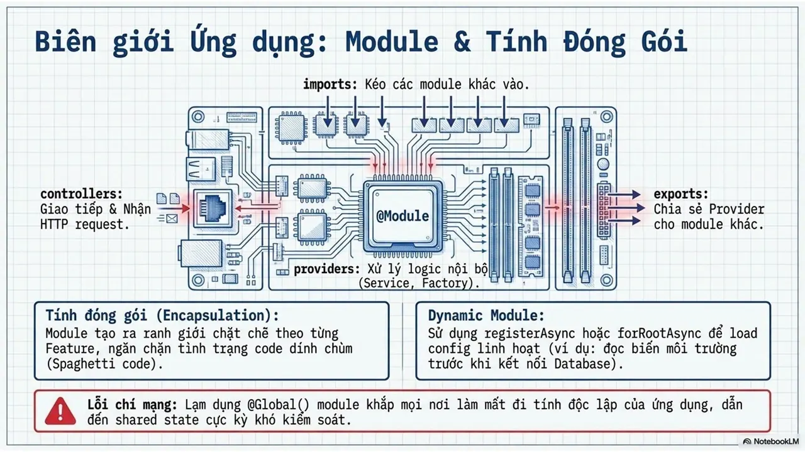
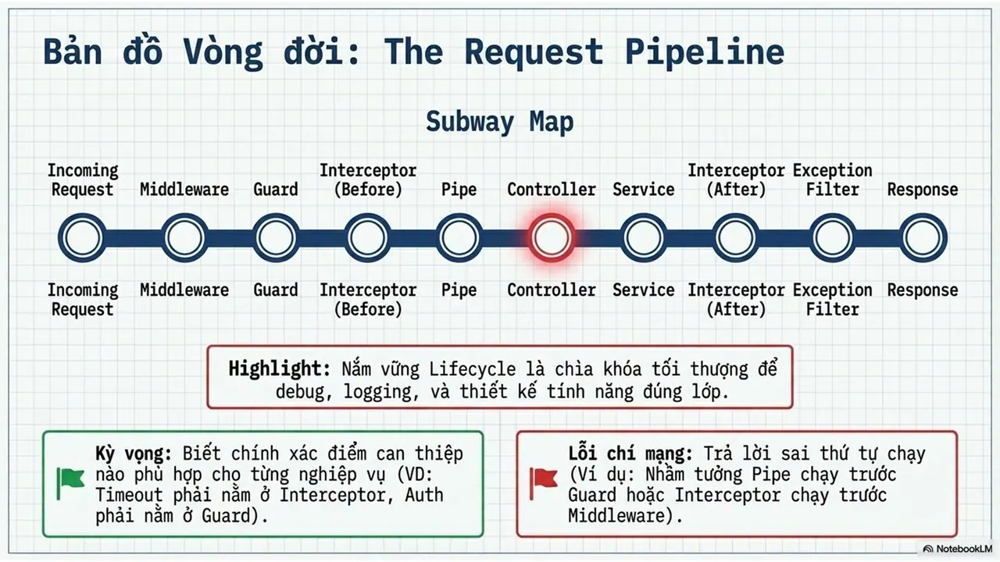
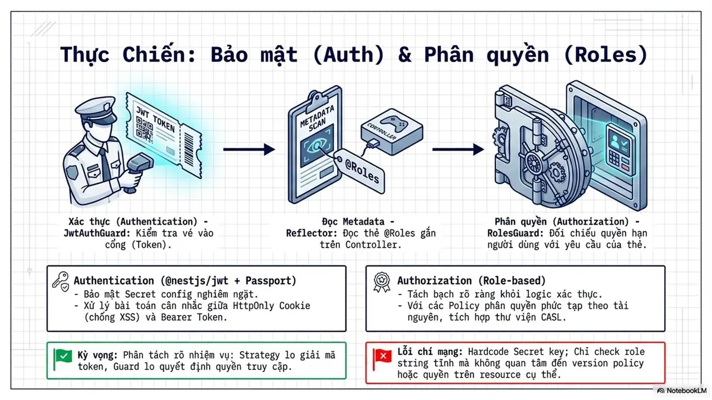
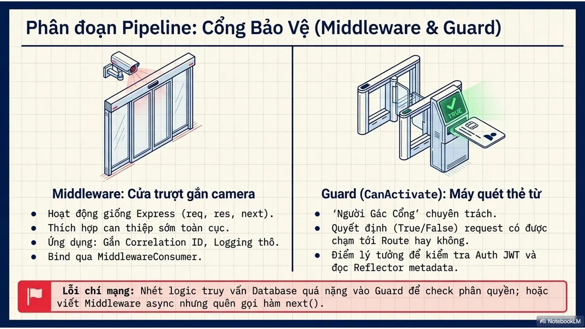
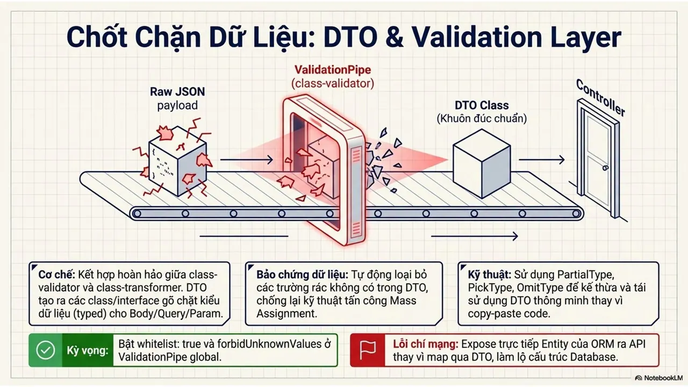
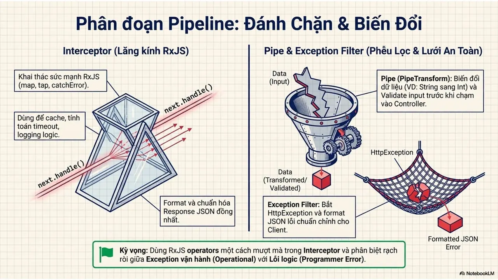
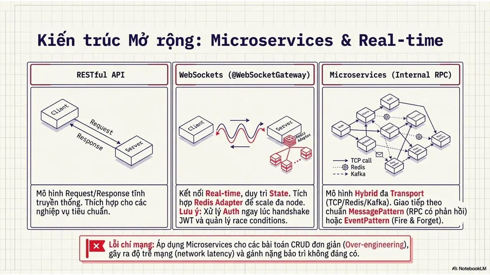
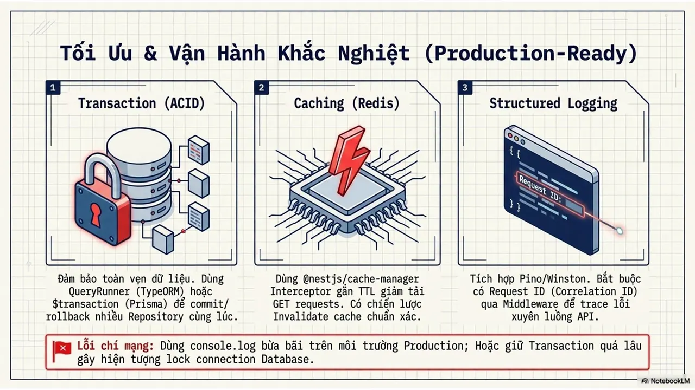
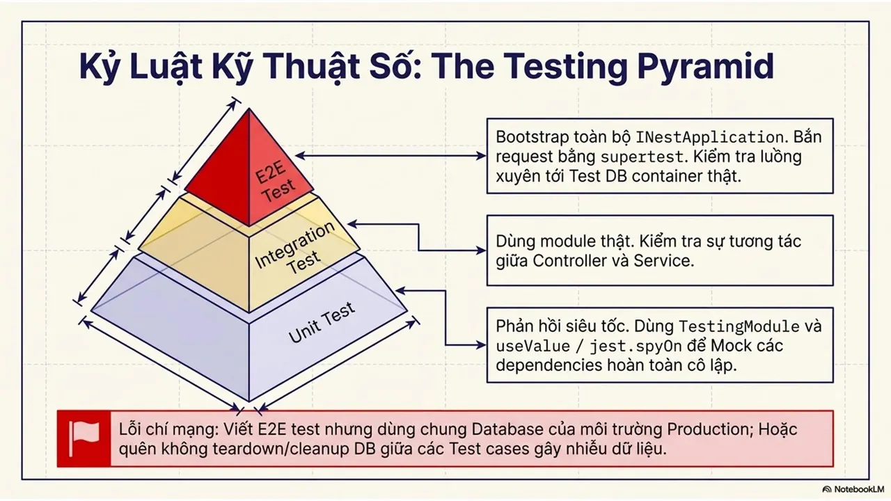
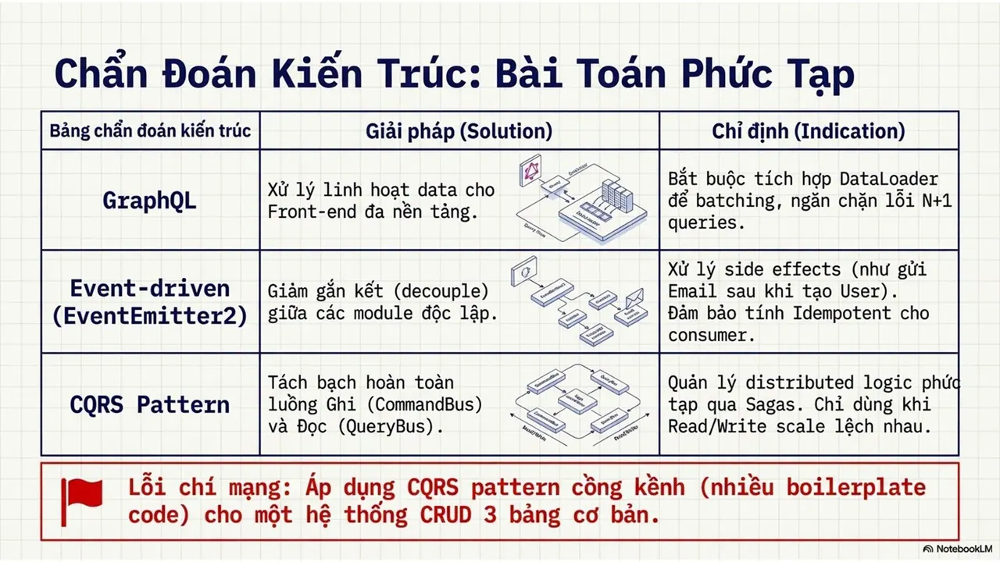
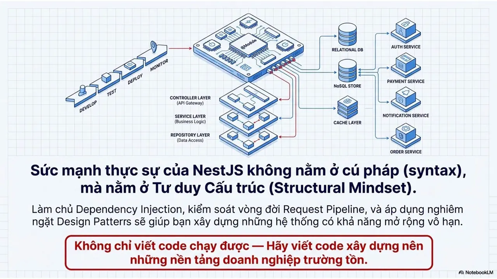

---

_Bài viết được lưu trữ từ [fanpage HCMUTE Developer Student Club](https://www.facebook.com/hcmute.dsc)._
