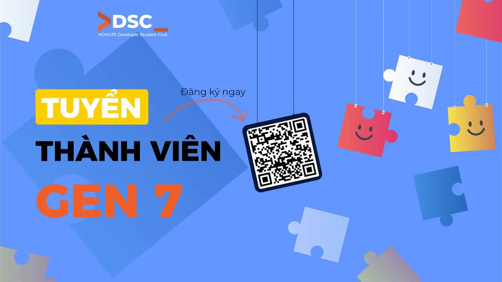

📣📣 \[TUYỂN THÀNH VIÊN HCMUTE - DSC GEN 7\]  
🌟 Bạn yêu thích công nghệ và muốn khám phá thêm nhiều điều mới mẻ

<!--truncate-->

🌟 Bạn muốn tham gia một môi trường năng động, nơi có thể học hỏi, rèn luyện kỹ năng và gặp gỡ những người bạn cùng đam mê  
🌟 Bạn muốn cùng đồng đội tham gia các hoạt động, thử sức với những điều mới và từng bước tạo ra những sản phẩm thú vị  
🎉 HCMUTE - DSC Generation 7 chính thức mở đăng ký tuyển thành viên! Đây là cơ hội để bạn trở thành một phần của cộng đồng sinh viên công nghệ, cùng nhau học hỏi, kết nối, tham gia các hoạt động và tạo nên những trải nghiệm đáng nhớ tại DSC.  
💙  
━━━━━━━━━━━━━━━━━━━━  
💡 ĐẾN VỚI DSC, BẠN SẼ ĐƯỢC 🔹 Cùng nhau chia sẻ kiến thức, khám phá những chủ đề mới và rèn luyện thêm các kỹ năng cần thiết.  
🔹 Không chỉ dừng lại ở việc học, bạn sẽ có cơ hội áp dụng kiến thức vào thực tế và cùng các thành viên xây dựng những sản phẩm cụ thể.  
🔹 Trong quá trình học tập và thực hành, các bạn sẽ có sự định hướng và hỗ trợ từ mentor để từng bước phát triển ý tưởng và hoàn thiện sản phẩm.  
🔹 Gặp gỡ những người bạn có chung sở thích, cùng làm việc, chia sẻ và tạo nên những trải nghiệm đáng nhớ trong thời gian đại học.  
🔹 Cùng DSC tổ chức và tham gia các workshop, cuộc thi, hoạt động nội bộ và những chương trình kết nối với cộng đồng công nghệ.  
━━━━━━━━━━━━━━━━━━━━  
🔑 AI CÓ THỂ THAM GIA Sinh viên HCMUTE có hứng thú với lập trình, công nghệ và phát triển phần mềm. Không yêu cầu kinh nghiệm trước – dù bạn đang bắt đầu tìm hiểu về công nghệ hay đã có kinh nghiệm, DSC luôn chào đón những bạn chủ động học hỏi, sẵn sàng thử sức và muốn cùng mọi người tạo nên những điều mới.  
━━━━━━━━━━━━━━━━━━━━  
👥 CÁC VỊ TRÍ ỨNG TUYỂN 📚 Ban Học thuật: Tham gia nghiên cứu, học tập và xây dựng các sản phẩm cùng thành viên; đồng thời hỗ trợ nội dung chuyên môn cho các hoạt động của CLB.  
🎨 Ban Truyền thông: Quản lý fanpage, thiết kế ấn phẩm, chỉnh sửa video, nhiếp ảnh và sáng tạo nội dung cho các hoạt động của CLB.  
🎉 Ban Sự kiện  Đối ngoại: Tham gia tổ chức sự kiện, xây dựng chương trình, kết nối diễn giả, đối tác và hỗ trợ các hoạt động đối ngoại của CLB.  
━━━━━━━━━━━━━━━━━━━━  
📋 QUY TRÌNH ĐĂNG KÝ 1️⃣ Điền đơn đăng ký: [https://forms.gle/aGmvB5hVwuPjYfFk6](https://forms.gle/aGmvB5hVwuPjYfFk6) 2️⃣ Chờ thông báo phỏng vấn: Chúng mình sẽ liên hệ với bạn qua email (dự kiến ngày 10/10/2026 hình thức offline). 3️⃣ Phỏng vấn: Hãy sẵn sàng thể hiện đam mê và năng lực của bản thân!  
⏰ Hạn chót đăng ký: 9/10/2026  
━━━━━━━━━━━━━━━━━━━━  
📬 LIÊN HỆ Fanpage: [https://www.facebook.com/hcmute.dsc](https://www.facebook.com/hcmute.dsc) Email: clb.dsc@student.hcmute.edu.vn
  
\#DSC #DSCHCMUTE #DSC\_HCMUTE\_GEN\_7 #JoinDSC #HCMUTEDSC

---

_Bài viết được lưu trữ từ [fanpage HCMUTE Developer Student Club](https://www.facebook.com/hcmute.dsc)._
