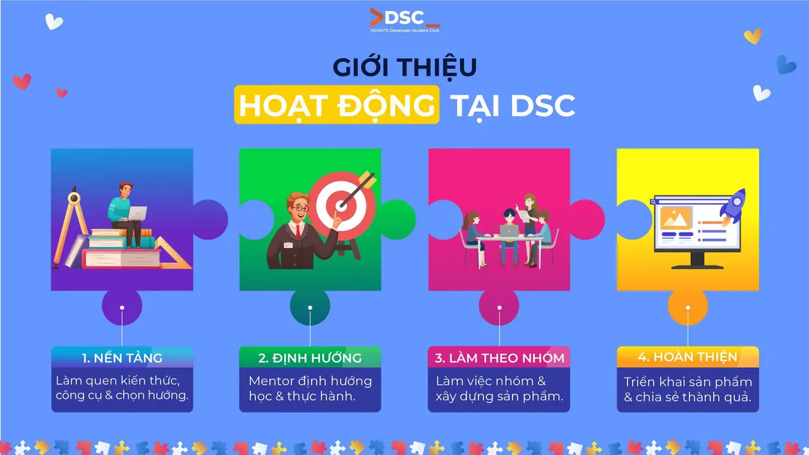

🌱 \[GIỚI THIỆU HOẠT ĐỘNG TẠI DSC\]  
🌱 Khi tìm hiểu về một CLB công nghệ, có lẽ điều bạn quan tâm nhất là: “Nếu mình trở thành thành viên, mình sẽ được làm những gì?”

<!--truncate-->

👀 Ở HCMUTE DSC, tụi mình muốn các thành viên có cơ hội học những điều cần thiết, tự mình thực hành và cùng nhau xây dựng một sản phẩm hoàn chỉnh trong suốt quá trình đồng hành với CLB. Vậy hành trình đó sẽ diễn ra như thế nào  
━━━━━━━━━━━━━━━━━━━━  
🌱 CHẶNG 1 - XÂY DỰNG NỀN TẢNG Bắt đầu từ những kiến thức và công cụ cơ bản để mọi người có thể cùng nhau bước vào hành trình phía trước.  
🔹Làm quen với cách một sản phẩm phần mềm được tạo ra và cách một team phát triển phần mềm hoạt động.  
🔹Tìm hiểu những công cụ cần thiết như Git/GitHub, Terminal và cách tự tìm hiểu thông qua tài liệu.  
🔹Khám phá các hướng như Frontend, Backend, Mobile, Data để có thêm góc nhìn và tìm ra hướng mình muốn thử sức.  
👉 Không cần phải biết hết từ đầu, quan trọng là có một nền tảng để bắt đầu.  
━━━━━━━━━━━━━━━━━━━━  
🧭 CHẶNG 2 - HỌC CÓ ĐỊNH HƯỚNG Sau khi đã có cái nhìn tổng quan, mỗi thành viên sẽ chọn một hướng mà mình muốn tìm hiểu sâu hơn.  
🔹Mentor sẽ giúp định hướng những kiến thức cần thiết để bắt đầu.  
🔹Vừa học vừa thực hành thông qua các bài tập.  
🔹Từng bước hoàn thiện một sản phẩm nhỏ của riêng mình.  
💡 Học đến đâu, thực hành đến đó để kiến thức không chỉ nằm trên giấy.  
━━━━━━━━━━━━━━━━━━━━  
🤝 CHẶNG 3 - LÀM SẢN PHẨM THEO NHÓM Đây là lúc các thành viên bắt đầu đưa những gì đã học vào một dự án chung.  
🔹Ghép nhóm khoảng 3–5 thành viên và cùng lựa chọn ý tưởng.  
🔹Phân chia công việc, phối hợp và cùng nhau phát triển sản phẩm.  
🔹Mentor đồng hành, đánh giá và góp ý trong quá trình thực hiện.  
👉 Từ một ý tưởng ban đầu, cả nhóm sẽ cùng nhau từng bước biến nó thành một sản phẩm hoàn chỉnh.  
━━━━━━━━━━━━━━━━━━━━  
🚀 CHẶNG 4 - HOÀN THIỆN  TỔNG KẾT Sau quá trình xây dựng, các nhóm sẽ tiếp tục hoàn thiện sản phẩm và nhìn lại những gì mình đã làm được.  
🔹Hoàn thiện và triển khai sản phẩm.  
🔹Chia sẻ thành quả và quá trình thực hiện với mọi người.  
🔹Cùng nhìn lại những kiến thức, kỹ năng và kinh nghiệm đã có được trong suốt hành trình.  
✨ Sau một năm, điều DSC mong muốn mỗi thành viên có được không chỉ là “mình đã học gì”, mà còn là “mình đã làm được gì”.  
━━━━━━━━━━━━━━━━━━━━  
Đó là hành trình mà HCMUTE - DSC muốn cùng các thành viên trải nghiệm trong năm tới. Nếu bạn muốn tìm một môi trường để bắt đầu, thử sức và cùng những người bạn có chung sở thích tạo ra một sản phẩm, HCMUTE - DSC Gen 7 chào đón bạn!  
🌱 📋 QUY TRÌNH ĐĂNG KÝ 1️⃣ Điền đơn đăng ký: [https://forms.gle/aGmvB5hVwuPjYfFk6](https://forms.gle/aGmvB5hVwuPjYfFk6) 2️⃣ Chờ thông báo phỏng vấn: Chúng mình sẽ liên hệ với bạn qua email (dự kiến ngày 10/10/2026 hình thức offline). 3️⃣ Phỏng vấn: Hãy sẵn sàng thể hiện đam mê và năng lực của bản thân!  
⏰ Hạn chót đăng ký: 9/10/2026  
━━━━━━━━━━━━━━━━━━━━  
📬 LIÊN HỆ Fanpage: [https://www.facebook.com/hcmute.dsc](https://www.facebook.com/hcmute.dsc) Email: clb.dsc@student.hcmute.edu.vn
  
\#DSC #DSCHCMUTE #DSC\_HCMUTE\_GEN\_7 #JoinDSC #HCMUTEDSC

---

_Bài viết được lưu trữ từ [fanpage HCMUTE Developer Student Club](https://www.facebook.com/hcmute.dsc)._
