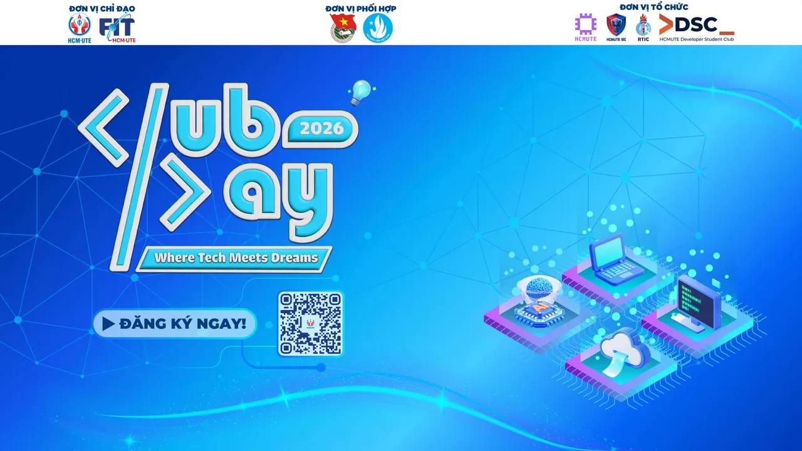

🔥 ĐĂNG KÝ THAM GIA LIÊN HOAN CÁC CÂU LẠC BỘ HỌC THUẬT VÀ SINH VIÊN 5 TỐT FIT CLUB'S DAY 2026 🔥  
\_\_\_\_\_\_\_\_\_\_\_\_\_\_\_\_\_\_\_\_\_\_\_\_\_\_\_\_\_\_

<!--truncate-->

🔸 Có một “Hành tinh” chỉ xuất hiện duy nhất một lần trong năm  
🔸 Nơi những CLB học thuật cùng nhau thắp sáng bầu trời tri thức  
🔸 Nơi những ý tưởng công nghệ bùng nổ như pháo hoa  
🔸 Nơi những con tim đồng điệu trong nhịp đập công nghệ  
🪐  Đó chính là FIT CLUB’S DAY 2026 – Tiếp nối hành trình đầy bùng nổ tại khoa Công nghệ Thông tin, trường Đại học Công nghệ Kỹ thuật TP.HCM (HCM-UTE)!  
\_\_\_\_\_\_\_\_\_\_\_\_\_\_\_\_\_\_\_\_\_\_\_\_\_\_\_\_\_\_  
🪐 FIT CLUB’S DAY 2026 là ngày hội giao lưu của các Câu lạc bộ học thuật và Sinh viên 5 tốt khoa Công nghệ Thông tin HCM-UTE. Sự kiện mở ra không gian trẻ trung, sôi động, nơi sinh viên được cập nhật những xu hướng công nghệ hiện đại, kết nối và trải nghiệm cùng các CLB học thuật sáng tạo, giàu nhiệt huyết.  
👉 ĐẾN VỚI FIT CLUB’S DAY 2026, BẠN SẼ ĐƯỢC  
⚡ Tham gia loạt trò chơi và thử thách đậm chất công nghệ  
⚡ Khám phá các gian hàng học thuật đầy sáng tạo từ chính các CLB trong khoa  
⚡ Kết nối cộng đồng đam mê công nghệ, mở rộng mạng lưới sinh viên năng động  
⚡ Trải nghiệm vòng quay số may mắn với những phần quà cực chất đang chờ bạn rinh về  
\_\_\_\_\_\_\_\_\_\_\_\_\_\_\_\_\_\_\_\_\_\_\_\_\_\_\_\_\_\_  
📋 THÔNG TIN SỰ KIỆN:  
⚡ Thời gian: 08:00 - 12:00 | ngày 17.10.2026  
⚡ Địa điểm: Phòng họp II (lầu 6, Tòa nhà Trung tâm, HCMUTE)  
⚡ Đối tượng: Sinh viên khoa Công nghệ thông tin  
⚡ Đăng ký tham gia tại: [https://link.hcmute.edu.vn/dk-fitclubday26](https://link.hcmute.edu.vn/dk-fitclubday26) (Hạn chót đăng ký đến hết ngày 16.10.2026)  
💥 Số lượng có hạn nhanh tay đăng ký ngay!  
🪐 Hãy để FIT CLUB’S DAY 2026 trở thành dấu ấn rực rỡ trong tuổi trẻ sinh viên Công nghệ Thông tin, bùng cháy cùng ngày hội công nghệ, ghi dấu một khởi đầu mới cho những hành trình phát triển sự nghiệp và khám phá bất tận bạn nhé!  
\_\_\_\_\_\_\_\_\_\_\_\_\_\_\_\_\_\_\_\_\_\_\_\_\_\_\_\_\_\_  
☎  MỌI THẮC MẮC VUI LÒNG LIÊN HỆ:  
📍 Nguyễn Trà Huy - UV BTV Đoàn khoa CNTT - (032.5585.320)  
📍 Lê Vũ Xuân An - CN. CLB SBG - (083.2415.045)  
📍 Lê Nhựt Quốc Khang - CN. CLB ATTT - (037.4477.202)  
📍 Hồ Việt Anh - CN. RTIC - (094.9000.030)  
📍 Mai Hồng Tín - Chủ nhiệm CLB DSC - (078.2882.461)
  
\#HCMUTE #FITUTE #FITCLUBDAY2026

---

_Bài viết được lưu trữ từ [fanpage HCMUTE Developer Student Club](https://www.facebook.com/hcmute.dsc)._
