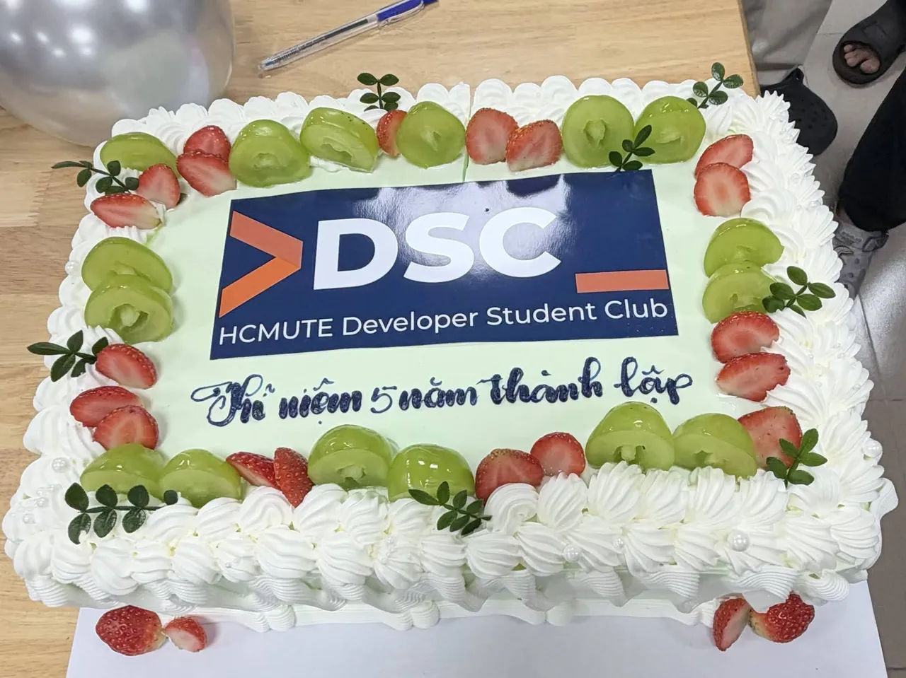
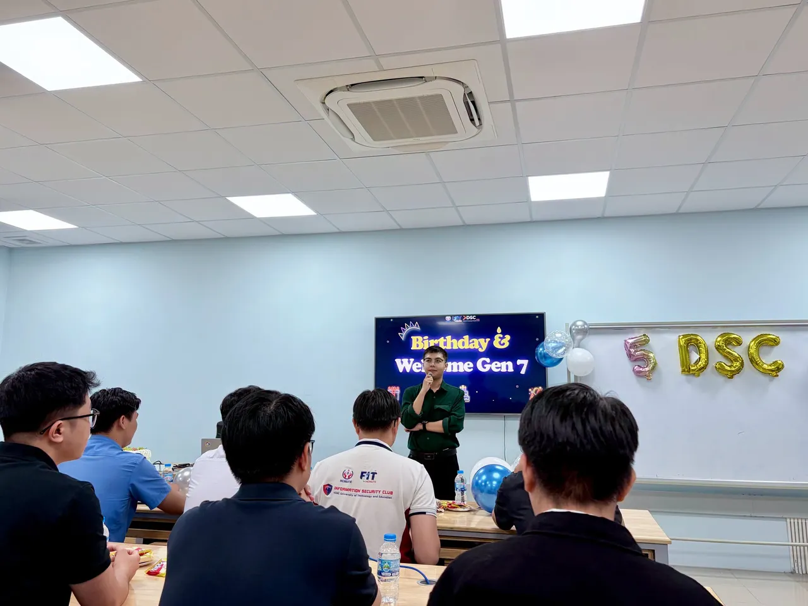
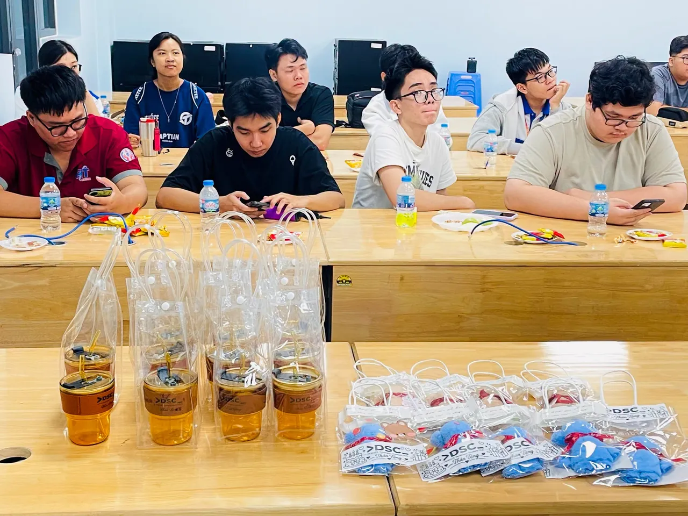
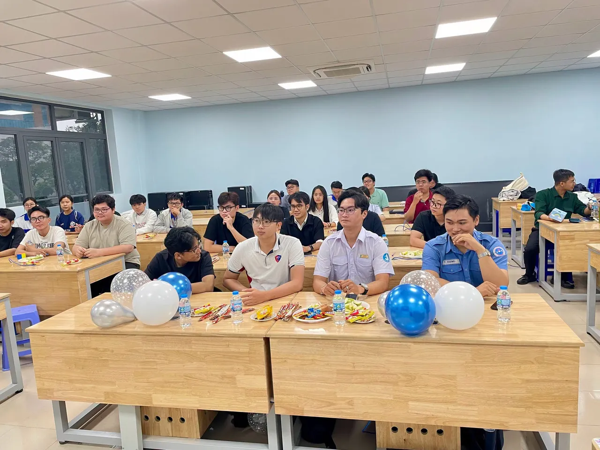
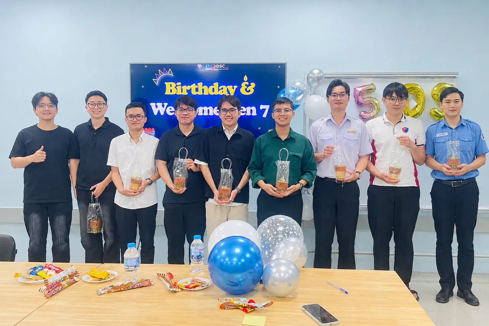

\[RECAP | BIRTHDAY AND WELCOME GEN 7 – KỶ NIỆM 5 NĂM THÀNH LẬP HCM-UTE DSC VÀ CHÀO ĐÓN THÀNH VIÊN GEN 7\]

🎉 Vậy là chương trình Birthday and Welcome Gen 7 đã diễn ra thành công tốt đẹp, đánh dấu cột mốc 5 năm thành lập HCM-UTE Developer Student Club và chào đón những thành viên Gen 7. Một buổi gặp gỡ với thật nhiều niềm vui, tiếng cười và những khoảnh khắc đáng nhớ, nơi các thế hệ thành viên có dịp cùng nhau nhìn lại hành trình đã qua và bắt đầu những kết nối mới.

<!--truncate-->

🌟 5 năm – một hành trình được tạo nên từ đam mê, nhiệt huyết và sự kết nối. Từ những ngày đầu thành lập, HCM-UTE DSC đã từng bước xây dựng một cộng đồng học thuật dành cho các bạn sinh viên có niềm đam mê với công nghệ và lập trình. Trải qua nhiều thế hệ, CLB không ngừng nỗ lực tạo ra môi trường để các thành viên có thể gặp gỡ, chia sẻ kiến thức, học hỏi kinh nghiệm và cùng nhau thực hiện những ý tưởng của mình. Mỗi hoạt động, mỗi dấu ấn và mỗi thành viên đều góp phần tạo nên hành trình phát triển của HCM-UTE DSC ngày hôm nay.

💖 Để có được những dấu ấn trong suốt chặng đường vừa qua, HCM-UTE DSC luôn trân trọng sự quan tâm và đồng hành của những người đã góp phần xây dựng CLB. Xin gửi lời tri ân chân thành đến các anh chị cựu Core Team qua các thế hệ, những người đã dành nhiều tâm huyết, đóng góp và tiếp thêm động lực để CLB được duy trì và phát triển. Đồng thời, CLB xin cảm ơn Ban Chủ nhiệm Khoa và Đoàn – Hội Khoa Công nghệ Thông tin đã luôn quan tâm, tạo điều kiện và hỗ trợ các hoạt động của CLB trong suốt những năm qua.

✨ Chào mừng Gen 7 đến với đại gia đình HCMUTE DSC! Hy vọng rằng đây sẽ là khởi đầu cho những tình bạn mới, những trải nghiệm thú vị và thật nhiều cơ hội để cùng nhau học hỏi, thử sức và trưởng thành. Mong rằng mỗi thành viên sẽ tìm thấy cho mình những giá trị riêng, đồng thời góp thêm những dấu ấn mới vào hành trình chung của CLB.

🔥 5 năm là một cột mốc đáng nhớ, nhưng cũng là điểm khởi đầu cho những hành trình tiếp theo. HCMUTE DSC hy vọng sẽ tiếp tục phát triển, xây dựng một cộng đồng học thuật năng động, nơi các thành viên luôn sẵn sàng kết nối, hỗ trợ và cùng nhau tiến xa hơn.

\_\_\_\_\_\_\_\_\_\_\_\_\_\_\_\_\_\_\_\_\_\_\_\_\_\_\_\_\_\_\_\_\_\_\_\_\_\_\_  
Mọi ý kiến đóng góp, các bạn có thể liên hệ trực tiếp thông qua fanpage HCMUTE Developer Student Club: https://www.facebook.com/hcmute.dsc/  
\#HCMUTE\_DSC \#Developer\_Student\_Club \#BirthdayAndWelcomeGen7 \#5YearsOfDSC

---

_Bài viết được lưu trữ từ [fanpage HCMUTE Developer Student Club](https://www.facebook.com/hcmute.dsc/posts/pfbid02Yfh864mtSHdt9MLAjnrHz9bxduadLohxZeZDJe5ozxKTZuRZtoBzYrfR5Sdb7TJpl)._
