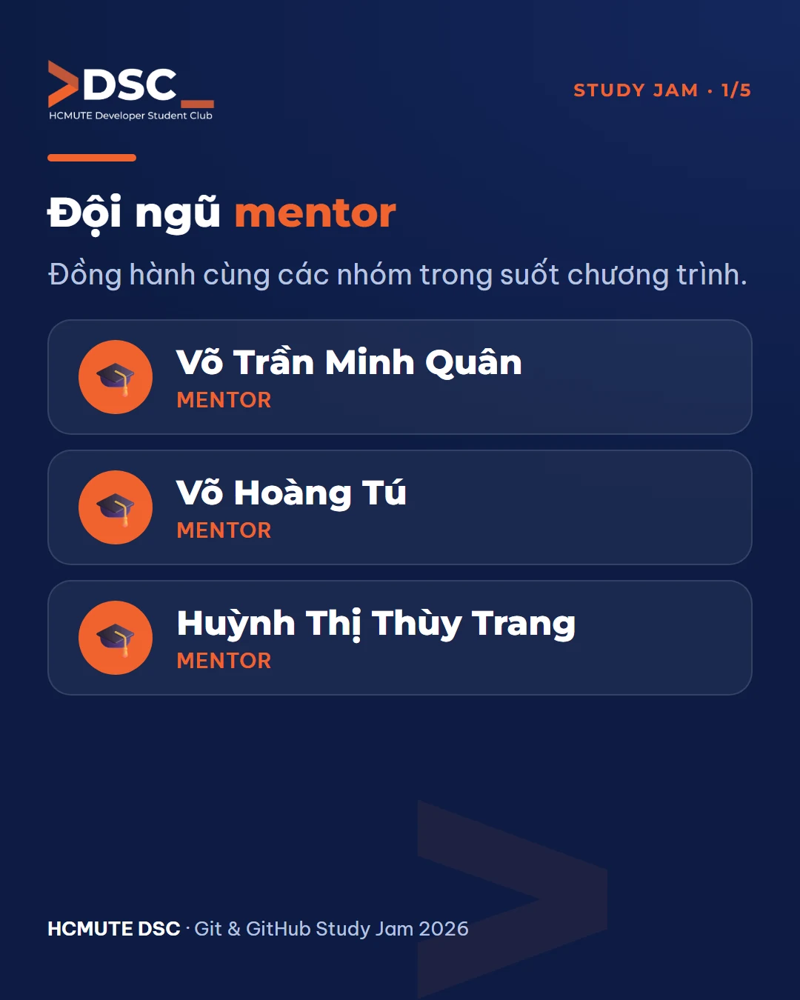

\[GIT & GITHUB STUDY JAM | CÔNG BỐ DANH SÁCH CÁC NHÓM THAM GIA\]

🎉 Sau thời gian đăng ký, HCMUTE Developer Student Club ghi nhận có **5 nhóm** tham gia chương trình **Git & GitHub Study Jam** với tổng số **22 bạn sinh viên**.

<!--truncate-->

🙌 CLB xin gửi lời cảm ơn chân thành đến tất cả các bạn đã quan tâm và đăng ký tham gia chương trình. Dưới đây là danh sách các nhóm và thành viên:

### 👥 Nhóm 1

- 👑 Nhóm trưởng: Trần Phương Trang
- Võ Chí Thành
- Nguyễn Trương Phương Vy
- Lê Ngọc Tú
- Nguyễn Ngọc Ánh Sương

### 👥 Nhóm Côn Đò Trên Con Đồ

- 👑 Nhóm trưởng: Võ Đông Phúc
- Nguyễn Trọng Khiêm
- Lương Hoàng Nhất Lâm

### 👥 Nhóm Đi code dạo

- 👑 Nhóm trưởng: Nguyễn Ngọc Thịnh
- Đỗ Đăng Anh Đức
- Nguyễn Đăng Khôi
- Nguyễn Thái Nam

### 👥 Nhóm CODE TOÀN BUG

- 👑 Nhóm trưởng: Ngô Thanh Vĩnh Hưng
- Nguyễn Tô Mỹ Trà
- Nguyễn Bá Huân
- Lê Anh Khoa
- Huỳnh Trung Trí Kiên

### 👥 Nhóm We-novar-notha

- 👑 Nhóm trưởng: Nguyễn Minh Duy
- Nguyễn Hàng Bảo Ngân
- Mai Thanh Trà
- Huỳnh Thị Hoài Phương
- Phan Gia Hân

🚀 Chúc các nhóm có thật nhiều niềm vui, học được nhiều điều bổ ích và cùng nhau hoàn thành thật tốt chương trình. Hãy theo dõi fanpage và máy chủ Discord của CLB để cập nhật những thông tin tiếp theo nhé!

\_\_\_\_\_\_\_\_\_\_\_\_\_\_\_\_\_\_\_\_\_\_\_\_\_\_\_\_\_\_\_\_\_\_\_\_\_\_\_  
Mọi ý kiến đóng góp, các bạn có thể liên hệ trực tiếp thông qua fanpage HCMUTE Developer Student Club: https://www.facebook.com/hcmute.dsc/  
\#HCMUTE\_DSC \#Developer\_Student\_Club \#STUDY\_JAM \#GIT\_GITHUB

